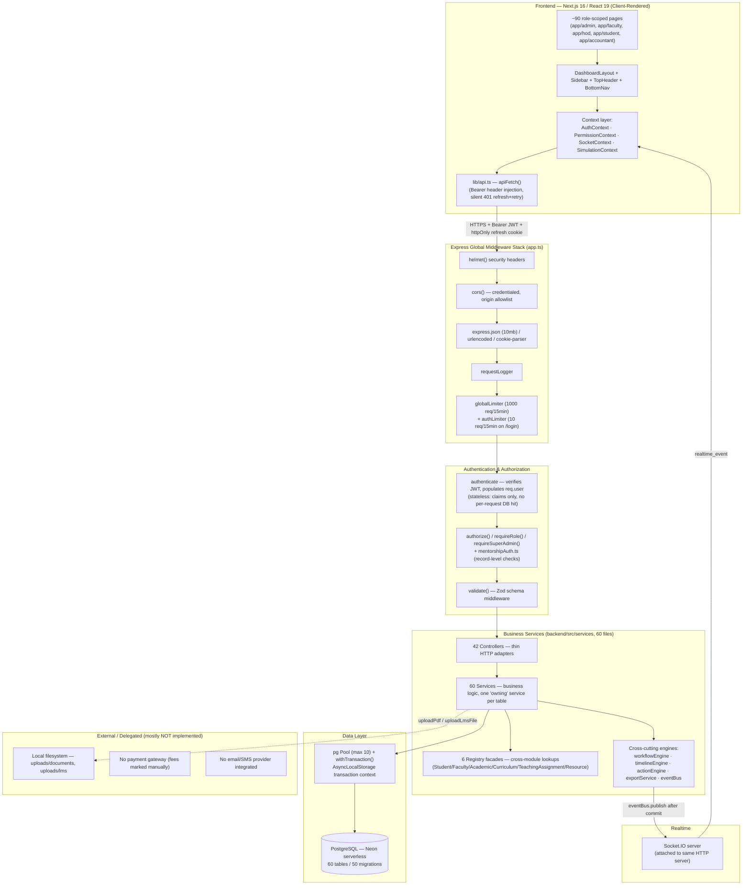
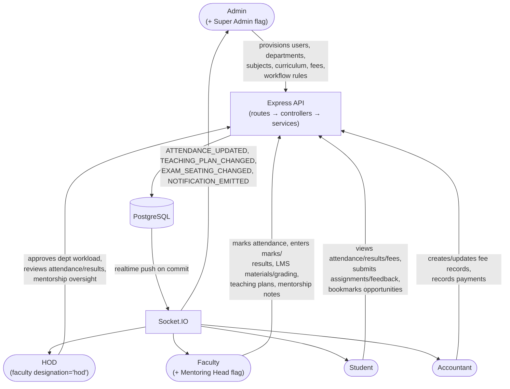
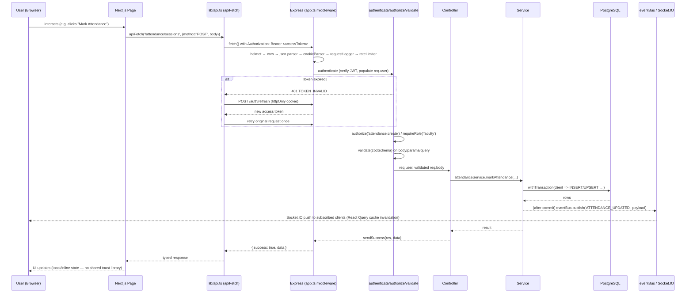

# 2. System Architecture & High-Level Architecture

← [Back to Index](00-INDEX.md)

## 2.1 Layered System Architecture

The system is a classic 3-tier web application: a Next.js client, a monolithic Express API, and a PostgreSQL database — plus a realtime side-channel (Socket.IO) and a handful of external delegation points (email/SMTP is referenced in planning docs but **not implemented**; there is no external payment gateway; PDF/Excel generation happens in-process).

### Layer responsibilities

| Layer | Responsibility | Key files |
|---|---|---|
| **Frontend (Client)** | Renders role-scoped UI, holds session in memory, calls the API, subscribes to realtime events | `frontend/src/app/**`, `frontend/src/lib/api.ts` |
| **API Layer (Express routers)** | Declares URL surface, wires middleware chains, delegates to controllers | `backend/src/routes/*.ts` (43 files) |
| **Authentication** | Verifies JWT, issues/rotates tokens, hashes passwords | `middleware/authenticate.ts`, `utils/jwt.ts`, `utils/password.ts`, `services/auth.service.ts` |
| **Authorization** | Role/permission/record-level gating | `middleware/authorize.ts`, `middleware/mentorshipAuth.ts`, `types/roles.ts` |
| **Business Services** | Domain logic, one owning service per table, registries for cross-module reads | `backend/src/services/*.ts` (60 files), `backend/src/registries/*.ts` |
| **Database** | Persistent relational storage, enforced constraints/checks, soft-delete convention | `backend/src/db/migrations/*.sql` (50 files), `config/database.ts` |
| **External Services** | File storage (local disk only today); no payment/email/SMS providers wired up | `middleware/upload.ts`, `middleware/uploadLms.ts` |

---

## 2.2 High-Level Role Interaction Architecture

### Notes on the diagram
- HOD and Mentoring Head are **not separate accounts** — they are the same `faculty` role with a `designation`/flag, so the arrows above represent capability supersets over the base Faculty arrow, not a separate login experience.
- All five populations authenticate through the same `/api/auth/login` endpoint; the returned JWT's `role`/`designation`/`isSuperAdmin`/`facultyId`/`departmentId`/`studentId` claims are what differentiate downstream authorization (see [07-authentication-and-security.md](07-authentication-and-security.md)).
- The Accountant role is the most narrowly scoped — it only reaches the Fees module and its own dashboard (`app/accountant/{dashboard,fees}` — only 2 frontend routes exist for this role, vs. ~27 for Admin).

---

## 2.3 Frontend Layout Composition (per-role)

```mermaid
flowchart LR
    RootLayout["app/layout.tsx\n(fonts, metadata, AppProviders)"] --> Providers

    subgraph Providers["AppProviders.tsx composition (outer→inner)"]
        QC["QueryClientProvider"] --> Sim["SimulationProvider\n(theme + legacy mock store + role-switch sim)"]
        Sim --> Auth["AuthProvider"]
        Auth --> Sock["SocketProvider"]
        Sock --> Perm["PermissionProvider"]
        Perm --> RTL["RealtimeSyncListener\n(useRealtimeSync)"]
    end

    RTL --> RoleLayout

    subgraph RoleLayout["Per-role layout.tsx (admin/faculty/hod/student/accountant)"]
        PR["ProtectedRoute\n(allowedRoles gate)"] --> AG["AccessGuard\n(path-level RBAC, all roles except accountant)"]
        AG --> DL["DashboardLayout\n(Sidebar + TopHeader + BottomNav)"]
    end

    DL --> Page["Role-specific page.tsx"]
```

See [04-frontend.md](04-frontend.md) for full detail on each box.

---

## 2.4 Request Lifecycle (single API call, end to end)

