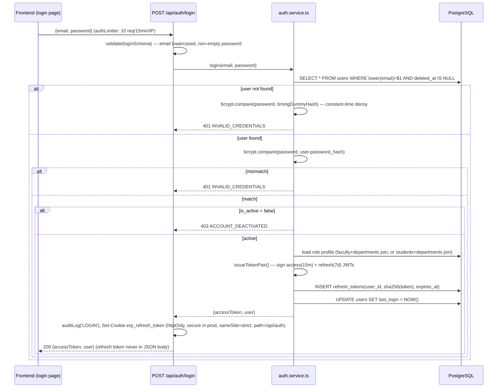
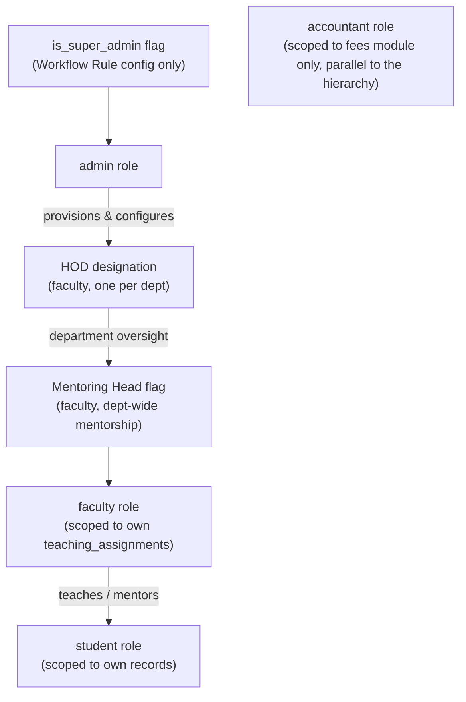

# 7. Authentication, Authorization & Security

← [Back to Index](00-INDEX.md)

## 7.1 Login Flow

**Timing-attack mitigation**: when the email doesn't exist, the service still performs a `bcrypt.compare` against a lazily-computed dummy hash, so the response latency for "no such user" and "wrong password" is indistinguishable.

## 7.2 JWT Design

| Property | Access Token | Refresh Token |
|---|---|---|
| Secret | `JWT_ACCESS_SECRET` (min 32 chars, Zod-enforced) | `JWT_REFRESH_SECRET` (separate secret, min 32 chars) |
| TTL (default) | 15 minutes | 7 days |
| Algorithm | HS256 (implicit — plain string secret, no algorithm pinned) | HS256 |
| Payload claims | `sub` (user id), `email`, `role`, `designation?`, `departmentId?`, `facultyId?`, `studentId?`, `isSuperAdmin?` | `sub`, `tokenId` (uuid, currently vestigial — lookup is by hash, not this id) |
| Delivered via | JSON response body | httpOnly cookie only (`erp_refresh_token`, `path=/api/auth`) |
| Storage on server | Not stored (stateless verification) | `sha256(token)` hash stored in `refresh_tokens` table — raw token never persisted |
| Verification | `authenticate` middleware on every request — **claims trusted directly, no DB re-check per request** | Only checked at `/auth/refresh` |

⚠ **Design implication**: because the access token embeds `role`/`departmentId`/`isSuperAdmin` etc. and `authenticate.ts` trusts those claims for up to 15 minutes without re-querying the DB, a role change, deactivation, or HOD reassignment made by an admin will not take effect for an already-issued access token until it expires or the user re-authenticates. `GET /api/auth/me` is deliberately the one exception — it always re-fetches from the DB "so the response reflects live state rather than potentially stale JWT claims."

## 7.3 Refresh Token Rotation & Reuse Detection

On `POST /api/auth/refresh`:
1. Verify the refresh JWT's signature/expiry (fails fast, no DB hit if invalid).
2. Hash the token, look up `refresh_tokens` joined to `users` by `(token_hash, user_id)`.
3. Not found → `401 TOKEN_INVALID`.
4. `expires_at` in the past → `401 TOKEN_EXPIRED`.
5. **Reuse detection**: if `revoked_at IS NOT NULL` (this exact token was already consumed once) → treat as a stolen/replayed token: revoke **every** active refresh token for that user (`UPDATE refresh_tokens SET revoked_at=NOW() WHERE user_id=$1 AND revoked_at IS NULL`), throw `401 TOKEN_REUSED`. This is the standard refresh-token-rotation-with-reuse-detection pattern and forces re-login on all devices if a stolen token is ever replayed.
6. Account deactivated → `403 ACCOUNT_DEACTIVATED`.
7. Otherwise: revoke the just-consumed token, issue a brand-new access+refresh pair (inserting a new `refresh_tokens` row), set the rotated cookie.

`logout()` revokes just the one token matching the presented cookie. `logout-all` (`POST /api/auth/logout-all`, requires a valid access token) revokes every active token for the current user — used after password changes (`profile.service.ts`'s `changePassword` calls this implicitly by design intent, invalidating all other sessions).

⚠ **Gap**: no scheduled job purges expired/revoked `refresh_tokens` rows — the table grows unbounded over the system's lifetime (see [12](12-performance-error-handling-workflow.md) and [15](15-future-and-appendix.md)).

## 7.4 Password Handling

- **Hashing**: `bcryptjs` (pure-JS, not native `bcrypt`), cost factor from `env.BCRYPT_ROUNDS` (Zod-bounded 10–14, default **12**).
- **Strength policy** (`utils/validation.ts`, enforced at set-time — registration/reset/change-password, **not** at login): minimum 8 characters, must include upper, lower, digit, and one of `@$!%*?&`.
- **Change password** (`PUT /api/profile/change-password`) invalidates all sessions (revokes all refresh tokens) — forces re-login everywhere after a password change, a defensible security default.
- No account-lockout-after-N-failed-attempts mechanism exists; brute-force mitigation is purely IP-based rate limiting (`authLimiter`, 10 req/15min) — see §7.7.

## 7.5 Authorization Model

Two authorization idioms coexist in the codebase:

### 7.5.1 Coarse role check — `requireRole(...roles)`
Simple allowlist against `req.user.role` (`admin | faculty | student | accountant`). Used on the majority of routes.

### 7.5.2 Fine-grained permission check — `authorize(...permissions)`
Checks a static `PERMISSIONS` map (`backend/src/types/roles.ts`) of `resource:action → allowed roles[]`. Full matrix in [01-overview-and-vision.md](01-overview-and-vision.md) §3. This is **not** a database-driven ACL — it's a compiled-in TypeScript constant, so changing permissions requires a code change and redeploy, not a config update. (The Workflow Rule engine is the one place end-users can configure system behavior without a redeploy — see [08-modules.md](08-modules.md) §Workflow Engine.)

### 7.5.3 Capability flags (not roles, used for scoping)
- `users.is_super_admin` — gates `requireSuperAdmin()`, used solely for Workflow Rule CRUD (`/api/workflow/rules*`).
- `faculty.designation = 'hod'` — DB-enforced one-per-department; used at the **service** layer (not route middleware) to scope Faculty Operations/Dashboard/Analytics `hod` variants — the route itself only requires `requireRole('faculty')`.
- `faculty.is_mentoring_head` — grants department-wide mentorship management via `authorizeMentoringHead` (checked live: `SELECT is_mentoring_head FROM faculty WHERE user_id=$1`).

### 7.5.4 Record-level authorization — `middleware/mentorshipAuth.ts`
The **only** module with genuinely record-level (not just role-level) authorization, entirely DB-backed:

| Guard | Logic |
|---|---|
| `authorizeMentoringHead` | admin, or faculty where `is_mentoring_head=true` |
| `authorizeStudentMentorshipAccess(source, field)` | Factory pulling `studentId` from params/body/query. Permits: admin (full); the student themself (self-access only, matched via `students.user_id`); mentoring head (full); or a faculty member with an active mentor-group membership over that specific student (checked via `mentorGroup.service.getAllGroupMemberships`) |
| `authorizeNoteAccess` | admin; mentoring head; or the specific faculty who is `mentor_id` on that `mentoring_notes` row (ownership check) |

⚠ **Gap**: broader department-scoped authorization (e.g., "an HOD can only manage their own department's data") is **not** implemented as a generic, reusable middleware anywhere else in the codebase — it is handled ad hoc inside individual controllers/services using the `departmentId` embedded in the JWT, on a module-by-module basis. A reviewer auditing a new HOD-scoped feature should verify this scoping was actually implemented in that feature's service layer, since there's no framework-level guarantee.

## 7.6 Validation Middleware

`middleware/validate.ts` wraps per-route Zod schemas (`validate({body?, params?, query?})`); on `ZodError`, joins all field errors into one message and throws `AppError.badRequest(msg, 'VALIDATION_ERROR')`. Every domain has its own schemas under `backend/src/types/*.ts` (e.g. `createStudentSchema`, `listAttendanceQuerySchema`).

## 7.7 Rate Limiting

| Limiter | Scope | Window | Max | Response on exceed |
|---|---|---|---|---|
| `globalLimiter` | Every `/api/*` request | 15 min | 1000 req/IP | 429 `RATE_LIMIT_EXCEEDED` |
| `authLimiter` | `POST /api/auth/login` only | 15 min | 10 req/IP | 429 `AUTH_RATE_LIMITED` |

Both use `express-rate-limit` with `standardHeaders: true, legacyHeaders: false`. ⚠ `env.RATE_LIMIT_WINDOW_MS`/`RATE_LIMIT_MAX` are defined in the Zod env schema and documented in `.env.example` but **not actually referenced** by either limiter (both hardcode their values) — a latent config/documentation mismatch.

## 7.8 Protected Routes & Middleware Chain

Standard chain per protected endpoint: `authenticate` → (`requireRole(...)` or `authorize(...)` or a `mentorshipAuth` guard) → `validate({...})` → controller. `backend/src/routes/protected.routes.ts` (mounted at `/api/example`) is a **non-business reference implementation** demonstrating all 6 patterns (public / authenticated-only / `requireRole('admin')` / `requireRole('admin','faculty')` / `authorize('attendance:create')` / `requireRole('student')`) — useful as a template when adding a new route, not part of the real API surface.

## 7.9 Authorization Hierarchy Summary

## 7.10 Security Considerations (OWASP-oriented)

| Concern | Mitigation in place | Gap / note |
|---|---|---|
| SQL Injection | 100% parameterized queries via `pg` (`$1,$2,...`) — no string-concatenated SQL found in the researched services | No ORM means discipline-dependent; a future contributor could introduce a vulnerable query without a linter catching it (no static SQL-injection lint rule configured) |
| XSS | React's default JSX escaping; no `dangerouslySetInnerHTML` usage found in the researched components | No CSP configured beyond `helmet()` defaults; `helmet()` does not set a custom Content-Security-Policy tailored to this app |
| CSRF | `sameSite: 'strict'` on the refresh cookie; access token is sent via `Authorization` header (not a cookie), which is inherently not subject to classic CSRF | No explicit CSRF token/double-submit-cookie pattern — acceptable given the auth token isn't cookie-based, but the refresh endpoint itself relies solely on `sameSite` |
| Mass assignment | Zod schemas whitelist accepted fields per endpoint | Decentralized — each schema must be manually kept in sync with the table; no automatic field-allowlist generation |
| File upload | MIME + extension allowlist (`upload.ts`/`uploadLms.ts`), 20MB size cap, randomized filenames (`uuidv4()`) prevent path traversal / overwrite | No virus/malware scanning of uploaded files; PDF-only and Office-doc-only allowlists reduce but don't eliminate risk |
| Rate limiting / brute force | `authLimiter` on login, `globalLimiter` app-wide | No account lockout; no CAPTCHA; no anomaly detection |
| Secrets management | `.env` + Zod validation, `.env.example` documents required vars, `.gitignore` presumably excludes `.env` | No secrets manager (Vault/AWS Secrets Manager) — expected for current project scale, flagged for production hardening |
| Realtime channel auth | Socket.IO handshake includes `{token: accessToken}` | ⚠ No route file shows explicit server-side socket handshake verification — `eventBus.service.ts`/`server.ts` were not found to validate the token against `verifyAccessToken` before allowing a socket connection; **this should be verified/hardened** as a priority security item |
| Audit trail | `audit_logs` (login/logout-all + presumably other mutating actions call `auditLog()`), `workflow_logs` (automation execution trail) | Coverage is not exhaustive — not every mutating endpoint was confirmed to call `auditLog()`; a systematic audit-coverage review is recommended |
| Data privacy | `studentImport.strategy.ts` explicitly excludes privacy-sensitive columns (e.g. Aadhaar) from ignored-but-recognized import columns | No field-level masking of phone numbers/addresses in API responses was confirmed in the research pass — recommend a follow-up review against the "Data Privacy" requirements in `project_vision_and_requirements.md` §7 |
| Transport security | `helmet()`, cookie `secure: NODE_ENV==='production'` | HTTPS/TLS termination itself is a deployment concern — no deployment config exists yet (see [13](13-deployment-config-dependencies.md)) |

## 7.11 Roles Recap

Full permission matrix: [01-overview-and-vision.md](01-overview-and-vision.md) §3. Full per-endpoint auth requirements: [09-api-documentation.md](09-api-documentation.md).
