# 10. Data Flow Diagrams & Sequence Diagrams

← [Back to Index](00-INDEX.md)

## 10.1 Student Registration → Dashboard Data Flow

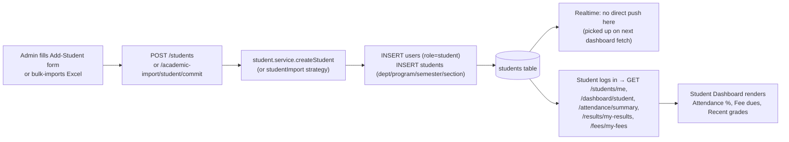

## 10.2 Attendance Flow

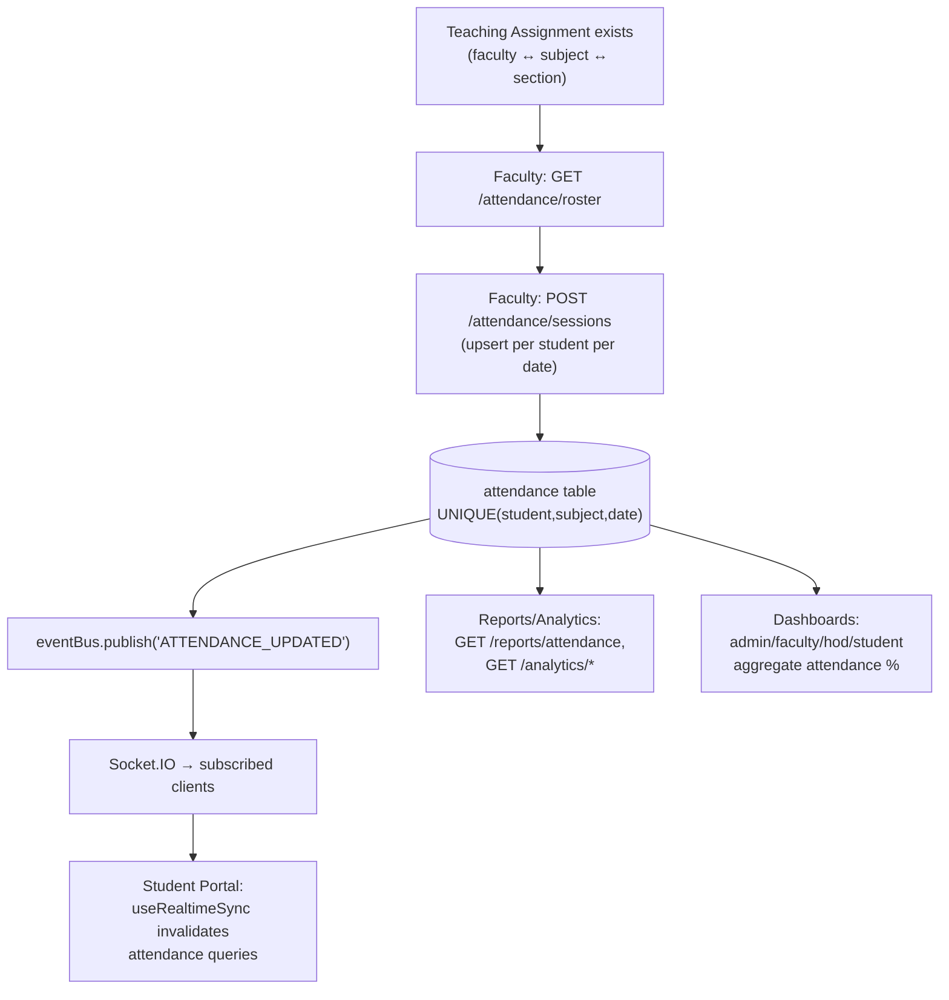

⚠ Note: the planning docs' "Attendance → Teaching Assignment → Attendance → Student Portal → Reports" flow implies a feedback loop through Teaching Assignment; in the actual implementation, Teaching Assignment is purely upstream (defines who *can* mark attendance for which section) — attendance data does not feed back into modifying teaching assignments.

## 10.3 Timetable Flow

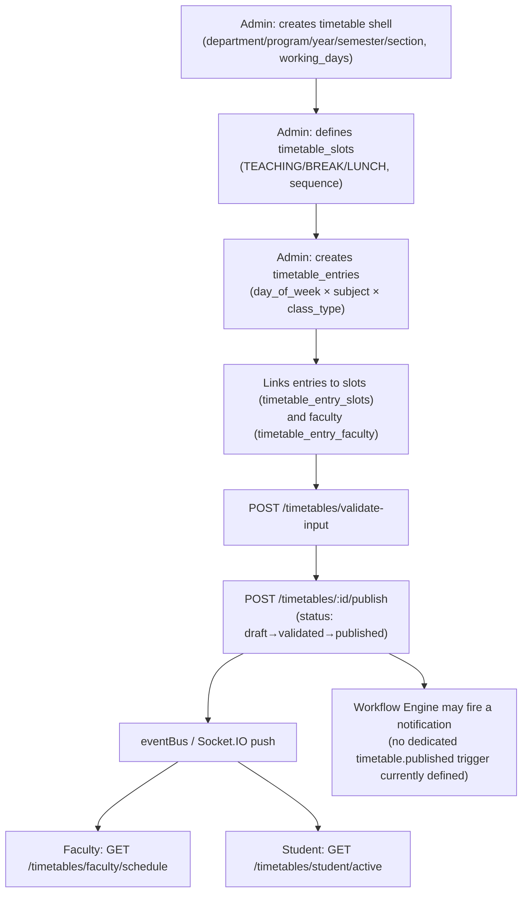

## 10.4 Result Flow

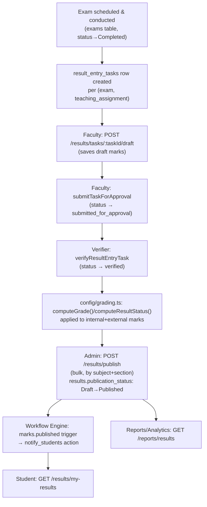

## 10.5 Login / Refresh Data Flow (see also §10.6 sequence diagram)

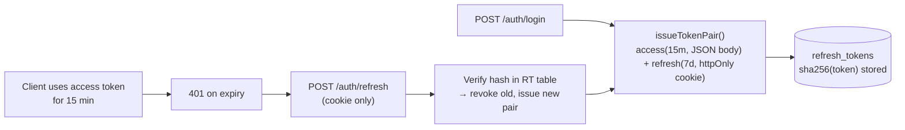

---

## 10.6 Sequence Diagrams

### 10.6.1 Login

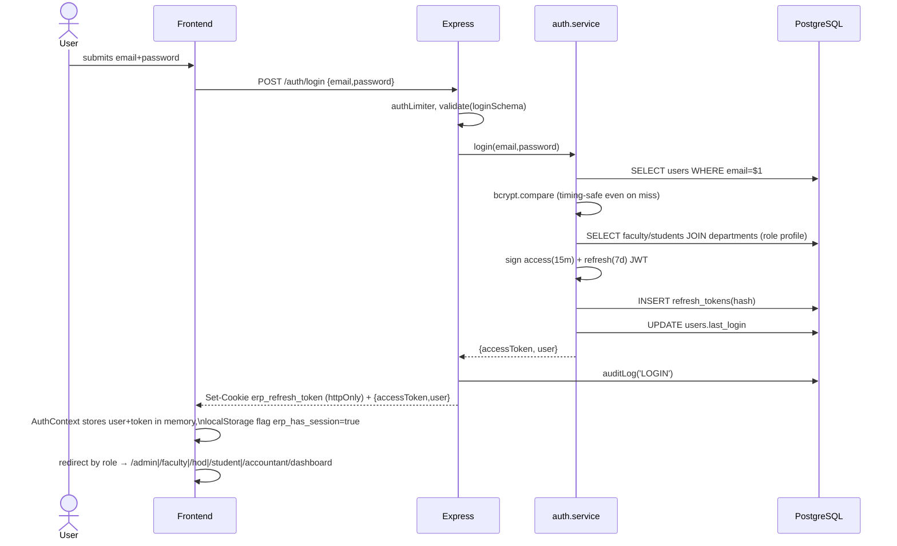

### 10.6.2 Attendance Marking

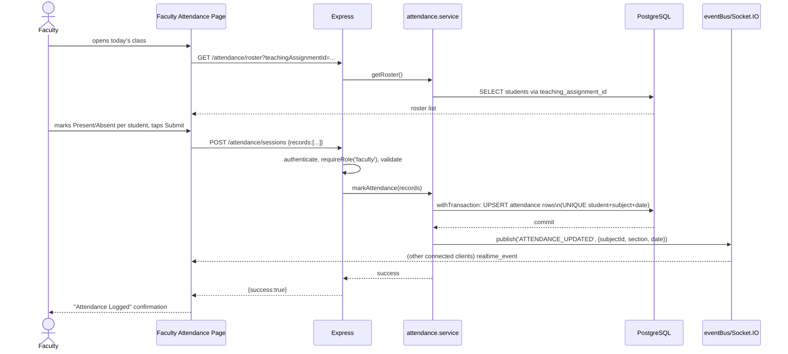

### 10.6.3 Results (Entry → Verify → Publish)

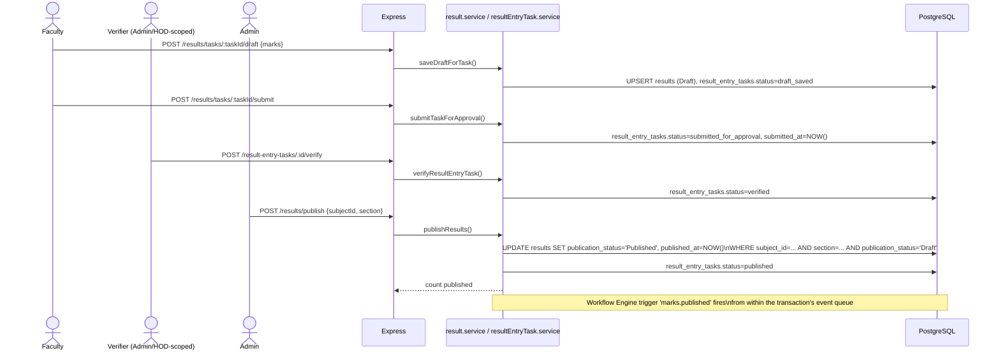

### 10.6.4 Timetable Publishing

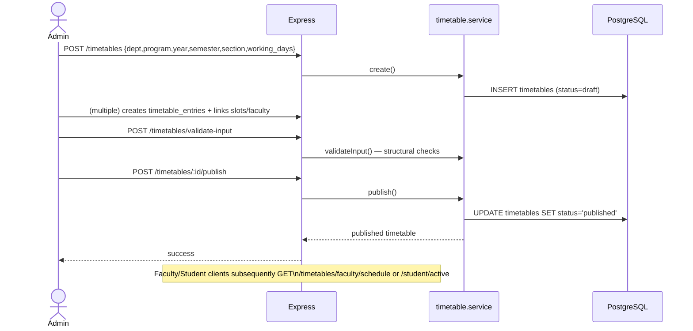

### 10.6.5 Teaching Assignment Creation & Transfer

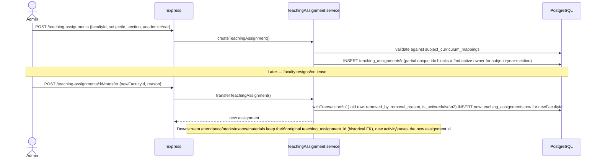

### 10.6.6 Subject/Curriculum Allocation (Bulk Excel Import)

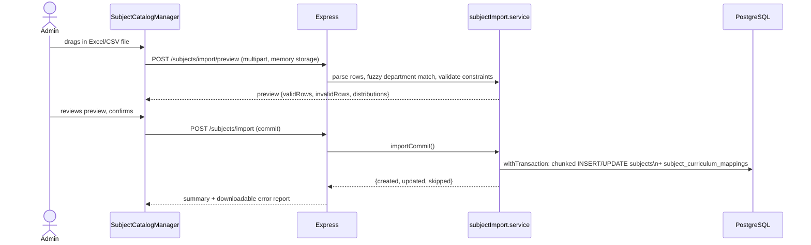

### 10.6.7 Student Registration (Bulk Import via Academic Import Engine)

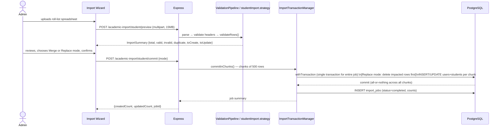

### 10.6.8 Mentorship Assignment (Auto-Balanced Groups)

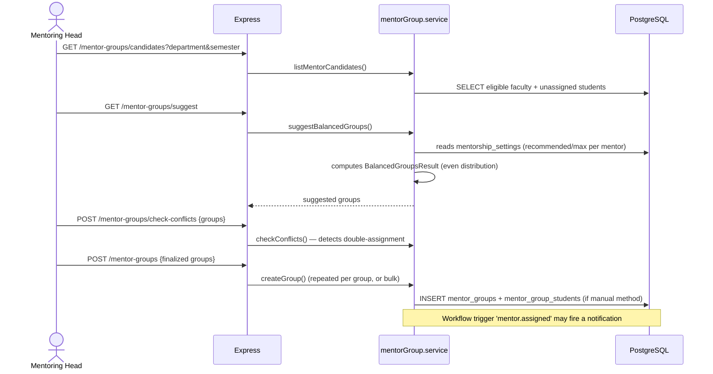

### 10.6.9 Notification Delivery

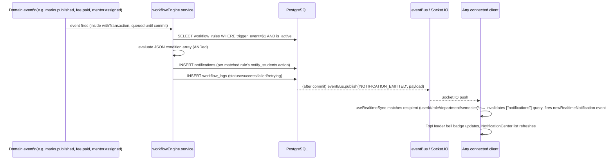
