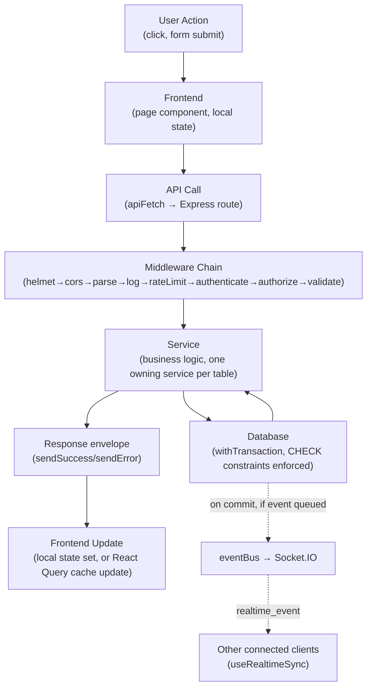

# 12. Performance, Error Handling & Project Workflow Lifecycle

← [Back to Index](00-INDEX.md)

## 12.1 Performance

| Technique | Where implemented | Notes |
|---|---|---|
| **Pagination** | Nearly every list endpoint (`page`/`limit` Zod-validated per module, default page=1/limit=20, max 100 observed) | Implemented ad hoc per service (~19 files) rather than a shared pagination utility — see [05-backend.md](05-backend.md) §5.15 |
| **Database indexing** | Every migration adds targeted indexes: FK columns, composite lookup indexes (e.g. `idx_students_program_sem`, `idx_timetables_lookup`), partial indexes for soft-delete/active-row filtering | Full list in [06-database.md](06-database.md) per-table entries |
| **In-process TTL caching** | `utils/ttlCache.ts` — `Map`-based, used to memoize expensive dashboard/analytics aggregations | Deliberate no-Redis choice for a single-instance deployment; cache is lost on restart, no in-flight de-dup on concurrent misses (acceptable since wrapped calls are read-only) |
| **Frontend caching** | React Query `staleTime: 60s`, `refetchOnWindowFocus: false`; per-resource staleTime tuning in `hooks/useRegistry.ts` | Only covers the subset of pages using `useRegistry`/React Query — most pages fetch on every mount with no caching |
| **Connection pooling** | `pg.Pool` max 10 connections, 30s idle/connection timeouts (tuned for Neon serverless cold-starts) | See [05-backend.md](05-backend.md) §5.10 |
| **Realtime push vs. polling** | Socket.IO push (attendance/teaching-plan/exam-seating/notifications) avoids client polling for these specific data types | Most other data (e.g. most list pages) still uses on-mount fetch, no polling and no push — data can go stale until the page is revisited |
| **Export row cap** | `export.service.ts` caps CSV/Excel/PDF exports at 5000 rows, with an explicit "N more rows omitted" notice | Prevents unbounded memory/response-size blowups on large report exports |
| **Body size limit** | `express.json({limit:'10mb'})` | Raised from an original 10kb to accommodate bulk spreadsheet-import payloads (see `walkthrough.md`) |
| **React performance** | No explicit `memo`/`useMemo`/`useCallback` optimization patterns were systematically documented in the frontend research pass; Recharts components render directly from fetched data | Not a confirmed bottleneck at current scale but worth profiling before a large data-volume rollout |
| **Query design** | Raw parameterized SQL (no ORM overhead); denormalized columns on hot-path tables (`exams.semester`, `teaching_plans.department_id`) trade normalization purity for query speed, explicitly documented in SQL comments | See [06-database.md](06-database.md) §6.6 |

⚠ **Gaps vs. the Non-Functional Requirements in `project_vision_and_requirements.md` §5** (target: <2s API response, <500ms search/listing at 100k records, 2000+ concurrent users, 99.9% uptime): none of these targets have been load-tested or measured as part of this documentation pass — they should be treated as aspirational until verified. Notably:
- No read-replica or horizontal-scaling story exists (single `pg.Pool`, single Node process).
- No Redis or shared cache — the TTL cache is per-process, so horizontal scaling (multiple API instances) would each maintain independent, inconsistent caches.
- No CDN/static-asset optimization strategy beyond Next.js's own build output.

## 12.2 Error Handling

Full mechanics in [05-backend.md](05-backend.md) §5.9 and [07-authentication-and-security.md](07-authentication-and-security.md). Summary by layer:

| Layer | Mechanism |
|---|---|
| **Frontend** | `lib/api.ts`: network failures → soft `{success:false}` object (no throw); non-2xx → thrown `Error`, caught in local `try/catch` per call site; no global error boundary (`error.tsx` doesn't exist); no shared toast/snackbar — inline banners or `alert()` |
| **Backend (validation)** | `middleware/validate.ts` — Zod errors → `400 VALIDATION_ERROR` with joined field messages |
| **Backend (business logic)** | `errors/AppError.ts` — single class, static factories per HTTP status, decentralized `code` strings per throw site |
| **Backend (database)** | `middleware/errorHandler.ts` maps Postgres codes: `23505`→409 `DUPLICATE_RECORD`, `23503`→400 `FOREIGN_KEY_VIOLATION`, `23502`→400 `NOT_NULL_VIOLATION` |
| **Backend (global/unhandled)** | `errorHandler.ts` catches everything else → logs via `console.error`, returns `500 INTERNAL_ERROR` (message hidden in production, shown in dev/test) |
| **Backend (process-level)** | `server.ts`: `unhandledRejection`/`uncaughtException` handlers close the HTTP server and exit rather than continuing in a corrupted state |
| **Database (constraints)** | CHECK constraints (financial bounds, mark limits, date ordering, enum-adjacent value sets) reject invalid data at the DB layer regardless of application-layer bugs — a genuine defense-in-depth layer |

**Response envelope contract** (relied upon by the frontend's `apiFetch`): success → `{success:true, data, message?, metadata?}`; failure → `{success:false, code, message}`. Any new endpoint should conform to this shape.

## 12.3 Project Workflow Lifecycle (Request → Response, Generic)

This is the same lifecycle detailed with concrete field names in [02-architecture-and-diagrams.md](02-architecture-and-diagrams.md) §2.4 and per-module in [10-data-flow-and-sequence-diagrams.md](10-data-flow-and-sequence-diagrams.md).

## 12.4 Background Work & Scheduling — Explicit Gap

⚠ As documented in [05-backend.md](05-backend.md) §5.16, **no scheduler/cron/job-queue exists anywhere in the codebase**. This has concrete operational consequences worth tracking as a punch list:

| Task that would normally be scheduled | Current behavior without a scheduler |
|---|---|
| Purge expired/revoked `refresh_tokens` | Rows accumulate indefinitely |
| Auto-transition `fees.payment_status` to `Overdue` past `due_date` | Must be computed on read (if at all) rather than stored/pushed |
| Auto-close feedback campaigns / result-entry windows past their configured close time | Requires a manual admin action (`closeCampaign`, task status transitions) rather than automatic expiry |
| Retry `workflow_logs` rows with `status='retrying'` | No retry mechanism was found to actually re-attempt these — the status exists in the enum but appears to require manual intervention |
| Periodic re-aggregation of `ttlCache`-backed dashboard metrics | Cache simply expires and recomputes lazily on next read, not proactively refreshed |

This is the single highest-leverage infrastructure addition for production-readiness — see [15-future-and-appendix.md](15-future-and-appendix.md) for the prioritized recommendation.
