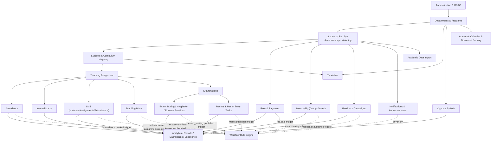

# 14. File-Level Documentation, Code Metrics & Feature Dependency Graph

← [Back to Index](00-INDEX.md)

## 14.1 Code Metrics (measured directly from the repository)

| Metric | Backend (`backend/src`) | Frontend (`frontend/src`) |
|---|---|---|
| Total lines of code | ~51,036 | ~60,667 |
| Route files | 47 (incl. `index.ts` barrel + `protected.routes.ts` reference) | — |
| Controller files | 45 | — |
| Service files | 60 | — |
| Registry facade files | 7 (incl. `index.ts` barrel) | — |
| Middleware files | 9 | — |
| SQL migration files | 50 | — |
| Backend test files | 20 (`__tests__/*.test.ts`, Jest) | 0 (no frontend test runner configured) |
| Page routes (`page.tsx`) | — | 89 |
| Layout files (`layout.tsx`) | — | 6 (root + 5 role layouts) |
| Component files (`.tsx` under `components/`) | — | 70 |
| Context providers | — | 4 |
| Custom hooks | — | 2 |
| `lib/*.ts` domain modules | — | 10 |

### Lines of code by backend folder

| Folder | LOC |
|---|---|
| `services/` | ~26,168 |
| `types/` | ~5,228 |
| `controllers/` | ~3,518 |
| `routes/` | ~2,700 |
| `db/` (migrations + scripts) | ~1,511 |
| `import/` | ~1,184 |
| `middleware/` | ~558 |
| `utils/` | ~520 |
| `registries/` | ~375 |
| `errors/` | 43 |

`services/` dwarfing every other backend folder (roughly half of all backend code) directly reflects the "thin controller, fat service" architecture described in [05-backend.md](05-backend.md).

### Lines of code by frontend folder

| Folder | LOC |
|---|---|
| `app/` (pages + layouts) | ~36,428 |
| `components/` | ~20,054 |
| `lib/` | ~2,340 |
| `context/` | ~1,076 |
| `types/` | ~345 |
| `hooks/` | ~381 |
| `providers/` | 43 |

`app/` being the largest frontend folder (60% of frontend LOC) reflects that most page-level logic (data fetching, local state, inline forms) lives directly in page components rather than being extracted into shared hooks/components — consistent with the "imperative fetch + useState per page" pattern noted in [04-frontend.md](04-frontend.md) §4.7.

## 14.2 Entities / Models / Schemas Count

| Category | Count | Reference |
|---|---|---|
| Database tables | 60 (+ 1 backward-compat view) | [06-database.md](06-database.md) §6.4 |
| Enum types | 43 | [06-database.md](06-database.md) §6.2 |
| API endpoints (approx., counted across all route files) | ~230 | [09-api-documentation.md](09-api-documentation.md) |
| Functional modules documented | 23 | [08-modules.md](08-modules.md) |
| User-facing roles (DB-level) | 4 (`admin`,`faculty`,`student`,`accountant`) + 2 designation/capability flags (HOD, Mentoring Head) + 1 super-admin flag | [01-overview-and-vision.md](01-overview-and-vision.md) §3 |

## 14.3 Complete File Documentation — Backend

This is a pointer table rather than a repeated listing — every backend file's purpose is documented in the section indicated, to avoid duplicating ~250 file descriptions across this document:

| File category | Where documented |
|---|---|
| `server.ts`, `app.ts` | [05-backend.md](05-backend.md) §5.1 |
| All 47 route files | [09-api-documentation.md](09-api-documentation.md) (endpoint-by-endpoint), summarized in [05-backend.md](05-backend.md) §5.2 |
| All 45 controller files | [05-backend.md](05-backend.md) §5.3 (role/pattern), individual controller responsibilities implied by their route file's endpoint table in [09](09-api-documentation.md) |
| All 60 service files | [08-modules.md](08-modules.md) (per-module "Backend" subsection lists the owning service(s) for each domain) |
| All 7 registry files | [05-backend.md](05-backend.md) §5.5 |
| All 9 middleware files | [05-backend.md](05-backend.md) §5.6, full auth mechanics in [07-authentication-and-security.md](07-authentication-and-security.md) |
| `errors/AppError.ts` | [05-backend.md](05-backend.md) §5.9 |
| `config/{env,database,grading}.ts` | [05-backend.md](05-backend.md) §5.12–5.13 |
| `utils/*.ts` (8 files) | [05-backend.md](05-backend.md) §5.11 |
| `import/*.ts` + `import/strategies/*.ts` | [05-backend.md](05-backend.md) §5.15 |
| All 50 migration files | [06-database.md](06-database.md) (final-state schema; per-migration provenance noted inline, e.g. "(035)") |
| `db/{migrate,seed,check,sync_roll_list,query_*}.ts` | [03-folder-structure.md](03-folder-structure.md) §3.2 |
| `__tests__/*.test.ts` (20 files) | [13-deployment-config-dependencies.md](13-deployment-config-dependencies.md) §13.8 (jest config); covers academicCalendar, announcement, attendance, calendarEntry, calendarExtractor, document, examination, faculty, fee, internal-marks, lmsAssignment, lmsSubmission, material, notification, opportunityHub, parsedEvent, result, search, subject, timetable services |

## 14.4 Complete File Documentation — Frontend

| File category | Where documented |
|---|---|
| `app/layout.tsx` + 5 role `layout.tsx` files | [04-frontend.md](04-frontend.md) §4.1 |
| `app/page.tsx` (login) | [04-frontend.md](04-frontend.md) §4.2 |
| All 89 page routes | [03-folder-structure.md](03-folder-structure.md) §3.3 (full tree) + [04-frontend.md](04-frontend.md) §4.4 (representative purpose per role) |
| All 70 components | [03-folder-structure.md](03-folder-structure.md) §3.3 (full listing by subfolder), architecture rationale in [04-frontend.md](04-frontend.md) §4.5 |
| `context/*.tsx` (4 files) | [04-frontend.md](04-frontend.md) §4.6 |
| `providers/AppProviders.tsx` | [04-frontend.md](04-frontend.md) §4.6 |
| `hooks/*.ts` (2 files) | [04-frontend.md](04-frontend.md) §4.6 |
| `lib/*.ts` (10 files) | [04-frontend.md](04-frontend.md) §4.6 |
| `types/*.ts` (5 files) | [03-folder-structure.md](03-folder-structure.md) §3.3 |

## 14.5 Feature Dependency Graph

This graph shows build/feature *dependency order* — which modules must exist before another can function — distinct from the runtime data-read dependencies in the [Synchronization Matrix](11-business-logic-and-sync-matrix.md) §11.9.

This mirrors the planning docs' "Subjects → Curriculum → Teaching Assignment → Attendance → Results → LMS → Teaching Planner → Student Dashboard" chain (`project_vision_and_requirements.md`), extended to reflect every implemented module rather than the original MVP subset — notably adding Fees, Mentorship, Feedback, Opportunity Hub, Notifications, Academic Calendar, Import, and the Workflow Rule Engine as siblings that all ultimately feed the Analytics/Dashboard layer, with the Workflow Engine cutting across nearly every module as a dotted (event-driven, not structural) dependency.
