# College ERP System — Software Architecture Document

## Cover Page

| Field | Value |
|---|---|
| **Project Name** | Sreyas College ERP (working title: "College ERP System") |
| **Project Type** | Full-stack academic & administrative ERP for a single college/institution |
| **Version** | Post-MVP, actively developed (no formal release tag in repository) |
| **Documentation Version** | 1.0 |
| **Date** | 2026-08-03 |
| **Authors** | Bhuvanesh T (Project Owner / Full Stack Developer); this document generated by an AI architecture-documentation pass over the codebase as of commit `184a34c` ("curricular scheme and Teaching assignments fix") |
| **Technology Stack** | Next.js 16 (React 19, TypeScript) · Node.js + Express.js 4 (TypeScript) · PostgreSQL (Neon serverless) · JWT auth · Socket.IO · TailwindCSS 4 |
| **Document Revision** | Rev. 1 — initial comprehensive architecture pass |
| **Source of Truth** | This document was produced by systematically reading the codebase (`frontend/src`, `backend/src`, all 50 SQL migrations) rather than from specifications alone. Where the pre-existing planning documents (`project_vision_and_requirements.md`, `ARCHITECT_REVIEW.md`, `SYSTEM_MODEL.md`, `BUSINESS_RULES_AND_WORKFLOWS.md`, `MVP_DEFINITION_AND_DEVELOPMENT_ROADMAP.md`, `UI_UX_BLUEPRINT.md`) disagree with what is actually implemented, this document follows the code and calls out the discrepancy explicitly. |

> **Important scope note**: the repository's original planning documents describe a 3-role MVP (Admin/Faculty/Student). The system as actually built has grown substantially beyond that MVP: it implements 4 database-level roles (`admin`, `faculty`, `student`, `accountant`), plus HOD and "Mentoring Head" as capability flags/designations on top of the `faculty` role, and roughly 40 functional modules (Attendance, Examinations, Results, Fees, LMS, Mentorship, Teaching Plans, Timetables, Exam Seating & Invigilation, Feedback Campaigns, Opportunity Hub, Workflow Engine, Academic Calendar/Document parsing, Academic Data Import, Analytics/Reports, Notifications, Announcements, Search). This document describes the **system as implemented**, not the original MVP plan.

---

## Table of Contents

This Software Architecture Document is split into the following files under `docs/architecture/`. Each maps to one or more sections of the standard 30-section documentation outline.

| # | File | Covers |
|---|---|---|
| 1 | [01-overview-and-vision.md](01-overview-and-vision.md) | Project Overview · Technology Stack · User Roles |
| 2 | [02-architecture-and-diagrams.md](02-architecture-and-diagrams.md) | System Architecture · High-Level Architecture (role/layer diagrams, Mermaid) |
| 3 | [03-folder-structure.md](03-folder-structure.md) | Complete Folder Structure (frontend & backend) |
| 4 | [04-frontend.md](04-frontend.md) | Frontend Documentation (pages, layouts, components, state, routing, forms, error handling) |
| 5 | [05-backend.md](05-backend.md) | Backend Documentation (routes, controllers, services, middleware, config, utils) |
| 6 | [06-database.md](06-database.md) | Database Documentation (60 tables, ER diagram, keys, constraints, normalization) |
| 7 | [07-authentication-and-security.md](07-authentication-and-security.md) | Authentication, Authorization, Security |
| 8 | [08-modules.md](08-modules.md) | Per-Module Deep Dive (~20 functional modules) |
| 9 | [09-api-documentation.md](09-api-documentation.md) | Full API Reference (43 route files, every endpoint) |
| 10 | [10-data-flow-and-sequence-diagrams.md](10-data-flow-and-sequence-diagrams.md) | Data Flow Diagrams · Sequence Diagrams |
| 11 | [11-business-logic-and-sync-matrix.md](11-business-logic-and-sync-matrix.md) | Business Logic · Module Synchronization Matrix |
| 12 | [12-performance-error-handling-workflow.md](12-performance-error-handling-workflow.md) | Performance · Error Handling · Project Workflow Lifecycle |
| 13 | [13-deployment-config-dependencies.md](13-deployment-config-dependencies.md) | Deployment · Configuration Files · Dependencies |
| 14 | [14-file-documentation-and-metrics.md](14-file-documentation-and-metrics.md) | File-Level Documentation · Code Metrics · Feature Dependency Graph |
| 15 | [15-future-and-appendix.md](15-future-and-appendix.md) | Future Improvements · Appendix (Glossary) · Undocumented/Missing Components |

### Reading order recommendations
- **New developer onboarding**: 01 → 02 → 03 → 07 → 06 → 05 → 04 → 08
- **API integration work**: 09 → 07 → 06
- **Database work / migrations**: 06 → 11 → 08
- **Frontend feature work**: 04 → 08 → 09

---

## Document Conventions

- File paths are given relative to the repository root `c:\Users\spybh\Downloads\ERP` (shown as `/` root below).
- `backend/` = Express/TypeScript API server. `frontend/` = Next.js 16 (App Router) client.
- All Mermaid diagrams render natively in most modern Markdown viewers (GitHub, VS Code, GitLab). If your viewer doesn't support Mermaid, paste the code blocks into the [Mermaid Live Editor](https://mermaid.live).
- Tables marked "Final state" in the database document reflect the schema **after all 50 migrations** are applied, not any single migration in isolation.
- Where this document notes a gap or inconsistency in the actual codebase, it is marked with **⚠ Note**.


# 1. Project Overview, Technology Stack & User Roles

← [Back to Index](00-INDEX.md)

## 1.1 Purpose

The College ERP is a centralized web platform that digitizes the academic and administrative operations of a single college: student/faculty records, attendance, examinations & results, fees, timetabling, learning-management (LMS), mentorship, feedback campaigns, placement/opportunity postings, academic-calendar management, and cross-cutting reporting/analytics. It replaces spreadsheet- and paper-based processes with one relational source of truth, scoped by role-based access control.

## 1.2 Target Users

Five distinct user populations interact with the system, mapped to 4 database roles plus 2 designation/capability flags layered on top of `faculty`:

| Population | DB Role | How they're distinguished |
|---|---|---|
| System/College Administrator | `admin` | Role value; an `is_super_admin` boolean additionally unlocks Workflow Rule configuration |
| Head of Department (HOD) | `faculty` | `faculty.designation = 'hod'` (one HOD per department, DB-enforced via partial unique index) |
| Mentoring Head | `faculty` | `faculty.is_mentoring_head = true` capability flag (department-wide mentorship oversight) |
| Regular Faculty | `faculty` | Default designation values (professor/associate_professor/assistant_professor/lecturer) |
| Student | `student` | Role value; scoped to own records only |
| Accounts Office Staff | `accountant` | Role value; scoped to Fees module |

⚠ **Note**: the planning documents (`project_vision_and_requirements.md`) additionally describe Librarian, Parent/Guardian, and Placement Officer as *future* roles, and a `SYSTEM_MODEL.md`/`ARCHITECT_REVIEW.md` "Super Admin" as a role distinct from Admin. In the actual implementation, none of these exist as separate `user_role` enum values — Super Admin is a boolean flag on an `admin` user, and Librarian/Parent/Placement Officer are not implemented at all (see [15-future-and-appendix.md](15-future-and-appendix.md) for the gap list). The frontend's `PermissionContext`/`lib/permissions.ts` layer additionally recognizes a richer set of *RBAC labels* (`Super Admin`, `College Admin`, `HOD`, `Academic Coordinator`, `Placement Officer`, `Mentoring Head`, `Faculty`, `Student`) purely for UI nav-filtering purposes — these are **not** backed by distinct database roles; they are derived client-side from the 4 real roles plus designation/flags.

## 1.3 Problem Statement

Colleges running manual/spreadsheet-based operations suffer from: duplicated data entry across departments, delayed attendance/grade visibility, no single audit trail for financial or academic record changes, ad hoc scheduling with undetected conflicts, and no unified channel for announcements, assignments, or placement opportunities. The ERP addresses this by making every academic transaction (attendance mark, grade entry, fee payment, teaching assignment) a row in one relational database, visible in real time (via Socket.IO) to every authorized party.

## 1.4 Objectives

- Provide one authenticated portal per role with data strictly scoped to what that role owns or is entitled to see (see [07-authentication-and-security.md](07-authentication-and-security.md)).
- Make attendance, results, and fee status available to students in real time.
- Give faculty a single "Operations Center" (dashboard, tasks, workload) instead of scattered spreadsheets.
- Give admins configurable, auditable workflows (Workflow Rule engine) instead of hard-coded notification logic.
- Support bulk onboarding via spreadsheet import (students, subjects/curriculum) rather than manual entry.
- Maintain an append-only audit trail (`audit_logs`, `workflow_logs`) for security-sensitive actions.

## 1.5 Scope

**In scope (implemented):** Authentication & RBAC; Student/Faculty/Accountant provisioning; Departments & Programs; Subjects & Curriculum Mapping; Teaching Assignments; Attendance; Internal Marks; Examinations (scheduling, sessions, seating, invigilation); Results (with a task-based entry/verify/publish workflow); Fees & Payments; Timetabling; LMS (materials, assignments, submissions/grading); Teaching Plans ("Lesson Progress Engine"); Mentorship (1:1 legacy + group-based); Feedback Campaigns; Opportunity Hub (placements/internships/events) with bookmarking; Notifications & Announcements; Academic Calendar (including PDF-based auto-extraction of calendar events); Bulk Academic Data Import; Workflow Rule engine; Analytics/Reports/Exports (PDF/Excel/CSV); Global Search.

**Out of scope (not implemented, see planning docs' aspirations):** Library management, Hostel/Transport modules, Parent portal, Placement-drive-specific workflow (only a generic Opportunity posting exists), payment gateway integration (fees are recorded manually, not processed online), biometric attendance, AI/predictive analytics, multi-language support, background job scheduler (no cron/queue — see [12](12-performance-error-handling-workflow.md)).

## 1.6 Major Features

See [08-modules.md](08-modules.md) for the full per-module breakdown. At a glance: 4-role JWT auth with refresh-token rotation and reuse detection · fine-grained + record-level authorization · 43 route files / ~230 REST endpoints · 60 backend tables across 12 functional domains · a task-based Result entry→verify→publish approval chain · an auto-balancing mentor-group allocator · a rule-based PDF calendar-event extractor · a generic multi-format (CSV/Excel/PDF) export engine · a configurable Workflow Rule engine driving in-app notifications from domain events · realtime push via Socket.IO for attendance/teaching-plan/exam-seating/notification updates.

## 1.7 Future Scope

See [15-future-and-appendix.md](15-future-and-appendix.md) §Future Improvements for the full list (containerization/CI, background job queue, Redis caching, payment gateway, AI-driven analytics, Library/Hostel/Transport/Parent-portal modules, automated testing on the frontend, WebSocket auth hardening).

---

## 2. Technology Stack

| Layer | Technology | Notes |
|---|---|---|
| Frontend framework | **Next.js 16** (App Router), **React 19**, TypeScript | `next.config.ts` is essentially default — no custom rewrites/SSR data-fetching strategy; effectively a client-rendered SPA calling an external API |
| Frontend styling | **TailwindCSS 4** (+ `@tailwindcss/postcss`) | Utility-first; dark/light theme via CSS variables + `SimulationContext` |
| Frontend data/state | **@tanstack/react-query 5** (partial use), React Context (Auth/Simulation/Permission/Socket), plain `useState` (majority of pages) | No Redux/Zustand; see [04-frontend.md](04-frontend.md) §State Management |
| Frontend charts | **Recharts 3** | Dashboard/analytics visualizations |
| Frontend realtime | **socket.io-client 4.8** | Auth via `{token: accessToken}` handshake payload |
| Icons | **lucide-react** | |
| Backend runtime | **Node.js**, **Express.js 4**, TypeScript (CommonJS output) | No web framework beyond Express; no ORM |
| Backend DB access | **pg 8** (raw SQL, hand-written queries), `AsyncLocalStorage`-based transaction context | See [05-backend.md](05-backend.md) |
| Database | **PostgreSQL** (Neon serverless Postgres in practice — connection string SSL logic special-cases `neon.tech`) | 50 versioned SQL migrations, `schema_migrations` tracking table |
| Auth | **jsonwebtoken 9** (HS256, separate access/refresh secrets), **bcryptjs 2** (cost 12), **cookie-parser** (httpOnly refresh cookie) | See [07-authentication-and-security.md](07-authentication-and-security.md) |
| Validation | **Zod 3** (both a request-validation middleware factory on the backend, and ad hoc on the frontend not at all — frontend has no schema validation library) | |
| Realtime (server) | **socket.io 4.8** | In-process `eventBus.service.ts` pub/sub wrapper, transaction-aware |
| File processing | **multer 2** (uploads), **exceljs 4** (Excel/CSV read+write), **pdfkit 0.19** (PDF generation), **pdf-parse 2.4** (PDF text extraction for calendar auto-import) | |
| Security middleware | **helmet 8**, **cors 2.8**, **express-rate-limit 7** | |
| Testing | **Jest 29** + **ts-jest** (backend only — 20 service-level test files); **no frontend test runner configured** | |
| Build tools | `tsc` (backend compile to `dist/`), Next.js's own bundler (frontend) | |
| Package manager | npm (both `frontend/` and `backend/` have their own `package.json` and `node_modules`) | |
| Dev tools | `tsx` (backend dev/hot-reload runner), ESLint 9 flat-config (frontend only — **backend has no ESLint config**) | |
| Version control | Git (this repository) | No CI/CD pipeline configured (no `.github/workflows`) — see [13-deployment-config-dependencies.md](13-deployment-config-dependencies.md) |

Full dependency-by-dependency breakdown with rationale: [13-deployment-config-dependencies.md](13-deployment-config-dependencies.md) §Dependencies.

---

## 3. User Roles — Detailed Permission Matrix

The backend defines exactly 4 roles (`backend/src/types/roles.ts`, `ROLES = ['admin','faculty','student','accountant']`) and a static `PERMISSIONS` map of `resource:action → allowed roles`, enforced by the `authorize()` middleware (coarse role checks use `requireRole()` instead — both idioms coexist). Record-level (not just role-level) checks exist only for the Mentorship module (`middleware/mentorshipAuth.ts`).

| Resource : Action | admin | faculty | student | accountant |
|---|:---:|:---:|:---:|:---:|
| users: create/update/delete | ✅ | | | |
| users: read | ✅ | ✅ | ✅ | ✅ |
| accountants: * | ✅ | | | |
| departments/courses/subjects: create/update/delete | ✅ | | | |
| departments/courses/subjects: read | ✅ | ✅ | ✅ | |
| attendance: create/update | | ✅ | | |
| attendance: read | ✅ | ✅ | ✅ | |
| grades (internal marks/results): create/update | | ✅ | | |
| grades: read | ✅ | ✅ | ✅ | |
| fees: create/update | ✅ | | | ✅ |
| fees: read | ✅ | | ✅ | ✅ |
| reports: read | ✅ | ✅ | | ✅ |
| mentorship: manage (assign/reassign/groups) | ✅ | | | |
| mentorship: read | ✅ | ✅ | ✅ | |
| mentorship: write (notes) | | ✅ | | |
| workflow rule configuration | ✅ (super-admin only) | | | |

Capability flags layered on top of role, used for scoping rather than access grant/deny:
- `users.is_super_admin` — only gate for `/api/workflow/rules*` endpoints.
- `faculty.designation = 'hod'` — one per department (DB-enforced); used to scope Faculty Operations/Analytics/Dashboard `hod` variants (`requireRole('faculty')` at the route, then the service checks `designation`).
- `faculty.is_mentoring_head` — grants department-wide mentorship management (assign/reassign/groups/reports) instead of just self-scoped mentee access.

### Ownership model (who owns what data)
- **Students** own: their assignment submissions, feedback answers, bookmarks, profile contact fields. They have read-only access to attendance, internal marks, results, fees, seating, timetable — all scoped to their own `student_id`.
- **Faculty** own: attendance/marks/results/teaching-plans/materials/assignments for subjects they hold an active `teaching_assignments` row for (enforced by the `teachingAssignmentRegistry` resolution helpers, not just role checks).
- **Admin** owns: master data (departments, programs, subjects, curriculum mappings, teaching assignments, fee records, announcements, workflow rules) and provisions all user accounts.
- **Accountant** owns: fee/payment records (shared write access with Admin).

See [07-authentication-and-security.md](07-authentication-and-security.md) for the full authentication/authorization mechanics and [11-business-logic-and-sync-matrix.md](11-business-logic-and-sync-matrix.md) for lifecycle/state-machine detail per entity.


# 3. Complete Folder Structure

← [Back to Index](00-INDEX.md)

## 3.1 Repository Root

```
ERP/
├── frontend/                    # Next.js 16 client application
├── backend/                     # Express/TypeScript API server
├── docs/                        # Miscellaneous engineering docs + this architecture document
│   └── architecture/            # ← this Software Architecture Document
├── AGENTS.md                    # AI-agent operating instructions for this repo
├── CLAUDE.md                    # Points to AGENTS.md
├── README.md                    # Project intro, setup instructions
├── project_vision_and_requirements.md   # Original planning doc (aspirational, MVP-oriented)
├── ARCHITECT_REVIEW.md          # Early architecture review notes
├── SYSTEM_MODEL.md              # Conceptual entity/actor model (planning-stage)
├── BUSINESS_RULES_AND_WORKFLOWS.md      # Planning-stage business rules
├── MVP_DEFINITION_AND_DEVELOPMENT_ROADMAP.md   # Original 3-week MVP roadmap
├── UI_UX_BLUEPRINT.md           # UI/UX design system spec (mostly matches implementation)
├── walkthrough.md               # Dev log for the Subjects Master module
├── sample_student_import.csv    # Sample file for the student bulk-import feature
└── I SEMESTER ROLL LIST WITH FULL DATA.xlsx   # Real sample data used with the import pipeline
```

⚠ **Note**: the planning `.md` files at the root describe an earlier, smaller-scope MVP (3 roles, no approval workflows). They are retained for historical context but should not be treated as current-state documentation — this architecture document (`docs/architecture/`) supersedes them for "what the system actually does."

---

## 3.2 Backend — `backend/src/`

```
backend/src/
├── server.ts              # Process entrypoint: pg connectivity check, HTTP+Socket.IO server, graceful shutdown
├── app.ts                 # createApp(): global Express middleware stack + route mounting (see 02-architecture)
├── config/
│   ├── env.ts              # Zod-validated environment schema; fail-fast on invalid config
│   ├── database.ts         # pg Pool, query() helper, withTransaction() + AsyncLocalStorage event context
│   └── grading.ts          # Grade-boundary constants (O/A+/A/B+/B/C/F) + computeGrade/computeResultStatus
├── routes/                 # 43 files — one per resource, thin: middleware chain + controller wiring only
├── controllers/            # 42 files — HTTP adapters: parse req, call service, sendSuccess/sendError
├── services/                # 60 files — business logic; one "owning" service per table (see 05-backend.md)
├── registries/              # 6 facade services — cross-module lookups (Student/Faculty/Academic/Curriculum/TeachingAssignment/Resource) + index.ts barrel
├── middleware/
│   ├── authenticate.ts       # JWT verification → req.user
│   ├── authorize.ts          # authorize()/requireRole()/requireSuperAdmin() — static RBAC
│   ├── mentorshipAuth.ts     # Record-level (mentor/mentee/note-owner) authorization
│   ├── validate.ts           # Zod schema validation middleware factory
│   ├── rateLimiter.ts        # globalLimiter + authLimiter (express-rate-limit)
│   ├── errorHandler.ts       # Global error handler (Postgres error code mapping + AppError formatting)
│   ├── requestLogger.ts      # Console-based request/response logging
│   ├── upload.ts             # Multer config — generic PDF documents (disk storage)
│   └── uploadLms.ts          # Multer config — LMS materials (PDF/PPT/DOC, disk storage)
├── errors/
│   └── AppError.ts           # Single error class + static factories (badRequest/unauthorized/forbidden/notFound/conflict/internal)
├── import/                  # Generic entity-agnostic bulk-import pipeline framework
│   ├── ExcelParser.ts         # .xlsx/.xls/.csv → row-object parser (header auto-detection)
│   ├── ImportStrategy.ts      # Interface every entity importer must implement
│   ├── ImportTransactionManager.ts   # Chunked, single-transaction commit orchestration
│   ├── ValidationPipeline.ts  # parse → validate → summarize glue
│   ├── strategyRegistry.ts    # ImportEntityType → strategy implementation map
│   └── strategies/
│       └── studentImport.strategy.ts   # The only implemented strategy (Merge/Replace modes)
├── db/
│   ├── migrate.ts             # Migration runner (handles enum ALTER TYPE special-casing)
│   ├── seed.ts, seed_exam_seating.ts, seed_feedback.ts   # Seed data scripts
│   ├── check.ts               # DB connectivity/sanity check script
│   ├── sync_roll_list.ts      # One-off script for syncing the Excel roll-list sample data
│   ├── query_student.ts, query_opportunities.ts, list_users_test.ts   # Ad hoc query/debug scripts
│   └── migrations/            # 50 numbered .sql files (001_... through 050_timetable_management.sql)
├── types/                   # Shared TypeScript types + Zod schemas per domain (roles.ts, auth.ts, subject.ts, etc.)
├── utils/
│   ├── asyncHandler.ts        # Wraps async route handlers → forwards rejections to next()
│   ├── audit.ts                # auditLog() → audit_logs table
│   ├── calendarExtractor.ts    # Rule-based PDF-text → academic calendar event extractor
│   ├── jwt.ts                  # Access/refresh token sign/verify
│   ├── password.ts             # bcryptjs hash/verify
│   ├── response.ts             # sendSuccess/sendCreated/sendError envelope helpers
│   ├── ttlCache.ts             # In-process Map-based TTL memoizer (no Redis)
│   └── validation.ts           # Password strength regex + Zod schema
└── __tests__/                # 20 Jest test files (service-level, ts-jest)

backend/uploads/
├── documents/                # uploadPdf target (Document Management)
└── lms/                      # uploadLmsFile target (Course Materials, Submissions)
```

---

## 3.3 Frontend — `frontend/src/`

```
frontend/src/
├── app/                      # Next.js App Router — file-based routing
│   ├── layout.tsx             # Root layout: fonts, metadata, <AppProviders>
│   ├── page.tsx               # Login page (root "/")
│   ├── admin/                 # 27 routes — layout.tsx gates role="admin"
│   │   ├── layout.tsx
│   │   ├── accountants/ analytics/ announcements/ attendance/ calendar/ courses/
│   │   ├── dashboard/ examinations/ faculty/ feedback/ fees/ import/ lms/[subjectId]/
│   │   ├── mentorship/ notifications/ opportunities/ profile/ reports/ results/
│   │   ├── seating/ settings/ students/ subject-allocations/ subjects/[id]/
│   │   └── teaching-planner/ timetables/ workflows/
│   ├── faculty/                # 18 routes — layout.tsx gates role="faculty"
│   │   ├── layout.tsx
│   │   ├── analytics/ announcements/ attendance/ calendar/ dashboard/ examinations/
│   │   ├── feedback/ grades/ invigilation/ lms/[subjectId]/
│   │   ├── mentorship/[groupId]/[studentId]/ notifications/ opportunities/ profile/
│   │   └── reports/ results/ subjects/ teaching-planner/ timetable/ workflows/
│   ├── hod/                    # 12 routes — layout.tsx gates role="faculty" + designation==="hod" check
│   │   ├── layout.tsx
│   │   └── analytics/ attendance/ classes/ dashboard/ faculty/ feedback/
│   │       mentorship/ reports/ seating/ students/ subject-allocations/ subjects/
│   │       (HOD reuses several /faculty/* routes directly for teaching-workload duties)
│   ├── student/                 # 17 routes — layout.tsx gates role="student"
│   │   ├── layout.tsx
│   │   └── analytics/ announcements/ attendance/ calendar/ dashboard/ examinations/
│   │       feedback/submit/ fees/ lms/[subjectId]/ mentorship/ notifications/
│   │       opportunities/[id]/bookmarks/ profile/ reports/ results/ seating/ timetable/
│   ├── accountant/              # 2 routes — layout.tsx gates role="accountant" (no AccessGuard layer)
│   │   ├── layout.tsx
│   │   └── dashboard/ fees/
│   └── unauthorized/            # Fallback page for AccessGuard/PermissionContext denial
├── components/                # Shared UI (see 04-frontend.md §Component Architecture for full file list)
│   ├── DashboardLayout.tsx, Sidebar.tsx, TopHeader.tsx, BottomNav.tsx, ProtectedRoute.tsx
│   ├── CalendarView.tsx, EventFormModal.tsx, PersonalEventModal.tsx, NotificationCenter.tsx
│   ├── FacultyFormDrawer.tsx, StudentFormDrawer.tsx, DeleteConfirmationModal.tsx, FacultyDeleteModal.tsx
│   ├── OpportunityCard.tsx, OpportunityFilterBar.tsx, OpportunityFormModal.tsx, PDFUploadModal.tsx
│   ├── Analytics/    # AccessGuard, AcademicSubNav, AnalyticsCharts, InsightCards, FilterPanel, ExportDialog, ProtectedComponentWrapper
│   ├── Dashboard/    # StatsCard, ActivityFeed, AssignmentWidget, CalendarWidget, DashboardCharts, OpportunityWidget, UpcomingEventsWidget, NotificationWidget, TeachingProgressCard, TodayTaskCenter, WorkloadCharts, MyTeachingAssignmentsCard
│   ├── Feedback/     # AnonymousCommentList, FeedbackCharts, CampaignForm, CampaignManager, FeedbackTemplatesManager, FeedbackWizard, SubjectFeedbackCard
│   ├── LMS/          # LMSDashboard, SubjectLMS, Modals/{AssignmentModal,GradingModal,MaterialModal,SubmissionModal}
│   ├── Profile/      # ProfileOverview, EditProfileForm, ChangePasswordForm
│   ├── Search/       # GlobalSearch
│   ├── Seating/      # SeatingChartGrid, PatternFormModal, RoomFormModal, SessionFormModal
│   ├── SubjectAllocation/   # AllocationManager
│   ├── Subjects/     # SubjectCatalogManager
│   ├── TeachingAssignment/  # TeachingAssignmentManager
│   ├── UX/           # ConfirmationDialog, EmptyState, SkeletonLoaders, UnifiedPagination, UnifiedSearchBar
│   └── UXL/          # ActionCenter, QuickActions, SmartProgressCard, TodayFocus, UnifiedTimeline
├── context/
│   ├── AuthContext.tsx         # Real backend session (user/token/login/logout/refresh)
│   ├── SimulationContext.tsx   # Legacy/demo local-state store + global theme + role-switch simulator (localStorage-persisted)
│   ├── SocketContext.tsx       # Socket.IO client connection
│   └── PermissionContext.tsx   # Derived RBAC role + path/widget access rules
├── providers/
│   └── AppProviders.tsx        # Composition root (QueryClient → Simulation → Auth → Socket → Permission → RealtimeSyncListener)
├── hooks/
│   ├── useRealtimeSync.ts      # Socket event → React Query cache invalidation + custom DOM events
│   └── useRegistry.ts          # React Query hooks wrapping apiFetch for shared "registry" lookups
├── lib/
│   ├── api.ts                  # apiFetch() — auth header injection, silent 401 refresh+retry
│   ├── permissions.ts          # RBAC role resolution + path/widget access rule tables
│   ├── lms.ts, opportunities.ts, search.ts, profile.ts, seating.ts, teachingPlan.ts, feedback.ts, mentorship.ts   # Domain type definitions
├── types/
│   └── opportunity.ts, subject.ts, academicImport.ts, realtime.ts, subjectAllocation.ts
└── globals.css                # Tailwind base + design tokens
```

### Folder-purpose summary table

| Folder | Purpose |
|---|---|
| `frontend/src/app` | Next.js App Router pages — one subtree per role, file path = URL path |
| `frontend/src/components` | Reusable React components, organized by domain subfolder; top-level = truly cross-role shared chrome |
| `frontend/src/context` | React Context providers for cross-cutting client state (auth, theme/simulation, sockets, permissions) |
| `frontend/src/providers` | Single composition root wiring all context providers + React Query in the correct nesting order |
| `frontend/src/hooks` | Reusable React hooks (realtime sync, shared data-fetching registries) |
| `frontend/src/lib` | Non-React utility/domain-type modules — the API client, RBAC engine, and per-domain TypeScript types |
| `frontend/src/types` | Additional shared TypeScript types not tied to a specific `lib/*` domain module |
| `backend/src/routes` | URL surface declarations — no business logic, only middleware wiring |
| `backend/src/controllers` | Thin request/response adapters between Express and services |
| `backend/src/services` | All business logic; each table has one "owning" service |
| `backend/src/registries` | Read-only facades so unrelated modules resolve shared master data through one path instead of ad hoc joins |
| `backend/src/middleware` | Cross-cutting request-pipeline concerns (auth, validation, rate limiting, uploads, errors) |
| `backend/src/import` | Generic bulk-import framework (parse → validate → chunked-transactional-commit) |
| `backend/src/db/migrations` | The authoritative schema history — 50 sequential, numbered SQL files |
| `backend/src/utils` | Small stateless helper modules (JWT, password hashing, audit logging, TTL cache, PDF-text extraction) |
| `backend/src/errors` | The single `AppError` class hierarchy used throughout the API |
| `backend/uploads` | Local-disk file storage target for both upload middlewares (no object storage/CDN) |


# 4. Frontend Documentation

← [Back to Index](00-INDEX.md)

The frontend is a Next.js 16 (App Router) application, effectively operating as a **client-rendered SPA** that calls an external Express API — `next.config.ts` is default/empty, there are no server actions, API routes, or SSR data-fetching patterns in use; every page is a `"use client"` component fetching data imperatively after mount.

## 4.1 Root & Role Layouts

`frontend/src/app/layout.tsx` (server component) sets up `Inter`/`Outfit` Google Fonts as CSS variables, global metadata ("Sreyas College ERP - Academic Portal"), imports `globals.css`, and wraps `{children}` in the single `<AppProviders>` composition root.

Each role subtree has its own `layout.tsx`, all client components with an almost identical shape:

```
ProtectedRoute (role gate) → AccessGuard (path-level RBAC) → DashboardLayout (chrome) → {children}
```

| Layout | `allowedRoles` | Extra logic |
|---|---|---|
| `app/admin/layout.tsx` | `["admin"]` | — |
| `app/faculty/layout.tsx` | `["faculty"]` | — |
| `app/hod/layout.tsx` | `["faculty"]` | `useEffect` double-checks `user.designation === "hod"`, else redirects `/` — **HOD is scoped at the `ProtectedRoute` level as plain "faculty"**; the HOD/faculty split happens later via `AccessGuard` + `PermissionContext` |
| `app/student/layout.tsx` | `["student"]` | — |
| `app/accountant/layout.tsx` | `["accountant"]` | **Does not wrap `AccessGuard`** — only `ProtectedRoute` + `DashboardLayout`, unlike the other four roles |

⚠ **Note**: No `app/loading.tsx`, `app/error.tsx`, `app/not-found.tsx`, or `app/global-error.tsx` exist anywhere in the tree — Next.js route-level error/loading boundaries are **not used**; all loading/error UI is handled ad hoc inside individual components.

## 4.2 Authentication Flow

**Login page** (`frontend/src/app/page.tsx`, root `/`): a single controlled-input form calling `useAuth().login(username, password)`. On success, a `useEffect` watching `user` redirects by role: `admin → /admin/dashboard`; `faculty` (designation `hod` → `/hod/dashboard`, else `/faculty/dashboard`); `student → /student/dashboard`; `accountant → /accountant/dashboard`.

**`AuthContext.tsx`** (`frontend/src/context/AuthContext.tsx`):
- Holds `user` (with nested `facultyProfile`/`studentProfile`), `accessToken`, `loading` — **all in React state, never in `localStorage`**. `localStorage` only stores a boolean hint `erp_has_session = "true"` used to attempt silent refresh on load.
- **Session bootstrap**: on mount, if the hint is set, calls `POST /auth/refresh` with `credentials: "include"` (relying on the httpOnly refresh cookie); on success, populates token/user and syncs into `SimulationContext`.
- Listens for two custom `window` events dispatched by `lib/api.ts`: `tokenRefreshed` (keeps context in sync after a silent refresh triggered by a 401) and `sessionExpired` (clears state when refresh fails).
- `logout()` calls `POST /auth/logout`, clears state + the localStorage hint, and hard-navigates to `/` via `window.location.href`.

**`lib/api.ts`** (`apiFetch<T>(endpoint, options, accessToken?)`):
- Attaches `Authorization: Bearer <token>` (explicit arg or module-level `globalAccessToken` fallback); auto-sets `Content-Type: application/json` unless the body is `FormData`.
- **Silent refresh-and-retry**: on a 401 (except for `/auth/refresh`/`/auth/login` themselves) it calls `POST /auth/refresh`, updates the token, dispatches `tokenRefreshed`, and retries the original request once. On refresh failure it dispatches `sessionExpired`.
- Network failures return a soft `{success:false, message:"Backend server is currently offline..."}` object instead of throwing, so callers can render inline errors rather than crash.
- `API_URL` defaults to `http://127.0.0.1:3001/api` via `NEXT_PUBLIC_API_URL`.

**Socket auth** (`context/SocketContext.tsx`): connects `socket.io-client` to `NEXT_PUBLIC_SOCKET_URL` passing `auth: { token: accessToken }`; reconnects whenever `accessToken`/`user` change.

## 4.3 Role Protection (3 layers, defense in depth)

1. **`components/ProtectedRoute.tsx`** — coarse role gate. Shows a full-screen "Verifying Identity Session..." spinner while `loading`; redirects to `/` if no `user`, or if `allowedRoles` is given and `user.role` isn't in it.
2. **`components/Analytics/AccessGuard.tsx`** — fine-grained path gate (inside `ProtectedRoute` in every layout except accountant). Uses `usePermission().hasAccess(pathname)`; redirects to `/unauthorized` if denied.
3. **`context/PermissionContext.tsx`** + **`lib/permissions.ts`** — the RBAC engine:
   - `getRbacRole()` resolves a fine-grained label (`Super Admin`, `College Admin`, `HOD`, `Academic Coordinator`, `Placement Officer`, `Mentoring Head`, `Faculty`, `Student`) from `user.role` + `facultyProfile.designation` + email, further overridable by the legacy `SimulationContext.currentRole` selector.
   - `hasAccessToPath(role, path)` — hardcoded string-prefix/allowlist rules per RBAC label.
   - `hasAccessToWidget(role, widgetName)` — same idea for dashboard widget visibility.
   - Also drives `components/Sidebar.tsx`'s nav-item filtering.

⚠ **Note**: no root-level `middleware.ts` exists — route protection is entirely client-side/component-based, not edge middleware. A determined client could briefly see a flash of protected route structure before the client-side redirect fires (standard SPA-auth caveat).

## 4.4 Page Routes by Role

Full path listing is in [03-folder-structure.md](03-folder-structure.md). Route counts: **Admin 27**, **Faculty 18**, **HOD 12** (+ reuses several `/faculty/*` routes for teaching-workload duties per `Sidebar.tsx`'s "Teaching Desk" nav group), **Student 17**, **Accountant 2**. Total ≈ 76 distinct top-level page routes plus dynamic segments (`[subjectId]`, `[id]`, `[groupId]`, `[groupId]/[studentId]`).

Representative purpose per role (full table in [03-folder-structure.md](03-folder-structure.md)):
- **Admin**: system-wide CRUD registries (students/faculty/accountants/subjects/departments via courses), curriculum configuration, teaching-assignment allocation, timetable/exam/seating management, fee oversight, workflow/settings configuration, bulk import wizard.
- **Faculty**: personal teaching workspace — today's schedule, attendance marking, gradebook (internal marks + results), LMS content/grading, teaching-plan tracker, invigilation duty, mentorship group dashboard.
- **HOD**: department-scoped oversight dashboards (workload charts, teaching-progress cards, action center) plus the shared faculty teaching-workspace routes.
- **Student**: read-mostly consumption views (attendance, results, fees, timetable, LMS, seating) plus write actions limited to assignment submissions, feedback, and opportunity bookmarks.
- **Accountant**: fee ledger and dashboard only.

## 4.5 Shared Component Architecture

**Top-level `components/`** (cross-role chrome): `DashboardLayout.tsx` (sidebar+header+bottom-nav shell + mobile drawer with "Reset Simulation Data"/logout), `Sidebar.tsx` (role-aware collapsible nav, builds separate `adminNav`/`facultyNav`/`studentNav`/`hodNav`/`accountantNav` arrays filtered through `usePermission().hasAccess()`), `TopHeader.tsx` (page title, `GlobalSearch`, theme toggle, notification bell dropdown), `BottomNav.tsx` (mobile tab bar), `ProtectedRoute.tsx`, `CalendarView.tsx` / `EventFormModal.tsx` / `PersonalEventModal.tsx` (calendar building blocks reused across 4 roles), `NotificationCenter.tsx` (full inbox: tabs, filters, pagination, mark read/unread), `FacultyFormDrawer.tsx`/`StudentFormDrawer.tsx` (registry CRUD drawers), `DeleteConfirmationModal.tsx`/`FacultyDeleteModal.tsx`, `OpportunityCard.tsx`/`OpportunityFilterBar.tsx`/`OpportunityFormModal.tsx`, `PDFUploadModal.tsx`.

**Domain subfolders** (full listing in [03-folder-structure.md](03-folder-structure.md)): `Analytics/` (RBAC widget gating + charts), `Dashboard/` (KPI cards, activity feeds, workload charts — mostly Recharts-based), `Feedback/` (campaign lifecycle + student submission wizard), `LMS/` (subject LMS view + 4 modals), `Profile/`, `Search/` (`GlobalSearch`), `Seating/` (exam seating designer), `SubjectAllocation/`, `Subjects/` (catalog manager), `TeachingAssignment/`, `UX/` (generic primitives: `ConfirmationDialog`, `EmptyState`, `SkeletonLoaders`, `UnifiedPagination`, `UnifiedSearchBar`), `UXL/` (higher-level dashboard UX widgets used heavily by HOD/Faculty dashboards: `ActionCenter`, `QuickActions`, `SmartProgressCard`, `TodayFocus`, `UnifiedTimeline`).

## 4.6 Hooks, Lib, Providers, Context, Types

| Folder/file | Purpose |
|---|---|
| `hooks/useRealtimeSync.ts` | Subscribes to the Socket.IO `realtime_event` channel; invalidates matching React Query keys on `ATTENDANCE_UPDATED`/`TEACHING_PLAN_CHANGED`/`EXAM_SEATING_CHANGED`; does recipient-matching (by userId/role/department/semester) and fires DOM events on `NOTIFICATION_EMITTED`. Mounted once globally via `RealtimeSyncListener` in `AppProviders`. |
| `hooks/useRegistry.ts` | Shared React Query hooks wrapping `apiFetch`: `useStudents`, `useFaculty`, `useDepartments`, `useAcademicSessions` (client-computed), `useSections`, `useSubjects`, `useTeachingAssignments`, `useClassrooms`, `usePrograms` — all gated on `enabled: !!accessToken`. |
| `lib/api.ts` | Core fetch wrapper (§4.2) |
| `lib/permissions.ts` | RBAC engine (§4.3) |
| `lib/lms.ts`, `lib/opportunities.ts`, `lib/search.ts`, `lib/profile.ts`, `lib/seating.ts`, `lib/teachingPlan.ts`, `lib/feedback.ts`, `lib/mentorship.ts` | Per-domain TypeScript type definitions (no runtime logic beyond a few pure helpers, e.g. `seating.ts`'s `departmentColorClasses()`) |
| `providers/AppProviders.tsx` | Composition root: `QueryClientProvider` (staleTime 60s, no refetch-on-focus) → `SimulationProvider` → `AuthProvider` → `SocketProvider` → `PermissionProvider` → `RealtimeSyncListener` → children |
| `context/AuthContext.tsx` | Real backend session (§4.2) |
| `context/SimulationContext.tsx` | **Legacy/demo local-state store**, `localStorage`-persisted (`erp_students`, `erp_faculty`, `erp_invoices`, etc.), holding mock CRUD records + a `resetDatabase()`; also doubles as the **global theme provider** (`theme`/`toggleTheme`) and the **role-switch simulator** (`currentRole`) consumed by `Sidebar`/`PermissionContext` |
| `context/SocketContext.tsx` | Socket.IO client connection (§4.2) |
| `context/PermissionContext.tsx` | RBAC engine wiring (§4.3) |
| `types/*.ts` | `opportunity.ts`, `subject.ts`, `academicImport.ts`, `realtime.ts` (the `RealtimeEvent` union consumed by `useRealtimeSync`), `subjectAllocation.ts` |

## 4.7 State Management

- **No Redux/Zustand/Jotai** — confirmed absent from `package.json`.
- **Server/remote state**: split between a handful of shared "registry" lookups on React Query (`hooks/useRegistry.ts`) and — for the large majority of the ~90 pages — **plain imperative `apiFetch` calls inside `useEffect`/`useCallback` with local `useState`** for data/loading/error, even though React Query is globally available. React Query's cache is still used as an invalidation target by `useRealtimeSync` even for manually-fetched data (via a parallel custom-event mechanism).
- **Client/global state**: React Context exclusively (`AuthContext`, `SimulationContext`, `PermissionContext`, `SocketContext`).
- **Realtime sync**: Socket.IO events drive both React Query invalidation and custom `window` `CustomEvent`s (`realtimeDashboardUpdate`, `newRealtimeNotification`, `tokenRefreshed`, `sessionExpired`) that decouple `lib/api.ts` / `useRealtimeSync` / `NotificationCenter` / `TopHeader` without prop drilling.

## 4.8 Forms & Validation

**No react-hook-form and no zod** on the frontend — forms are plain controlled inputs (`useState` per field). Validation is manual/inline (e.g. login page checks `!username.trim()`) or relies on native HTML `required` attributes and server-side errors surfaced from `apiFetch`'s thrown `Error`. No shared form-schema library or generic `<Form>` abstraction exists — each modal/drawer (`StudentFormDrawer`, `FacultyFormDrawer`, `EventFormModal`, `OpportunityFormModal`, `CampaignForm`, etc.) implements its own local state and submit handler.

## 4.9 Error Handling & Loading States

- No Next.js error/loading boundaries (§4.1) — all handled inside components.
- **Loading**: ad hoc `Loader2` spinners (`ProtectedRoute`'s "Verifying Identity Session...", `AccessGuard`'s "Verifying Access Rights..."), plus dedicated skeletons in `components/UX/SkeletonLoaders.tsx` (`SkeletonTable`, `SkeletonCard`, `SkeletonDropdown`) used in list-heavy admin pages.
- **Empty states**: `components/UX/EmptyState.tsx` — generic icon/title/description/CTA card.
- **Destructive-action confirmation**: `components/UX/ConfirmationDialog.tsx` (generic) plus `DeleteConfirmationModal.tsx`/`FacultyDeleteModal.tsx` (entity-specific).
- **Error surfacing**: inline styled error banners built from local `error` string state; some destructive actions fall back to browser `alert(err.message)`.
- ⚠ **No toast/snackbar library or shared toast component exists** (no `react-hot-toast`/`sonner`/custom provider) — user feedback is either an inline banner, `alert()`, or `confirm()` (used for "Reset Simulation Data"/"Reset Database" actions).
- `lib/api.ts` centralizes one class of error handling: network failure → soft `{success:false}` object; non-2xx → thrown `Error`, caught in local `try/catch` around each `apiFetch` call site.

## 4.10 Caching

- React Query default `staleTime: 60s`, `refetchOnWindowFocus: false` (set in `AppProviders`).
- `hooks/useRegistry.ts` tunes `staleTime` per resource type (e.g. departments/programs rarely change → longer staleTime than teaching assignments).
- Backend-side, `utils/ttlCache.ts` provides a parallel in-process TTL cache for expensive read aggregations (dashboards/analytics) — see [05-backend.md](05-backend.md).
- No service worker / offline cache / CDN-level caching is configured anywhere in the stack.

## 4.11 Responsive Design

Mobile-first, per `UI_UX_BLUEPRINT.md` (still accurate to the implementation): sidebar hidden below 1024px in favor of a sticky bottom nav (`BottomNav.tsx`) + slide-up drawer; two-column dashboard grids on tablet; full multi-column + hover states + `Cmd/Ctrl+K` global search on desktop. Status badges, metric cards, and responsive data tables (desktop table ↔ mobile card-list collapse) are the primary reusable responsive primitives — see `UI_UX_BLUEPRINT.md` §7/§8 for the full design-token specification (colors, radii, shadows) which is implemented via Tailwind utility classes rather than a separate design-token file.

## 4.12 Frontend Architecture Summary

The frontend intentionally has **no backend-for-frontend layer** — Next.js's own API-route capability is unused; it is a pure client calling the Express API directly via `NEXT_PUBLIC_API_URL`. This keeps the two codebases fully decoupled (any client could replace the Next.js frontend without backend changes) at the cost of duplicating some type definitions between `frontend/src/lib/*.ts` / `frontend/src/types/*.ts` and `backend/src/types/*.ts` (no shared/generated types package exists — see [15-future-and-appendix.md](15-future-and-appendix.md) for this as a noted improvement opportunity).


# 5. Backend Documentation

← [Back to Index](00-INDEX.md)

The backend is a monolithic Express 4 + TypeScript application (CommonJS, compiled via `tsc`), with **no ORM** — every query is hand-written SQL against the `pg` driver. It follows a strict **Route → Controller → Service → Database** layering, plus a **Registry** facade layer for cross-module reads (see [02-architecture-and-diagrams.md](02-architecture-and-diagrams.md)).

## 5.1 Application Entry & Global Middleware

**`server.ts`**: verifies PostgreSQL connectivity before listening (`pool.connect()`, exits(1) on failure); creates the HTTP server from `createApp()`; attaches a `socket.io` `Server` to the same HTTP server (CORS mirrors `env.CORS_ORIGIN`); calls `eventBus.init(io)`. Graceful shutdown on `SIGTERM`/`SIGINT` (closes server, drains pg pool, force-exits after 10s); `unhandledRejection`/`uncaughtException` handlers close the server and exit.

**`app.ts`** (`createApp()`) — global middleware stack, in order:
1. `app.set('trust proxy', 1)` — correct `req.ip` behind a proxy (used by rate limiter and audit logging).
2. `helmet()` — security headers.
3. `cors({ origin: env.CORS_ORIGIN.split(','), credentials: true, methods: GET/POST/PUT/PATCH/DELETE/OPTIONS, allowedHeaders: Content-Type/Authorization })`.
4. `express.json({ limit: '10mb' })` + `express.urlencoded({ extended: false })`.
5. `cookieParser()`.
6. `requestLogger` — logs `METHOD URL STATUS DURATIONms`.
7. `globalLimiter` — 1000 req/15min per IP.
8. `app.use('/api', apiRouter)` — mounts the entire route tree.
9. 404 handler.
10. `errorHandler` — last middleware (§5.5).

A stricter `authLimiter` (10 req/15min) applies only to `POST /api/auth/login`.

## 5.2 Routes (43 files, ~230 endpoints)

Every route file mounts under `/api` via `routes/index.ts`. Full endpoint-by-endpoint reference: **[09-api-documentation.md](09-api-documentation.md)**. Summary table:

| Base path | File | Domain |
|---|---|---|
| `/auth` | auth.routes.ts | Login/refresh/logout/me |
| `/search` | search.routes.ts | Global search |
| `/profile` | profile.routes.ts | Own-account profile/password |
| `/dashboard` | dashboard.routes.ts | Per-role dashboard aggregation |
| `/accountants` | accountant.routes.ts | Accountant account CRUD |
| `/departments` | departments.routes.ts | Departments & Programs |
| `/students` | students.routes.ts | Student CRUD & listing |
| `/faculty`, `/faculty-operations` | faculty.routes.ts, facultyOperations.routes.ts | Faculty CRUD; faculty operations center (dashboard/tasks/workload/workflow-logs/analytics) |
| `/subjects` | subjects.routes.ts | Subject catalog, curriculum mappings, Excel import/export |
| `/attendance` | attendance.routes.ts | Attendance assignments, roster, marking, history |
| `/internal-marks` | internal-marks.routes.ts | Internal assessment marks |
| `/examinations`, `/exam-sessions`, `/exam-rooms`, `/exam-seating`, `/exam-invigilation`, `/seating-patterns` | (6 files) | Examination scheduling/seating/invigilation family |
| `/results`, `/result-entry-tasks` | result.routes.ts, resultEntryTask.routes.ts | Results + task-based entry/verify/publish workflow |
| `/fees` | fee.routes.ts | Fee invoices & payments |
| `/announcements` | announcement.routes.ts | Institutional announcements |
| `/documents`, `/parsed-events`, `/calendar` | document.routes.ts, parsedEvent.routes.ts, academicCalendar.routes.ts | PDF upload → rule-based event extraction → published calendar |
| `/lms/materials`, `/lms/assignments`, `/lms/submissions` | material/lmsAssignment/lmsSubmission.routes.ts | LMS |
| `/opportunities` | opportunityHub.routes.ts | Placement/internship/event postings + bookmarks |
| `/notifications`, `/calendar-entries` | notification.routes.ts, calendarEntry.routes.ts | Notifications; personal calendar feed |
| `/mentorship`, `/mentor-groups`, `/mentorship-settings` | (3 files) | Mentorship (legacy 1:1 + group-based) |
| `/analytics`, `/reports`, `/experience` | (3 files) | Analytics, reports/exports, personalized timeline |
| `/feedback` | feedback.routes.ts | Feedback campaigns |
| `/workflow` | workflowRule.routes.ts | Configurable notification/automation rules (super-admin only) |
| `/subject-allocations` (deprecated), `/teaching-assignments`, `/teaching-plans`, `/teaching-load-settings` | (4 files) | Teaching workload assignment & lesson-progress tracking |
| `/academic-import` | academicImport.routes.ts | Generic bulk spreadsheet import engine |
| `/timetables` | timetable.routes.ts | Timetable generation/publishing |
| `/example` | protected.routes.ts | Reference implementation of the 6 auth patterns (not business logic) |
| `/health` | inline in `app.ts` | Liveness check, no auth |

**Route-ordering discipline**: nearly every route file explicitly declares static/literal segments (`/me`, `/export`, `/bookmarks`, `/count`, `/:id/status`) before the generic `/:id` route, to avoid Express param-shadowing — a consistent, deliberate convention across the codebase.

## 5.3 Controllers

42 controller files, one roughly per route file — thin HTTP adapters: parse/validate is already done by middleware, so a controller typically extracts `req.user`/`req.params`/`req.body`, calls exactly one service method, and returns via `sendSuccess`/`sendCreated` (or throws an `AppError`, caught by the global handler). No business logic lives here.

## 5.4 Services (60 files) — Ownership Model

**Architectural pattern: one owning service per table.** Each service exposes CRUD + domain operations for the table(s) it owns, and other modules read cross-entity data through either (a) the owning service's exported functions, or (b) the **Registry facade layer** rather than querying tables directly. See [08-modules.md](08-modules.md) for the full per-module service breakdown and [09-api-documentation.md](09-api-documentation.md) for which tables each service touches.

**Cross-cutting / infrastructure services (no direct routes):**

| Service | Purpose |
|---|---|
| `eventBus.service.ts` | Singleton wrapping the Socket.IO server; `publish(type, payload)`, transaction-aware via `AsyncLocalStorage` (deferred until commit) |
| `export.service.ts` | Shared Excel/PDF/CSV renderer (ExcelJS + PDFKit), 5000-row cap, used by Subjects export and Reports export |
| `actionEngine.service.ts` / `timelineEngine.service.ts` | Student/Faculty "Experience" aggregation-and-rules layer (composes ~10 other services, no own tables) |
| `workflowEngine.service.ts` | Generic rule execution + audit engine (`workflow_rules`, `workflow_logs`) driving Result Entry Task approvals and configurable notification triggers |
| `facultyDailyStatus.service.ts`, `facultyTasks.service.ts`, `facultyWorkload.service.ts` | Faculty Operations Center support aggregations |
| `dashboardAggregator.service.ts` | Shared aggregation helper underlying per-role dashboard endpoints |
| `resourceAvailability.service.ts` | Shared room/invigilator availability engine used by exam-room, exam-invigilation, exam-session modules |

## 5.5 Registries (`backend/src/registries/`, 6 files + barrel)

An internal, non-routed "master data" facade layer — no independent tables of their own. Purpose: prevent the ~20-45 ad hoc duplicate lookup queries that existed before consolidation.

| Registry | Wraps | Consolidates |
|---|---|---|
| `studentRegistry.service.ts` | `student.service.ts` | Core student-identity lookups (roll no, name, dept, program, semester, section, year) — replaced ~20 call sites |
| `facultyRegistry.service.ts` | `faculty.service.ts` | Core faculty-identity lookups — replaced ~25 call sites |
| `academicRegistry.service.ts` | `department.service.ts` | Departments/Programs/"Academic Session" (the latter is just `students.academic_year`, not a real table — by design), TTL-cached |
| `curriculumRegistry.service.ts` | `subject_curriculum_mappings` | Resolves "what should this student/section study" by (department, regulation, semester) |
| `teachingAssignmentRegistry.service.ts` | `teachingAssignment.service.ts` + `assignment.service.ts` | The shared "is this faculty assigned to this subject/section" check, used by Attendance/LMS/Internal Marks/Results |
| `resourceRegistry.service.ts` | `examRoom.service.ts` | "What rooms exist / are available" for Timetable, Events, Labs |

## 5.6 Middleware (`backend/src/middleware/`)

Full detail in [07-authentication-and-security.md](07-authentication-and-security.md). Summary:

| File | Purpose |
|---|---|
| `authenticate.ts` | Bearer/`?token=` JWT verification → populates `req.user` |
| `authorize.ts` | `authorize()` (permission matrix), `requireRole()` (coarse allowlist), `requireSuperAdmin()` |
| `mentorshipAuth.ts` | Record-level authorization for Mentorship (mentor/mentee/note-owner scoping) |
| `rateLimiter.ts` | `globalLimiter` (1000/15min), `authLimiter` (10/15min on login) |
| `errorHandler.ts` | Global error handler (§5.9) |
| `requestLogger.ts` | Console request/response logging |
| `upload.ts` | `uploadPdf` — disk storage, 20MB, PDF-only (Documents) |
| `uploadLms.ts` | `uploadLmsFile` — disk storage, 20MB, PDF/PPT/PPTX/DOC/DOCX (LMS) |
| `validate.ts` | Zod schema validation middleware factory for body/params/query |

Two additional ad hoc multer instances exist inline in route files (not shared middleware): memory-storage 10MB in `subjects.routes.ts` (Excel/CSV import preview) and memory-storage 15MB in `academicImport.routes.ts` (generic spreadsheet import) — both parsed in-process, never persisted to disk.

## 5.7 Authentication & Authorization

See [07-authentication-and-security.md](07-authentication-and-security.md) for the complete mechanics (JWT signing, refresh rotation with reuse detection, bcrypt cost factor, permission matrix, record-level checks).

## 5.8 Validation

`middleware/validate.ts` wraps per-domain Zod schemas defined in `backend/src/types/*.ts`; on failure it throws `AppError.badRequest` with a joined `field: message` string, code `VALIDATION_ERROR`. Every list endpoint has its own `list*QuerySchema` (page/limit pagination, default page=1/limit=20, max 100 observed in Opportunity Hub).

## 5.9 Error Handling

**`errors/AppError.ts`** — a single class (no subclass hierarchy) with static factories: `badRequest` (400), `unauthorized` (401), `forbidden` (403), `notFound` (404), `conflict` (409), `internal` (500, the only factory setting `isOperational=false`). Each throw site supplies its own machine-readable `code` string (decentralized code taxonomy, e.g. `NOT_ASSIGNED_MENTOR`, `MISSING_REQUIRED_HEADERS`).

**`middleware/errorHandler.ts`** — global handler (last in the middleware stack): maps Postgres error codes (`23505`→409 `DUPLICATE_RECORD`, `23503`→400 `FOREIGN_KEY_VIOLATION`, `23502`→400 `NOT_NULL_VIOLATION`); passes through operational `AppError`s with their own status/code/message; everything else is logged via `console.error` and returns 500 `INTERNAL_ERROR` (message hidden in production, shown in dev/test).

**Response envelope** (`utils/response.ts`): `{success:true, data, message?, metadata?}` on success (`sendSuccess`/`sendCreated`); `{success:false, code, message}` on error, optionally with a field-level `errors:[{field?,message}]` array (`sendError`).

## 5.10 Database Access

`config/database.ts` — `pg.Pool` (max 10, idle timeout 30s, connection timeout 30s to tolerate Neon cold starts); SSL auto-enabled when the connection string contains `sslmode=` or `neon.tech`; `pool.on('error')` logs but never crashes the process on a dropped idle client. `query<T>()` is a thin logging wrapper (SQL + duration + row count, dev-only). `withTransaction<T>(fn)` runs `BEGIN`/`fn(client)`/`COMMIT` inside an `AsyncLocalStorage`-backed context so deeply-nested code can queue domain events without threading context through every function signature; on commit, queued events are emitted via `eventBus`; on any throw, `ROLLBACK`; `finally` always releases the client. See [06-database.md](06-database.md) for the schema itself.

## 5.11 Utilities (`backend/src/utils/`)

| File | Purpose |
|---|---|
| `asyncHandler.ts` | Wraps async handlers → forwards rejected promises to `next(err)` |
| `audit.ts` | `auditLog()` → `audit_logs` table (captures actor, action, resource, changes, IP, user-agent) |
| `calendarExtractor.ts` | Rule-based PDF-text → academic-calendar-event extractor (regex date parsing, event-type/audience classification, dedup) |
| `jwt.ts` | Access/refresh token sign/verify |
| `password.ts` | bcryptjs hash/verify (cost from `env.BCRYPT_ROUNDS`) |
| `response.ts` | Success/error response envelope helpers |
| `ttlCache.ts` | In-process `Map`-based TTL memoizer — a deliberate no-Redis, single-instance solution for un-memoized dashboard/analytics reads |
| `validation.ts` | Password-strength regex + Zod schema (used at set-time, not login-time) |

## 5.12 Configuration

`config/env.ts` (Zod-validated, fail-fast on `process.exit(1)` if invalid): `NODE_ENV`, `PORT` (3001), `DATABASE_URL`, `JWT_ACCESS_SECRET`/`JWT_REFRESH_SECRET` (min 32 chars), `JWT_ACCESS_EXPIRES_IN` (15m)/`JWT_REFRESH_EXPIRES_IN` (7d), `BCRYPT_ROUNDS` (10–14, default 12), `CORS_ORIGIN`, `RATE_LIMIT_WINDOW_MS`/`RATE_LIMIT_MAX` (⚠ defined but **not actually read** by `rateLimiter.ts`, which hardcodes its own values — vestigial env vars), `UPLOAD_DIR`, `LMS_UPLOAD_DIR`. `config/grading.ts` holds the grade-boundary table (§5.13). Full config file inventory: [13-deployment-config-dependencies.md](13-deployment-config-dependencies.md).

## 5.13 Business-Rule Config (not env-driven)

`config/grading.ts`: `GRADES = ['O','A+','A','B+','B','C','F']`, `DEFAULT_GRADE_RULES` (percentage-band → grade → pass/fail, JNTUH-aligned), `computeGrade()`/`computeResultStatus()` as pure functions. A code comment documents a planned future move to a DB-driven `grading_configs` table keyed by (program, regulation) if multiple simultaneous grading schemes are ever needed.

## 5.14 Logging

Console-only (`console.log`/`console.error`/`console.warn`/`console.debug`) — **no structured logging library** (no winston/pino). `requestLogger.ts` logs every request/response; `config/database.ts` logs SQL in development only; `errorHandler.ts` logs unhandled errors. There is no log aggregation/shipping configured (expected, given no deployment infra exists — see [13](13-deployment-config-dependencies.md)).

## 5.15 Importers / Exporters

**Importers** — a generic, entity-agnostic pipeline (`backend/src/import/`): `ExcelParser.ts` (header-auto-detecting `.xlsx/.xls/.csv` parser via `exceljs`), `ImportStrategy.ts` (interface every entity importer implements), `ImportTransactionManager.ts` (chunked commit, default 500 rows/chunk, wrapped in one `withTransaction` so a mid-import failure rolls back the entire job), `ValidationPipeline.ts` (parse → header-check → strategy validation → summary), `strategyRegistry.ts` (entity-type → strategy map). **Only the Student importer is implemented** (`strategies/studentImport.strategy.ts`, 796 lines — supports Merge/create-or-update-by-roll-number and Replace/wipe-and-reimport modes); Faculty/Subjects/Curriculum/Teaching-Assignment/Department/Classroom/Timetable/Exam-Schedule strategies are documented as planned but not built (`getImportStrategy()` throws `IMPORT_STRATEGY_NOT_IMPLEMENTED` for them). The Subjects module has its own separate, simpler Excel importer (`subjectImport.service.ts`) predating the generic framework.

**Exporters** — `export.service.ts`: CSV (manual escaping + UTF-8 BOM), Excel (ExcelJS, optional Summary sheet + data sheet), PDF (PDFKit, auto-landscape >6 columns, pagination, truncation notice) — all capped at 5000 rows ("a rendering convenience, not a bulk data dump"). Used by Subjects export and the Reports module's `/export/{pdf,excel,csv}` endpoints.

## 5.16 Schedulers / Background Jobs

⚠ **None exist.** No cron/node-schedule/agenda/bull/bullmq anywhere in the codebase or dependencies. Consequences: expired/revoked `refresh_tokens` rows are never purged; all work is request-driven or event-driven (via `eventBus`+Socket.IO), never time-driven. See [15-future-and-appendix.md](15-future-and-appendix.md) for this as a flagged improvement area.


# 6. Database Documentation

← [Back to Index](00-INDEX.md)

**Engine**: PostgreSQL (Neon serverless in practice). **Schema history**: 50 sequential numbered migrations (`backend/src/db/migrations/001_*.sql` → `050_timetable_management.sql`), tracked in a `schema_migrations(version, applied_at)` table maintained by `backend/src/db/migrate.ts`. This document describes the **final schema state after all 50 migrations**, not any single migration in isolation.

## 6.1 Global Conventions

- Every table's primary key is `id UUID PRIMARY KEY DEFAULT uuid_generate_v4()` (extension `uuid-ossp`).
- Most tables have `created_at`/`updated_at TIMESTAMPTZ DEFAULT NOW()`, maintained by a per-table trigger `trg_<table>_updated_at` calling the shared function `fn_set_updated_at()`.
- Most tables have a soft-delete column `deleted_at TIMESTAMPTZ` (`NULL` = live row). **Soft delete is not universal** — see §6.5.
- `ALTER TYPE ... ADD VALUE` cannot run inside the same transaction that uses the new value (a Postgres restriction); `migrate.ts` special-cases migrations 020, 021, 026, 031, 039, 042, 044, 045, 046, 049 to run outside a transaction for this reason — an operational detail worth knowing before hand-writing new migrations.

## 6.2 Enum Types

| Enum | Introduced | Final value set |
|---|---|---|
| `user_role` | 001 (+021) | admin, faculty, student, accountant |
| `student_status` | 002 | active, graduated, suspended, inactive |
| `faculty_designation` | 003 (+020) | professor, associate_professor, assistant_professor, lecturer, hod |
| `faculty_status` | 003 | active, on_leave, resigned, retired |
| `subject_type` | 004 (+044) | core, elective, lab, project, seminar *(⚠ the `subjects.type` column was widened to `VARCHAR(50)` in migration 035 and is no longer bound to this enum — free-text values like "mandatory"/"workshop" are now allowed)* |
| `subject_status` | 004 | active, inactive, archived |
| `attendance_status` | 006 | present, absent |
| `assessment_type` | 007 | Assignment, Mid-1, Mid-2, Lab, Internal |
| `exam_type` | 008 (+039) | Mid-1, Mid-2, Lab Exam, Internal, End Semester, Internal Assessment, Semester End Examination, Practical/Laboratory Exam, Viva, Improvement Exam, Supplementary Exam |
| `exam_status` | 008 (+045) | Scheduled, Ongoing, Completed, Cancelled, Scripts Distributed, Archived |
| `result_grade` | 009 | O, A+, A, B+, B, C, F |
| `result_status` | 009 | Pass, Fail, Absent |
| `result_pub_status` | 009 | Draft, Published |
| `fee_type` | 010 | Tuition Fee, Examination Fee, Laboratory Fee, Miscellaneous Fee |
| `payment_status` | 010 | Pending, Partially Paid, Paid, Overdue |
| `fee_payment_mode` | 010 | Cash, DD, Cheque, Online |
| `announcement_audience` | 011 | All, Students, Faculty, Admin, Department Specific, Semester Specific |
| `announcement_priority` | 011 | Low, Medium, High, Urgent |
| `announcement_status` | 011 | Draft, Published, Expired |
| `document_type` | 013 | Academic Calendar |
| `document_status` | 013 | Uploaded, Processed |
| `parsed_event_type` | 014 | Class Commencement, Mid-Term Examination, End Semester Examination, Lab Examination, Internal Assessment, Holiday, Supplementary Examination, Academic Activity, Other |
| `parsed_event_audience` | 014 | All, Students, Faculty, I/II/III/IV Year |
| `parsed_event_status` | 014 | Pending, Approved, Edited, Rejected |
| `cal_publish_status` | 015 | Published, Updated, Archived |
| `lms_file_type` | 017 | pdf, ppt, pptx, doc, docx |
| `submission_status` | 017 | Submitted, Late Submission, Evaluated |
| `opportunity_type` | 018 | Internship, Job Opportunity, Workshop, Seminar, Hackathon, Competition, Placement Drive, College Event |
| `opportunity_status` | 018 | Active, Closed, Archived |
| `notification_type` | 019 | Announcement, Assignment, Grade Released, Event, Internship, Job Opportunity, Placement Drive, Reminder, Academic Alert |
| `calendar_event_type` | 019 | Academic, Assignment Deadline, Examination, Opportunity, Reminder, Meeting, Other |
| `calendar_visibility` | 019 | personal, department, semester, faculty, student, institution_wide |
| `mentor_assignment_status` | 023 | active, reassigned, completed |
| `mentor_assignment_method` | 024 | range, section, manual |
| `lesson_completion_status` | 025 (+026) | Planned, Completed, Rescheduled, Cancelled, In Progress, Partially Completed |
| `feedback_type_enum` | 027 | faculty, course, lms, erp |
| `question_type_enum` | 027 | rating, mcq, text, boolean |
| `workflow_trigger_event` | 028 (+031,+042,+046,+049) | material.created, assignment.created, lesson.completed, lesson.rescheduled, quiz.published, exam_seating.published, exam.completed, teaching_assignment.created, student_import.completed, attendance.marked, marks.published, feedback.published, mentor.assigned, fee.paid |
| `workflow_action_type` | 028 (+042) | notify_students, create_calendar_event, log_only, create_result_entry_task |
| `workflow_log_status` | 028 | success, failed, retrying |
| `invigilation_status` | 029 | Assigned, Completed, Cancelled |
| `bench_type_enum` | 030 | single, double, triple |
| `seating_pattern_type` | 030 | mid, semester, random, custom |
| `exam_session_status` | 030 (+031) | draft, generated, published, archived, validated, completed *(backs `exam_sessions` only — see §6.6 note 1)* |
| `campaign_status_enum` | 033 | draft, published, open, closed, archived |
| `result_entry_task_status` | 042 (+045) | open, draft_saved, submitted_for_approval, verified, published, closed |
| `import_entity_type` | 046 | student, faculty, subject, curriculum, teaching_assignment, department, classroom, timetable, examination_schedule |
| `import_job_status` | 046 | previewed, committing, completed, failed, rolled_back |
| `import_mode` | 048 | merge, replace |

**Fixed value-sets not backed by an enum** (VARCHAR + CHECK): `teaching_assignments.status` ('active'/'inactive'/'pending'), `examination_sessions.status` (VARCHAR(30), app-enforced only), `timetables.status` ('draft'/'validated'/'published'/'archived'), `timetable_slots.slot_type` ('TEACHING'/'BREAK'/'LUNCH'), `timetable_entries.day_of_week`, `timetable_entries.class_type`, `notifications.target_role`, and `*.academic_year` columns (regex `^\d{4}-\d{4}$`).

## 6.3 Entity-Relationship Diagrams

Given 60 tables, the ER model is presented as several domain-scoped diagrams rather than one unreadable diagram.

### 6.3.1 Core Identity & Organization

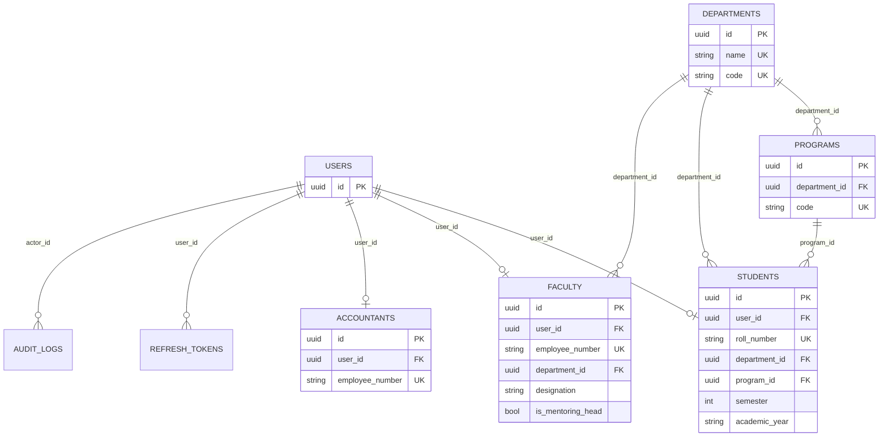

`faculty` additionally enforces **one HOD per department** via a partial unique index: `idx_unique_hod_per_dept ON faculty(department_id) WHERE designation='hod' AND deleted_at IS NULL`.

### 6.3.2 Subjects, Curriculum, Teaching Assignment

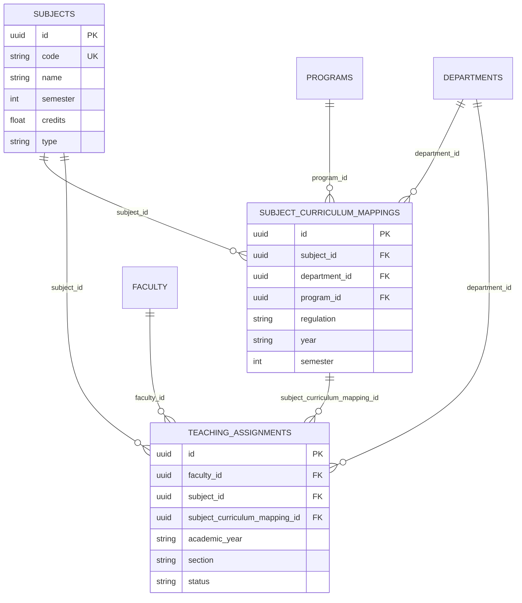

Note: `PROGRAMS ||--o{ SUBJECT_CURRICULUM_MAPPINGS` is nullable — the FK is `ON DELETE SET NULL`, not a hard dependency.

⚠ **Historical note**: `subjects` originally carried `department_id/program_id/program/regulation/year/semester_raw` directly (migrations 004→035); migration 038 moved all of that into `subject_curriculum_mappings`, leaving `subjects` with only `semester` plus catalog fields (credits, L/T/P hours, description, abbreviation). `faculty_subject_assignments` was renamed to `teaching_assignments` in migration 041, with a read-only compatibility **VIEW** kept under the old name so legacy queries still work.

`teaching_assignments` is the hub for nearly every academic transaction table — `attendance`, `internal_marks`, `exams`, `teaching_plans`, `course_materials`, `assignments`, `result_entry_tasks`, and `results` all carry a nullable `teaching_assignment_id` FK (added in migrations 042/043) in addition to their original direct `subject_id`/`faculty_id` FKs (kept for backward compatibility and denormalized query speed).

### 6.3.3 Attendance, Marks, Examinations, Results

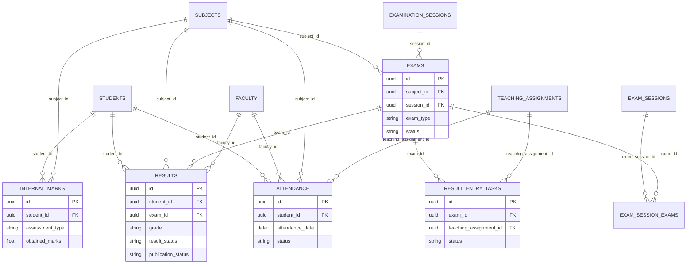

Note: `EXAMINATION_SESSIONS ||--o{ EXAMS` cascades on delete (`ON DELETE CASCADE`); `EXAMS ||--o{ RESULTS` is nullable (a result can exist without a linked exam row).

`attendance`, `internal_marks`, and `fee_payments` are **append-only ledgers with no `deleted_at`** — corrections happen via `UPDATE`, not soft-delete, preserving a single row per (student, subject, date)/(student, subject, assessment_type) unique constraint.

### 6.3.4 Fees

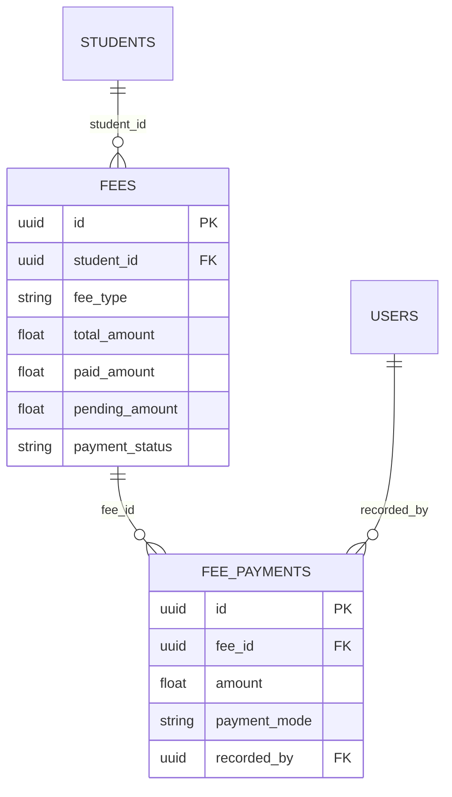

`fees` enforces `pending_amount = total_amount - paid_amount` and `paid_amount <= total_amount` via CHECK constraints — the database itself guarantees the "financial bounds" invariant described in the planning docs.

### 6.3.5 LMS

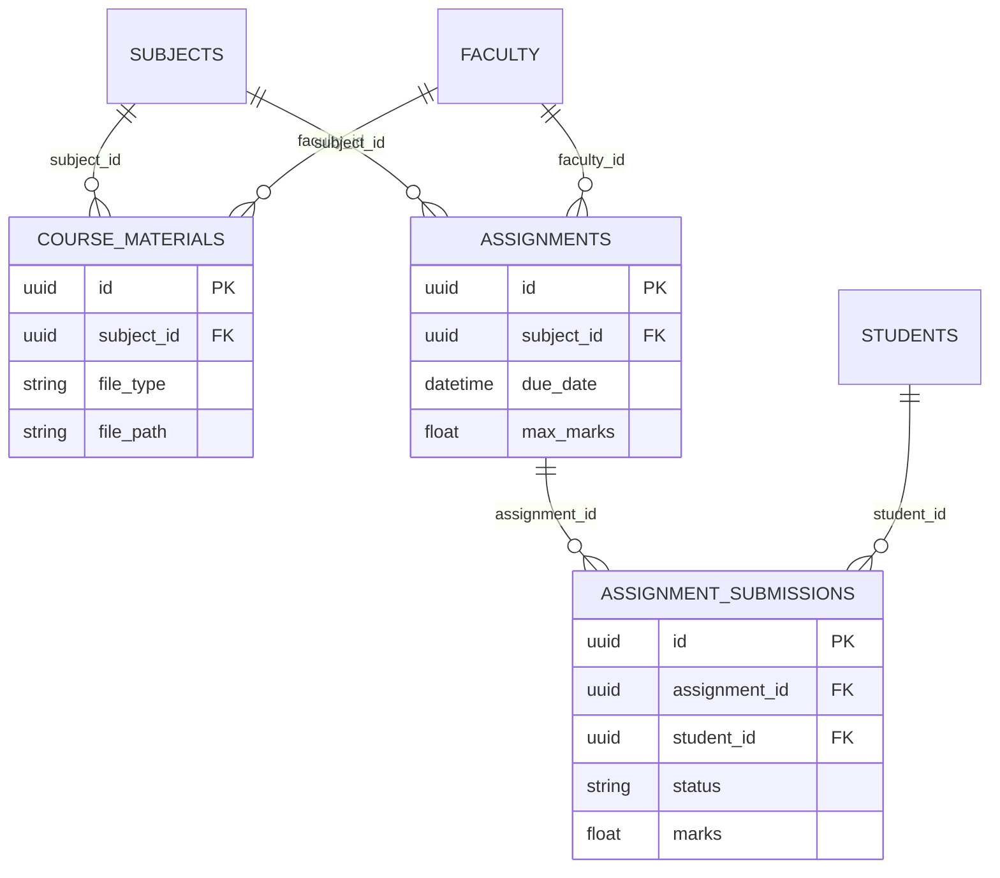

`assignment_submissions` has a unique partial index `(assignment_id, student_id) WHERE deleted_at IS NULL` — one active submission per student per assignment (resubmission soft-deletes the prior row).

### 6.3.6 Opportunity Hub, Notifications, Calendar

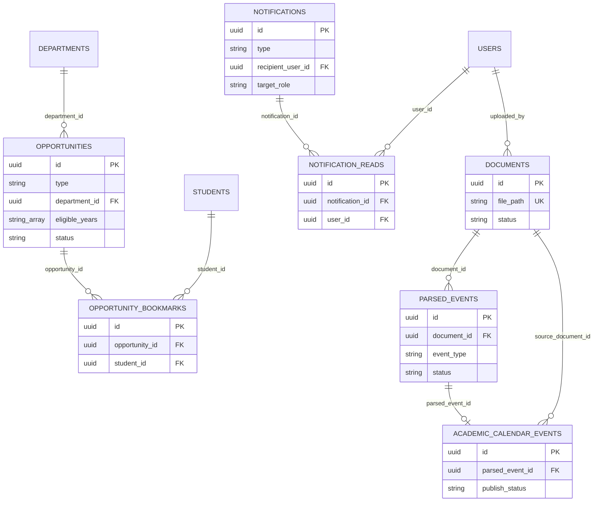

Note: `DEPARTMENTS ||--o{ OPPORTUNITIES` is nullable (`NULL` = visible to all departments); `PARSED_EVENTS ||--o| ACADEMIC_CALENDAR_EVENTS` is enforced as a unique FK (one live calendar event per parsed candidate).

`opportunity_bookmarks` and `notification_reads` are the two true **many-to-many join tables** in the schema (students↔opportunities, users↔notifications), both hard-delete-toggle (no `deleted_at`).

### 6.3.7 Mentorship

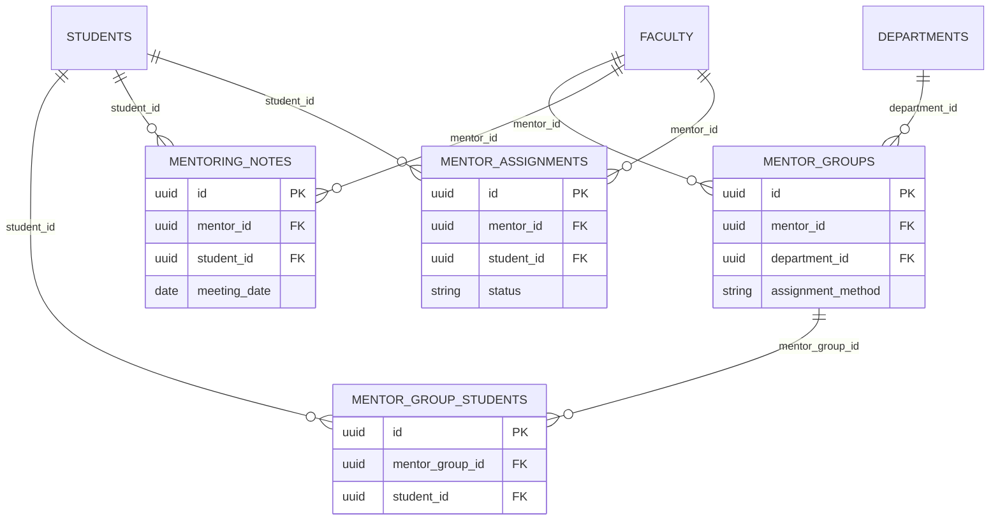

Note: `FACULTY ||--o{ MENTOR_ASSIGNMENTS` represents the legacy 1:1 mentorship model (migration 023).

`mentor_assignments` (legacy 1:1 model, migration 023) is superseded in practice by the group-based `mentor_groups`/`mentor_group_students` model (migration 024) but the table remains for backward compatibility. `idx_unique_active_mentee` enforces one active 1:1 mentor per student under the legacy model.

### 6.3.8 Teaching Plans (Lesson Progress Engine)

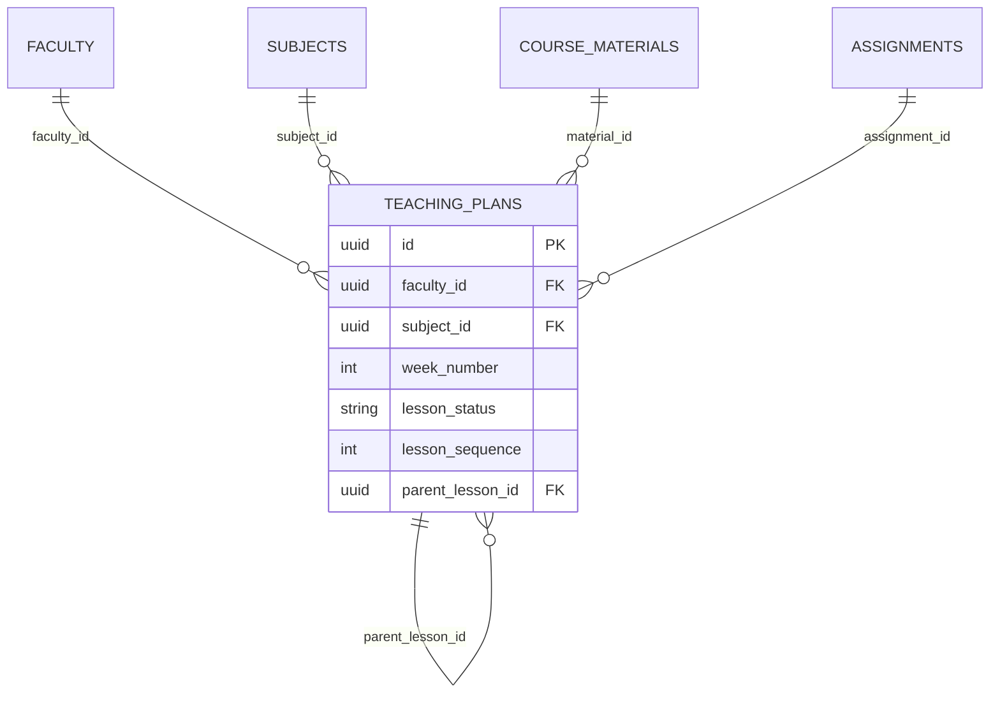

Note: `material_id` and `assignment_id` are nullable; `parent_lesson_id` is a self-referencing FK back to `TEACHING_PLANS`, used for "continuation" lessons when a topic runs over its planned session.

A unique partial index `(subject_id, section, semester, lesson_sequence) WHERE deleted_at IS NULL` enforces strict lesson ordering per class.

### 6.3.9 Feedback Campaigns

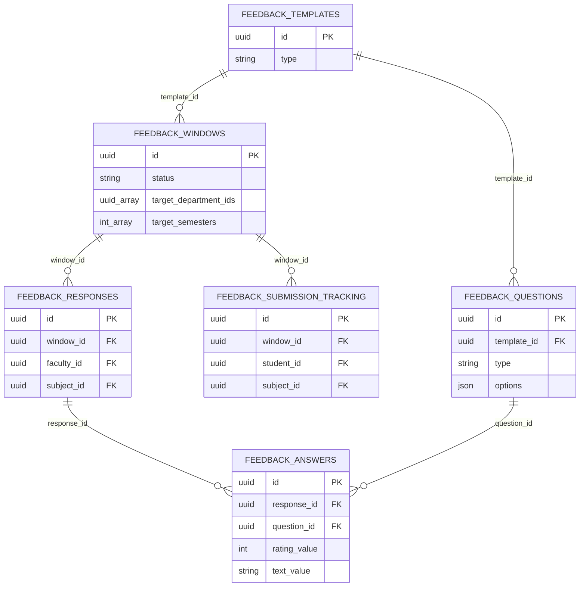

Note: `FEEDBACK_TEMPLATES ||--o{ FEEDBACK_QUESTIONS`, `FEEDBACK_WINDOWS ||--o{ FEEDBACK_SUBMISSION_TRACKING`, `FEEDBACK_WINDOWS ||--o{ FEEDBACK_RESPONSES`, and `FEEDBACK_RESPONSES ||--o{ FEEDBACK_ANSWERS` all cascade on delete (`ON DELETE CASCADE`).

Deliberate anonymity design: `feedback_responses`/`feedback_answers` carry **no `student_id`** — only `feedback_submission_tracking` links a student to a window (for one-submission-per-window dedup), while the actual answers are unlinkable back to the submitter.

### 6.3.10 Examination Seating, Invigilation, Rooms & Sessions

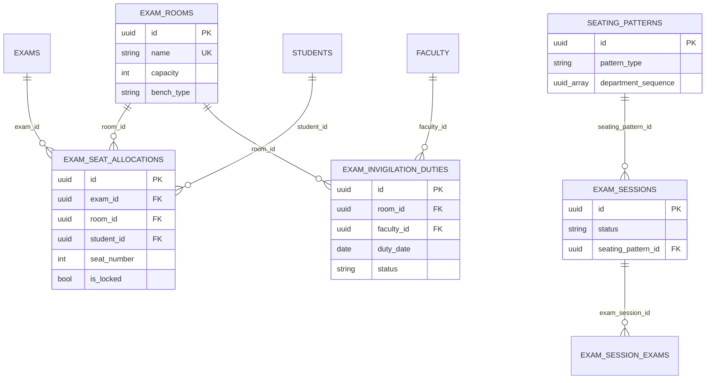

⚠ **Two distinct "session" concepts that read similarly but are different tables** — do not conflate them:
- `exam_sessions` (migration 030) is an **orchestration/config record** for bulk seating+invigilation generation across many exams at once; it joins to `exams` via the `exam_session_exams` many-to-many table, and its `status` uses the `exam_session_status` enum.
- `examination_sessions` (migration 040) is a **scheduling-batch container** that individual `exams` rows reference directly via `exams.session_id` (`ON DELETE CASCADE`). Its `status` is a plain `VARCHAR(30)`, not tied to any enum.

### 6.3.11 Timetable

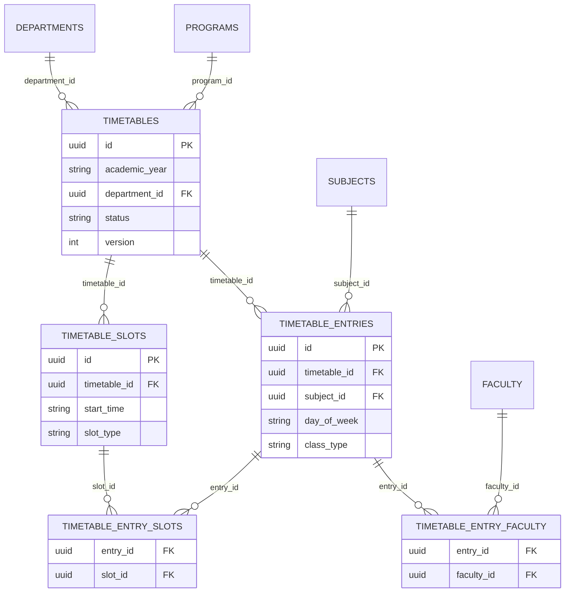

Note: `DEPARTMENTS ||--o{ TIMETABLES`, `TIMETABLES ||--o{ TIMETABLE_SLOTS`, `TIMETABLES ||--o{ TIMETABLE_ENTRIES`, and `SUBJECTS ||--o{ TIMETABLE_ENTRIES` all cascade on delete (`ON DELETE CASCADE`); `PROGRAMS ||--o{ TIMETABLES` is `ON DELETE SET NULL`.

`timetable_entry_slots` (supports merged/double periods) and `timetable_entry_faculty` (supports co-teaching) are both composite-PK many-to-many join tables — the newest module (migration 050) in the schema.

## 6.4 Full Table Inventory (60 tables + 1 view)

| # | Table | Domain | Key columns beyond id/timestamps | PK/Unique highlights |
|---|---|---|---|---|
| 1 | `users` | Identity | email UK, password_hash, role, is_active, is_super_admin, phone_number, last_login | partial idx on email where live |
| 2 | `refresh_tokens` | Identity | user_id FK, token_hash UK, expires_at, revoked_at | reuse-detection model, see [07](07-authentication-and-security.md) |
| 3 | `audit_logs` | Identity | actor_id FK, action, resource, resource_id, changes JSONB, ip_address INET | append-only |
| 4 | `departments` | Org | name UK, code UK, color | |
| 5 | `programs` | Org | department_id FK, code UK, total_semesters | UNIQUE(department_id, name) |
| 6 | `students` | Org | user_id UK FK, roll_number UK, department_id/program_id FK, semester, section, academic_year, status, mobile_number, gender, father_name, mother_name | composite partial idx (program_id, semester) for active students |
| 7 | `faculty` | Org | user_id UK FK, employee_number UK, department_id FK, designation, status, is_mentoring_head | partial unique: one HOD/department |
| 8 | `subjects` | Curriculum | code UK, name, semester, credits (NUMERIC 3,1), type (VARCHAR), lecture/tutorial/practical_hours, abbreviation | column relocation history, see §6.3.2 |
| 9 | `subject_curriculum_mappings` | Curriculum | subject_id FK (CASCADE), department_id FK, program_id FK (SET NULL), regulation, year, semester | UNIQUE(subject_id, department_id, program, regulation, year, semester) |
| 10 | `teaching_assignments` (renamed from `faculty_subject_assignments`) | Teaching | faculty_id/subject_id FK, academic_year, section, status, department_id, weekly_teaching_hours | UNIQUE(faculty_id, subject_id, academic_year, section); partial unique one-active-faculty-per-section |
| 11 | `attendance` | Academic ledger | student_id/faculty_id/subject_id FK, section, attendance_date, status, teaching_assignment_id | UNIQUE(student_id, subject_id, attendance_date); **no deleted_at** |
| 12 | `internal_marks` | Academic ledger | student_id/faculty_id/subject_id FK, assessment_type, maximum_marks, obtained_marks | UNIQUE(student_id, subject_id, assessment_type); **no deleted_at** |
| 13 | `exams` | Examination | subject_id FK, faculty_id FK (nullable), exam_type, exam_date/start/end (nullable), max_marks, status, session_id FK (CASCADE) | partial unique no-duplicate-active-exam |
| 14 | `results` | Examination | student_id/subject_id FK, exam_id FK (nullable), internal/external marks + max, total, grade, result_status, publication_status | UNIQUE(student_id, subject_id); 3 CHECKs incl. total=internal+external |
| 15 | `fees` | Finance | student_id FK, academic_year, semester, fee_type, total/paid/pending_amount, due_date, payment_status | 2 CHECKs enforce financial bounds |
| 16 | `fee_payments` | Finance ledger | fee_id FK, amount, payment_date, payment_mode, transaction_ref, recorded_by FK | append-only, no updated_at/deleted_at |
| 17 | `announcements` | Communication | title, content, target_audience, department_id (conditional), semester (conditional), priority, publish/expiry_date, status, created_by FK | 3 CHECKs enforce audience-field consistency |
| 18 | `documents` | Calendar pipeline | title, file_name, file_path UK, document_type, extracted_text, uploaded_by FK, status | |
| 19 | `parsed_events` | Calendar pipeline | document_id FK, title, start/end_date, event_type, target_audience, department_id, status | |
| 20 | `academic_calendar_events` | Calendar pipeline | parsed_event_id UK FK, source_document_id FK, publish_status, is_edited, created_by FK | unique partial: one live event per candidate |
| 21 | `course_materials` | LMS | title, subject_id/faculty_id FK, file_name/path UK, file_type, file_size, teaching_assignment_id | |
| 22 | `assignments` | LMS | title, subject_id/faculty_id FK, due_date, max_marks, teaching_assignment_id | |
| 23 | `assignment_submissions` | LMS | assignment_id/student_id FK, file_name/path UK, status, marks, feedback, submitted_at | unique partial: one active submission per (assignment, student) |
| 24 | `opportunities` | Placement | title, type, department_id (nullable=all), eligible_years TEXT[], deadline, status, created_by FK | CHECK date ordering; GIN idx on eligible_years |
| 25 | `opportunity_bookmarks` | Placement | opportunity_id/student_id FK | many-to-many join, unique pair |
| 26 | `notifications` | Communication | title, message, type, source_module/source_id (no FK), target_role, department_id, recipient_user_id FK | **no updated_at** |
| 27 | `notification_reads` | Communication | notification_id FK (CASCADE), user_id FK (CASCADE), read_at | many-to-many join, unique pair |
| 28 | `calendar_entries` | Calendar | title, event_type, start/end_date, visibility, source_module/source_id, department_id, room_id FK, created_by FK | unique partial on (source_module, source_id) |
| 29 | `accountants` | Org | user_id UK FK, employee_number UK, avatar_url | |
| 30 | `mentor_assignments` | Mentorship (legacy) | mentor_id/student_id FK, assigned_by FK, status | partial unique: one active mentee row |
| 31 | `mentoring_notes` | Mentorship | mentor_id/student_id FK, title, remarks, meeting_date, follow_up_date | |
| 32 | `mentor_groups` | Mentorship | mentor_id FK, department_id FK, year, semester, section, assignment_method, roll_number_start/end, created_by FK | |
| 33 | `mentor_group_students` | Mentorship | mentor_group_id FK (CASCADE), student_id FK (CASCADE) | many-to-many join |
| 34 | `teaching_plans` | Teaching | faculty_id/subject_id/department_id FK, year, semester, section, week_number, lesson_date, topic_title, material_id/assignment_id FK (nullable), lesson_status, lesson_sequence, parent_lesson_id (self-ref), teaching_assignment_id | unique partial on lesson sequence per class |
| 35 | `feedback_windows` | Feedback | title, academic_year, status (enum), template_id FK, target_department_ids/semesters/sections/subject_ids/faculty_ids arrays, published_at | |
| 36 | `feedback_templates` | Feedback | title, type, is_active | |
| 37 | `feedback_questions` | Feedback | template_id FK (CASCADE), text, type, options JSONB, order_index, is_required | |
| 38 | `feedback_submission_tracking` | Feedback | window_id FK (CASCADE), student_id FK (CASCADE), subject_id FK (CASCADE, nullable), feedback_type | UNIQUE(window,student,subject,type) — dedup only, no answer linkage |
| 39 | `feedback_responses` | Feedback | window_id/template_id FK, subject_id/faculty_id FK (CASCADE) | **anonymous — no student_id** |
| 40 | `feedback_answers` | Feedback | response_id FK (CASCADE), question_id FK, rating_value, text_value | |
| 41 | `workflow_rules` | Automation | name, trigger_event, condition JSONB, actions[] (CHECK non-empty), is_active, created_by FK | |
| 42 | `workflow_logs` | Automation | workflow_name, trigger_event, rule_id FK, action, actor_id FK, payload JSONB, status, retry_count | append-only |
| 43 | `exam_rooms` | Exam infra | name UK, building, capacity, floor, room_number, rows, columns, bench_type, under_maintenance | |
| 44 | `exam_seat_allocations` | Exam infra | exam_id/room_id/student_id FK, seat_number, bench_number, seat_position, is_locked, exam_session_id FK | 2 unique partial indexes (no double-booking) |
| 45 | `exam_invigilation_duties` | Exam infra | room_id/faculty_id FK, duty_date, start/end_time, status, assigned_by FK | unique partial: no double-assignment |
| 46 | `seating_patterns` | Exam infra | name, pattern_type, department_sequence UUID[], is_default, created_by FK | |
| 47 | `exam_sessions` | Exam infra | name, exam_type, department_ids[]/years[]/sections[]/exam_dates[]/subject_ids[]/classroom_ids[]/invigilator_ids[] arrays, seating_pattern_id FK, status | see §6.3.10 note |
| 48 | `exam_session_exams` | Exam infra | exam_session_id/exam_id FK | many-to-many join |
| 49 | `mentorship_settings` | Config | recommended/maximum_students_per_mentor, allow_cross_department, updated_by FK | single global row (not PK-enforced singleton) |
| 50 | `examination_sessions` | Exam infra | academic_year, regulation, department_id FK, year, semester, exam_type, sections[]/subject_ids[], status (VARCHAR) | see §6.3.10 note |
| 51 | `result_entry_tasks` | Examination | exam_id/teaching_assignment_id/faculty_id FK, status, window_opens/closes_at, submitted/published_at | UNIQUE(exam_id, teaching_assignment_id) |
| 52 | `teaching_assignment_backfill_exceptions` | Migration audit | source_table, source_id, faculty_id/subject_id (informational, no FK), reason | one-time migration audit table |
| 53 | `teaching_load_settings` | Config | theory/lab/tutorial_weight, min/max_weekly_load, min/max_subjects_per_faculty, auto_marks_window_days, require_result_verification | **true singleton** — `id SMALLINT PK DEFAULT 1 CHECK(id=1)` |
| 54 | `import_jobs` | Import engine | entity_type, status, file_name, total/valid/invalid/duplicate_rows, created/updated_count, mode, summary JSONB, created_by FK | |
| 55 | `timetables` | Timetable | academic_year, department_id FK (CASCADE), program_id FK (SET NULL), year, semester, section, status, working_days[], version, effective_from | |
| 56 | `timetable_slots` | Timetable | timetable_id FK (CASCADE), start/end_time, slot_type, sequence_order | no soft delete |
| 57 | `timetable_entries` | Timetable | timetable_id FK (CASCADE), day_of_week, subject_id FK (CASCADE), class_type | no soft delete |
| 58 | `timetable_entry_slots` | Timetable | entry_id/slot_id FK (both CASCADE) | composite PK join |
| 59 | `timetable_entry_faculty` | Timetable | entry_id FK (CASCADE), faculty_id FK (CASCADE) | composite PK join |
| 60 | `schema_migrations` | Meta | version PK, applied_at | maintained by `migrate.ts`, not a `.sql` file |
| — | `faculty_subject_assignments` (VIEW) | Compat | `SELECT * FROM teaching_assignments` | read-only backward-compat shim |

## 6.5 Soft Delete — Where It Applies and Where It Doesn't

Soft delete (`deleted_at`) is the default convention, but is **deliberately omitted** on immutable/ledger tables where a correction should be a new row or an in-place `UPDATE`, not a delete: `attendance`, `internal_marks`, `fee_payments`, `notifications` (has `deleted_at` but no `updated_at`), `opportunity_bookmarks`, `exam_seat_allocations` (has `deleted_at` but no `updated_at` — regeneration soft-deletes prior allocations), `timetable_slots`, `timetable_entries`, `workflow_logs`, `import_jobs`, `teaching_load_settings`, `mentorship_settings`. This matches the "audit-first, append where possible" philosophy documented in `BUSINESS_RULES_AND_WORKFLOWS.md`.

## 6.6 Normalization & Design Notes

1. **Denormalization by explicit design** (documented in SQL comments): `exams.semester` duplicates `subjects.semester` for query speed; `teaching_plans.department_id/year/semester` duplicate the subject/curriculum placement; `results.internal_max_marks`/`external_max_marks` are stored per-row rather than derived from `subjects`, so historical grading-scheme changes don't retroactively alter published results.
2. **Column relocation**: curriculum-placement columns moved from `subjects` to `subject_curriculum_mappings` (migration 038) once it became clear a subject can be taught under multiple department/program/regulation/year/semester combinations — a genuine normalization improvement made mid-project.
3. **Rename with compatibility shim**: `faculty_subject_assignments` → `teaching_assignments` (migration 041), old name preserved as a VIEW.
4. **Singleton config tables**: `teaching_load_settings` (DB-enforced via `CHECK(id=1)`), `mentorship_settings` (convention-only, not DB-enforced).
5. **Two similarly-named but distinct entities**: `exam_sessions` vs. `examination_sessions` — see §6.3.10. Any new work on exam scheduling should first determine which of the two a given feature actually needs.
6. **Un-typed cross-module references**: `notifications.source_module`/`source_id`, `calendar_entries.source_module`/`source_id`, and `seating_patterns.department_sequence` (a UUID array with no DB-level FK) are intentional "soft" references — the application layer, not the database, guarantees referential integrity for these. This trades DB-enforced consistency for schema flexibility across many source modules.

Full relationship-by-relationship listing (for anyone building a complete ER tool import) is embedded in the per-domain diagrams in §6.3; the domain groupings above are exhaustive across all 60 tables.


# 7. Authentication, Authorization & Security

← [Back to Index](00-INDEX.md)

## 7.1 Login Flow

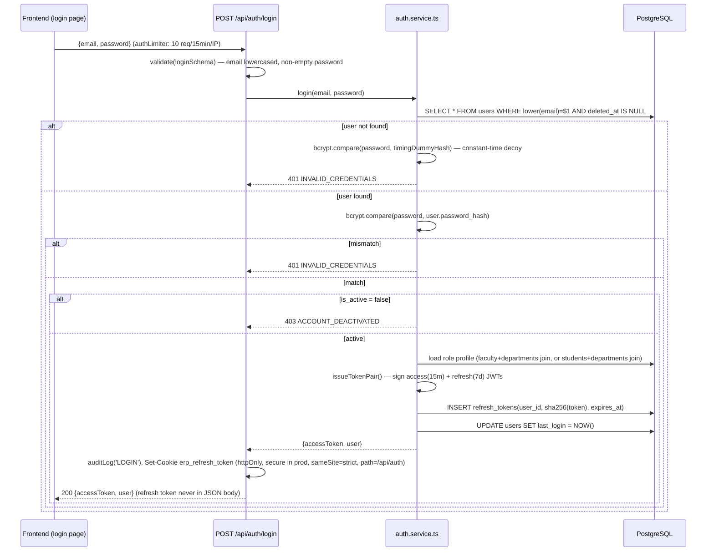

**Timing-attack mitigation**: when the email doesn't exist, the service still performs a `bcrypt.compare` against a lazily-computed dummy hash, so the response latency for "no such user" and "wrong password" is indistinguishable.

## 7.2 JWT Design

| Property | Access Token | Refresh Token |
|---|---|---|
| Secret | `JWT_ACCESS_SECRET` (min 32 chars, Zod-enforced) | `JWT_REFRESH_SECRET` (separate secret, min 32 chars) |
| TTL (default) | 15 minutes | 7 days |
| Algorithm | HS256 (implicit — plain string secret, no algorithm pinned) | HS256 |
| Payload claims | `sub` (user id), `email`, `role`, `designation?`, `departmentId?`, `facultyId?`, `studentId?`, `isSuperAdmin?` | `sub`, `tokenId` (uuid, currently vestigial — lookup is by hash, not this id) |
| Delivered via | JSON response body | httpOnly cookie only (`erp_refresh_token`, `path=/api/auth`) |
| Storage on server | Not stored (stateless verification) | `sha256(token)` hash stored in `refresh_tokens` table — raw token never persisted |
| Verification | `authenticate` middleware on every request — **claims trusted directly, no DB re-check per request** | Only checked at `/auth/refresh` |

⚠ **Design implication**: because the access token embeds `role`/`departmentId`/`isSuperAdmin` etc. and `authenticate.ts` trusts those claims for up to 15 minutes without re-querying the DB, a role change, deactivation, or HOD reassignment made by an admin will not take effect for an already-issued access token until it expires or the user re-authenticates. `GET /api/auth/me` is deliberately the one exception — it always re-fetches from the DB "so the response reflects live state rather than potentially stale JWT claims."

## 7.3 Refresh Token Rotation & Reuse Detection

On `POST /api/auth/refresh`:
1. Verify the refresh JWT's signature/expiry (fails fast, no DB hit if invalid).
2. Hash the token, look up `refresh_tokens` joined to `users` by `(token_hash, user_id)`.
3. Not found → `401 TOKEN_INVALID`.
4. `expires_at` in the past → `401 TOKEN_EXPIRED`.
5. **Reuse detection**: if `revoked_at IS NOT NULL` (this exact token was already consumed once) → treat as a stolen/replayed token: revoke **every** active refresh token for that user (`UPDATE refresh_tokens SET revoked_at=NOW() WHERE user_id=$1 AND revoked_at IS NULL`), throw `401 TOKEN_REUSED`. This is the standard refresh-token-rotation-with-reuse-detection pattern and forces re-login on all devices if a stolen token is ever replayed.
6. Account deactivated → `403 ACCOUNT_DEACTIVATED`.
7. Otherwise: revoke the just-consumed token, issue a brand-new access+refresh pair (inserting a new `refresh_tokens` row), set the rotated cookie.

`logout()` revokes just the one token matching the presented cookie. `logout-all` (`POST /api/auth/logout-all`, requires a valid access token) revokes every active token for the current user — used after password changes (`profile.service.ts`'s `changePassword` calls this implicitly by design intent, invalidating all other sessions).

⚠ **Gap**: no scheduled job purges expired/revoked `refresh_tokens` rows — the table grows unbounded over the system's lifetime (see [12](12-performance-error-handling-workflow.md) and [15](15-future-and-appendix.md)).

## 7.4 Password Handling

- **Hashing**: `bcryptjs` (pure-JS, not native `bcrypt`), cost factor from `env.BCRYPT_ROUNDS` (Zod-bounded 10–14, default **12**).
- **Strength policy** (`utils/validation.ts`, enforced at set-time — registration/reset/change-password, **not** at login): minimum 8 characters, must include upper, lower, digit, and one of `@$!%*?&`.
- **Change password** (`PUT /api/profile/change-password`) invalidates all sessions (revokes all refresh tokens) — forces re-login everywhere after a password change, a defensible security default.
- No account-lockout-after-N-failed-attempts mechanism exists; brute-force mitigation is purely IP-based rate limiting (`authLimiter`, 10 req/15min) — see §7.7.

## 7.5 Authorization Model

Two authorization idioms coexist in the codebase:

### 7.5.1 Coarse role check — `requireRole(...roles)`
Simple allowlist against `req.user.role` (`admin | faculty | student | accountant`). Used on the majority of routes.

### 7.5.2 Fine-grained permission check — `authorize(...permissions)`
Checks a static `PERMISSIONS` map (`backend/src/types/roles.ts`) of `resource:action → allowed roles[]`. Full matrix in [01-overview-and-vision.md](01-overview-and-vision.md) §3. This is **not** a database-driven ACL — it's a compiled-in TypeScript constant, so changing permissions requires a code change and redeploy, not a config update. (The Workflow Rule engine is the one place end-users can configure system behavior without a redeploy — see [08-modules.md](08-modules.md) §Workflow Engine.)

### 7.5.3 Capability flags (not roles, used for scoping)
- `users.is_super_admin` — gates `requireSuperAdmin()`, used solely for Workflow Rule CRUD (`/api/workflow/rules*`).
- `faculty.designation = 'hod'` — DB-enforced one-per-department; used at the **service** layer (not route middleware) to scope Faculty Operations/Dashboard/Analytics `hod` variants — the route itself only requires `requireRole('faculty')`.
- `faculty.is_mentoring_head` — grants department-wide mentorship management via `authorizeMentoringHead` (checked live: `SELECT is_mentoring_head FROM faculty WHERE user_id=$1`).

### 7.5.4 Record-level authorization — `middleware/mentorshipAuth.ts`
The **only** module with genuinely record-level (not just role-level) authorization, entirely DB-backed:

| Guard | Logic |
|---|---|
| `authorizeMentoringHead` | admin, or faculty where `is_mentoring_head=true` |
| `authorizeStudentMentorshipAccess(source, field)` | Factory pulling `studentId` from params/body/query. Permits: admin (full); the student themself (self-access only, matched via `students.user_id`); mentoring head (full); or a faculty member with an active mentor-group membership over that specific student (checked via `mentorGroup.service.getAllGroupMemberships`) |
| `authorizeNoteAccess` | admin; mentoring head; or the specific faculty who is `mentor_id` on that `mentoring_notes` row (ownership check) |

⚠ **Gap**: broader department-scoped authorization (e.g., "an HOD can only manage their own department's data") is **not** implemented as a generic, reusable middleware anywhere else in the codebase — it is handled ad hoc inside individual controllers/services using the `departmentId` embedded in the JWT, on a module-by-module basis. A reviewer auditing a new HOD-scoped feature should verify this scoping was actually implemented in that feature's service layer, since there's no framework-level guarantee.

## 7.6 Validation Middleware

`middleware/validate.ts` wraps per-route Zod schemas (`validate({body?, params?, query?})`); on `ZodError`, joins all field errors into one message and throws `AppError.badRequest(msg, 'VALIDATION_ERROR')`. Every domain has its own schemas under `backend/src/types/*.ts` (e.g. `createStudentSchema`, `listAttendanceQuerySchema`).

## 7.7 Rate Limiting

| Limiter | Scope | Window | Max | Response on exceed |
|---|---|---|---|---|
| `globalLimiter` | Every `/api/*` request | 15 min | 1000 req/IP | 429 `RATE_LIMIT_EXCEEDED` |
| `authLimiter` | `POST /api/auth/login` only | 15 min | 10 req/IP | 429 `AUTH_RATE_LIMITED` |

Both use `express-rate-limit` with `standardHeaders: true, legacyHeaders: false`. ⚠ `env.RATE_LIMIT_WINDOW_MS`/`RATE_LIMIT_MAX` are defined in the Zod env schema and documented in `.env.example` but **not actually referenced** by either limiter (both hardcode their values) — a latent config/documentation mismatch.

## 7.8 Protected Routes & Middleware Chain

Standard chain per protected endpoint: `authenticate` → (`requireRole(...)` or `authorize(...)` or a `mentorshipAuth` guard) → `validate({...})` → controller. `backend/src/routes/protected.routes.ts` (mounted at `/api/example`) is a **non-business reference implementation** demonstrating all 6 patterns (public / authenticated-only / `requireRole('admin')` / `requireRole('admin','faculty')` / `authorize('attendance:create')` / `requireRole('student')`) — useful as a template when adding a new route, not part of the real API surface.

## 7.9 Authorization Hierarchy Summary

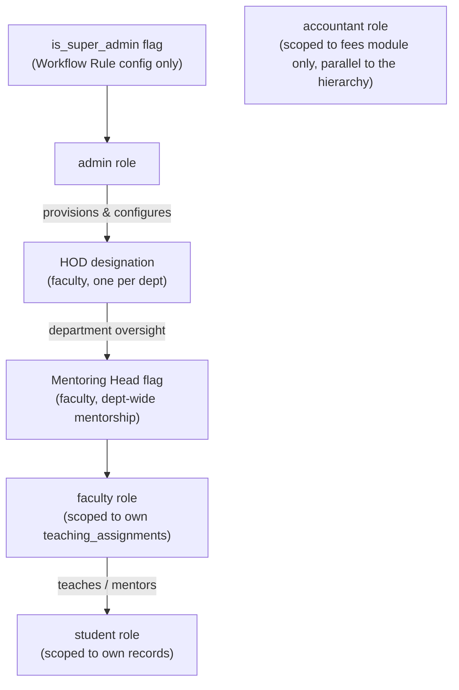

## 7.10 Security Considerations (OWASP-oriented)

| Concern | Mitigation in place | Gap / note |
|---|---|---|
| SQL Injection | 100% parameterized queries via `pg` (`$1,$2,...`) — no string-concatenated SQL found in the researched services | No ORM means discipline-dependent; a future contributor could introduce a vulnerable query without a linter catching it (no static SQL-injection lint rule configured) |
| XSS | React's default JSX escaping; no `dangerouslySetInnerHTML` usage found in the researched components | No CSP configured beyond `helmet()` defaults; `helmet()` does not set a custom Content-Security-Policy tailored to this app |
| CSRF | `sameSite: 'strict'` on the refresh cookie; access token is sent via `Authorization` header (not a cookie), which is inherently not subject to classic CSRF | No explicit CSRF token/double-submit-cookie pattern — acceptable given the auth token isn't cookie-based, but the refresh endpoint itself relies solely on `sameSite` |
| Mass assignment | Zod schemas whitelist accepted fields per endpoint | Decentralized — each schema must be manually kept in sync with the table; no automatic field-allowlist generation |
| File upload | MIME + extension allowlist (`upload.ts`/`uploadLms.ts`), 20MB size cap, randomized filenames (`uuidv4()`) prevent path traversal / overwrite | No virus/malware scanning of uploaded files; PDF-only and Office-doc-only allowlists reduce but don't eliminate risk |
| Rate limiting / brute force | `authLimiter` on login, `globalLimiter` app-wide | No account lockout; no CAPTCHA; no anomaly detection |
| Secrets management | `.env` + Zod validation, `.env.example` documents required vars, `.gitignore` presumably excludes `.env` | No secrets manager (Vault/AWS Secrets Manager) — expected for current project scale, flagged for production hardening |
| Realtime channel auth | Socket.IO handshake includes `{token: accessToken}` | ⚠ No route file shows explicit server-side socket handshake verification — `eventBus.service.ts`/`server.ts` were not found to validate the token against `verifyAccessToken` before allowing a socket connection; **this should be verified/hardened** as a priority security item |
| Audit trail | `audit_logs` (login/logout-all + presumably other mutating actions call `auditLog()`), `workflow_logs` (automation execution trail) | Coverage is not exhaustive — not every mutating endpoint was confirmed to call `auditLog()`; a systematic audit-coverage review is recommended |
| Data privacy | `studentImport.strategy.ts` explicitly excludes privacy-sensitive columns (e.g. Aadhaar) from ignored-but-recognized import columns | No field-level masking of phone numbers/addresses in API responses was confirmed in the research pass — recommend a follow-up review against the "Data Privacy" requirements in `project_vision_and_requirements.md` §7 |
| Transport security | `helmet()`, cookie `secure: NODE_ENV==='production'` | HTTPS/TLS termination itself is a deployment concern — no deployment config exists yet (see [13](13-deployment-config-dependencies.md)) |

## 7.11 Roles Recap

Full permission matrix: [01-overview-and-vision.md](01-overview-and-vision.md) §3. Full per-endpoint auth requirements: [09-api-documentation.md](09-api-documentation.md).


# 8. Module Documentation

← [Back to Index](00-INDEX.md)

Each module below follows the same structure: **Purpose · Architecture/Workflow · Backend · Frontend · Database · Dependencies/Relationships · Future Improvements**. Full endpoint listings are in [09-api-documentation.md](09-api-documentation.md); full table schemas in [06-database.md](06-database.md).

---

## 8.1 Identity & Access (Authentication, Users, Roles)

- **Purpose**: Central login/session management and the 4-role RBAC foundation every other module depends on.
- **Workflow**: Login → JWT issuance → per-request stateless verification → refresh rotation → logout/logout-all. Full detail: [07-authentication-and-security.md](07-authentication-and-security.md).
- **Backend**: `auth.routes/controller/service.ts`, `user.service.ts` (shared user-lookup/creation helper reused by Student/Faculty/Accountant provisioning), `middleware/authenticate.ts`, `middleware/authorize.ts`.
- **Frontend**: `app/page.tsx` (login), `context/AuthContext.tsx`, `lib/api.ts`.
- **Database**: `users`, `refresh_tokens`, `audit_logs`.
- **Dependencies**: Everything downstream depends on this module; it has no upstream dependency itself.
- **Future improvements**: MFA, account lockout after N failed attempts, session-device listing/revocation UI.

## 8.2 Student Management

- **Purpose**: Full student record lifecycle — profile, department/program/semester/section placement, status (active/graduated/suspended/inactive).
- **Workflow**: Admin creates a student (auto-provisions a `users` row + `students` row) → student can self-view via `/students/me` → admin updates placement/status over time → soft-delete on exit.
- **Backend**: `students.routes.ts`, `student.controller.ts`, `student.service.ts`, `studentSync.service.ts` (Academic Import's "Student Placement Sync" flow), `registries/studentRegistry.service.ts` (canonical identity lookup used by ~20 other modules).
- **Frontend**: `app/admin/students`, `app/hod/students`, `StudentFormDrawer.tsx`, `hooks/useRegistry.ts`'s `useStudents`.
- **Database**: `students` (see [06-database.md](06-database.md) #6).
- **Relationships**: Feeds Attendance, Internal Marks, Results, Fees, LMS Submissions, Mentorship, Opportunity Bookmarks, Exam Seating, Timetable (via section), Feedback.
- **Future improvements**: Parent portal linkage, formal transfer/lateral-entry workflow (only status enum exists today, no dedicated transfer/backlog tracking table).

## 8.3 Faculty Management & Faculty Operations Center

- **Purpose**: Faculty profile lifecycle plus a consolidated "Operations Center" workspace (today's tasks, workload, daily status, workflow-log audit view).
- **Workflow**: Admin onboards faculty (designation assigned, e.g. `hod` is DB-uniqueness-enforced per department) → faculty logs in to a dashboard aggregating tasks across every module they're assigned to.
- **Backend**: `faculty.routes/controller/service.ts`; `facultyOperations.routes/controller/service.ts` + `facultyDailyStatus.service.ts`/`facultyTasks.service.ts`/`facultyWorkload.service.ts`; `registries/facultyRegistry.service.ts`.
- **Frontend**: `app/admin/faculty`, `app/hod/faculty`, `app/faculty/dashboard`, `FacultyFormDrawer.tsx`/`FacultyDeleteModal.tsx`, `components/UXL/*` (ActionCenter, TodayFocus, SmartProgressCard — heavy use on HOD/Faculty dashboards).
- **Database**: `faculty` (see [06](06-database.md) #7).
- **Relationships**: Every teaching-related module (Attendance, Internal Marks, Exams, LMS, Teaching Plans, Result Entry Tasks) resolves faculty via `teachingAssignmentRegistry` rather than the raw table.
- **Future improvements**: Leave-of-absence / substitution workflow described in planning docs is **not implemented** as a distinct state machine — status enum has `on_leave` but no substitution-handover automation exists.

## 8.4 Accountant Management & Fees

- **Purpose**: Fee invoicing and payment recording for students; Accountant is the narrowest-scoped role (2 frontend routes only).
- **Workflow**: Admin/Accountant bulk-creates fee invoices for a program or explicit student list → student views dues → accountant records a payment (partial or full) → `payment_status` auto-transitions (Pending→Partially Paid→Paid) via DB CHECK-consistent `pending_amount` math.
- **Backend**: `accountant.routes/controller/service.ts`, `fee.routes/controller/service.ts`.
- **Frontend**: `app/accountant/{dashboard,fees}`, `app/admin/fees`, `app/student/fees`.
- **Database**: `accountants`, `fees`, `fee_payments` (see [06](06-database.md) #15–16, #29).
- **Relationships**: Planning docs describe Fee clearance as an Exam-eligibility gate — **not enforced in code**: no query in the researched Examination/Result services checks `fees.payment_status` before hall-ticket/seat-allocation generation (see [11-business-logic-and-sync-matrix.md](11-business-logic-and-sync-matrix.md) for the full gap analysis).
- **Future improvements**: Online payment gateway integration (currently 100% manual entry, by original MVP design — see `MVP_DEFINITION_AND_DEVELOPMENT_ROADMAP.md` §9), automated late-fee application (schema has `payment_status='Overdue'` but no scheduler computes it — see §8.20 Workflow Engine and [12](12-performance-error-handling-workflow.md)).

## 8.5 Departments & Programs (Organizational Structure)

- **Purpose**: Foundational org units — every Student/Faculty/Subject-mapping/Timetable/Opportunity/Announcement scopes to a department; Programs scope degree tracks within a department.
- **Backend**: `departments.routes.ts`, `department.controller/service.ts`; `registries/academicRegistry.service.ts` (TTL-cached facade).
- **Frontend**: Read via dropdowns across nearly every admin/HOD form; color-coding configurable per department (`PUT /departments/:id/color`, used by Exam Seating's visual chart).
- **Database**: `departments`, `programs` (see [06](06-database.md) #4–5).
- **Relationships**: Upstream of nearly everything — see the Synchronization Matrix in [11](11-business-logic-and-sync-matrix.md).

## 8.6 Subjects & Curriculum Mapping

- **Purpose**: The subject catalog (course metadata: credits, L-T-P hours, type) plus the curriculum-placement join (which department/program/regulation/year/semester a subject belongs to) — the single source of truth all downstream academic modules interface with (per `walkthrough.md`).
- **Workflow**: Admin creates/edits subjects and curriculum mappings directly, or bulk-imports via Excel/CSV (`subjectImport.service.ts` — fuzzy department-name matching, e.g. "AI & ML"/"AI/ML"/"CSE" → DB codes) → soft-delete is guarded: the service checks for active allocations/attendance/marks/results/teaching-plans/LMS-materials referencing the subject before allowing deactivation.
- **Backend**: `subjects.routes.ts`, `subject.controller/service.ts`, `subjectImport.service.ts`, `export.service.ts` (shared exporter).
- **Frontend**: `app/admin/subjects` (`SubjectCatalogManager.tsx` — metrics grid, filters, import/export, bulk-wipe with confirmation), `app/admin/courses` (Curriculum Scheme Configurator — year/semester tree with allocation status).
- **Database**: `subjects`, `subject_curriculum_mappings` (see [06](06-database.md) #8–9).
- **Relationships**: Feeds Teaching Assignment, Attendance, Internal Marks, Exams, Results, LMS, Teaching Plans, Timetable, Feedback.
- **Future improvements**: Prerequisite-chain enforcement described in planning docs is not implemented (no `prerequisite_subject_id` column exists).

## 8.7 Teaching Assignment

- **Purpose**: Maps a faculty member to a subject+section+academic-year — the hub every per-class transactional module (Attendance/Marks/Exams/LMS/Teaching-Plans/Result-Entry-Tasks) hangs off of via `teaching_assignment_id`.
- **Workflow**: Admin creates an assignment (validated against `subject_curriculum_mappings`) → a partial unique index prevents two active faculty owning the same subject+year+section simultaneously → `transferAllocation`/`transferTeachingAssignment` reassigns ownership mid-semester (faculty resignation/substitution scenario) with `removed_by`/`removal_reason` audit columns.
- **Backend**: `teachingAssignment.routes/controller/service.ts` (canonical), `subjectAllocation.routes/controller/service.ts` (**deprecated** — zero-logic re-export, kept for backward compatibility), `assignment.service.ts` (legacy resolution helper still used by 4 other modules), `registries/teachingAssignmentRegistry.service.ts` (the canonical `resolveTeachingAssignmentId`/`isFacultyAssigned` check used everywhere).
- **Frontend**: `app/admin/subject-allocations`, `app/hod/subject-allocations` (`AllocationManager.tsx`).
- **Database**: `teaching_assignments` (renamed from `faculty_subject_assignments`, compat VIEW retained — see [06](06-database.md) #10).
- **Relationships**: This is the most heavily depended-upon table in the schema — 8 other tables carry a `teaching_assignment_id` FK.
- **Future improvements**: `academic_session_id` column exists but has no FK (deliberate placeholder for a future formal "Academic Session" entity — currently `academic_year` is just a string on several tables).

## 8.8 Attendance

- **Purpose**: Per-session present/absent recording per student per subject; real-time cumulative percentage exposed to students.
- **Workflow**: Admin defines an "assignment" (attendance-taking scope) → faculty pulls the roster → marks attendance (upsert per session, `UNIQUE(student_id, subject_id, attendance_date)`) → student views summary/history.
- **Backend**: `attendance.routes.ts`, `attendance.controller/service.ts`.
- **Frontend**: `app/faculty/attendance` (roster + Present/Absent/Late touch UI per `UI_UX_BLUEPRINT.md`), `app/student/attendance`, `app/admin/attendance`, `app/hod/attendance`.
- **Database**: `attendance` — **no soft delete**, immutable ledger, corrected via `UPDATE` (see [06](06-database.md) #11).
- **Relationships**: Read by Analytics/Reports/Dashboard/Experience-timeline modules; realtime-pushed via `ATTENDANCE_UPDATED` Socket.IO event.
- ⚠ **Gap vs. planning docs**: the documented "48-hour correction window with HOD approval" (`BUSINESS_RULES_AND_WORKFLOWS.md` §4) and "medical/sports leave denominator adjustment" are **not implemented** — the schema has no correction-window timestamp, approval-request table, or leave-adjustment mechanism; corrections are a direct `PATCH /attendance/:id` with role-based access only (admin/faculty), no maker-checker gate.
- **Future improvements**: implement the documented approval-based correction workflow using the existing Workflow Engine primitives (§8.20).

## 8.9 Internal Marks (Assessments)

- **Purpose**: Records internal assessment scores (Assignment/Mid-1/Mid-2/Lab/Internal types) separate from final Examination results.
- **Backend**: `internal-marks.routes.ts`, `internal-marks.controller/service.ts`.
- **Frontend**: `app/faculty/grades` (bulk entry grid).
- **Database**: `internal_marks` — no soft delete, `UNIQUE(student_id, subject_id, assessment_type)` (see [06](06-database.md) #12).
- **Relationships**: Feeds `results.internal_marks` (via the Results module, not a DB FK — computed/copied at result-creation time).

## 8.10 Examinations (Scheduling, Sessions, Rooms, Seating, Invigilation)

- **Purpose**: The largest single functional family — exam definition, batch scheduling ("examination sessions"), seat allocation, invigilation duty assignment, and conflict detection.
- **Workflow** (orchestration lifecycle via `exam_sessions`/`examSession.routes.ts`): draft → resolve constituent exams → check-conflicts (dry run) → generate seating → generate invigilation → validate → publish → complete → archive.
- **Backend**: `examination.routes/controller/service.ts` (exam CRUD + `examination_sessions` batch scheduling); `examRoom.routes/controller/service.ts` (+ `resourceAvailability.service.ts`, shared availability engine); `examSeating.routes/controller/service.ts` (generate/swap/move/lock/search/analytics); `examInvigilation.routes/controller/service.ts` (generate/suggest/reassign); `examSession.routes/controller/service.ts` (the orchestration layer above); `seatingPattern.routes/controller/service.ts` (department-sequencing templates for seat generation).
- **Frontend**: `app/admin/examinations`, `app/admin/seating` + `app/faculty/invigilation` (`components/Seating/*`), `app/student/examinations`/`app/student/seating`.
- **Database**: `exams`, `examination_sessions`, `exam_sessions`, `exam_session_exams`, `exam_rooms`, `exam_seat_allocations`, `exam_invigilation_duties`, `seating_patterns` (see [06](06-database.md) §6.3.10 for the "two session tables" caveat).
- **Relationships**: Feeds Results (via `exam_id`), Result Entry Tasks, Reports (room-seating-chart, invigilator-sheet, seating-summary print center).
- **Future improvements**: no automated hall-ticket eligibility gate against attendance % or fee clearance was found (see §8.4 and [11](11-business-logic-and-sync-matrix.md)).

## 8.11 Results & Result Entry Tasks

- **Purpose**: Final grade computation and a **task-based approval workflow** for entering/verifying/publishing results per teaching assignment (replacing free-form subject-picking with a driven task queue).
- **Workflow**: `result_entry_tasks` created per (exam, teaching_assignment) → faculty saves a draft (`POST /tasks/:taskId/draft`) → submits for approval (`submitTaskForApproval`) → a verifier approves (`verifyResultEntryTask`) → admin bulk-publishes (`publishResults`) which flips `results.publication_status` Draft→Published and stamps `published_at`. Grade/pass-fail is computed via `config/grading.ts`'s pure functions against `total_marks = internal_marks + external_marks` (DB CHECK-enforced consistency).
- **Backend**: `result.routes/controller/service.ts`, `resultEntryTask.routes/controller/service.ts`, `workflowEngine.service.ts` (drives the submit→verify chain's audit trail).
- **Frontend**: `app/faculty/results`, `app/admin/results`, `app/student/results` (`FacultyGrades` component family).
- **Database**: `results`, `result_entry_tasks` (see [06](06-database.md) #14, #51).
- **Relationships**: Consumes `exams`, `teaching_assignments`; feeds Analytics/Reports/Student dashboard; a `marks.published` workflow-trigger event exists in the Workflow Engine's enum, wiring result publication to configurable notifications.
- **Future improvements**: Revaluation and Supplementary-exam workflows described in planning docs (`BUSINESS_RULES_AND_WORKFLOWS.md` §7) have **no dedicated schema support** (no `revaluation_requests` table, no grade-history versioning) — a published result can only be corrected via a direct `PATCH`, which recomputes grade/status but leaves no distinct "revaluation" audit trail beyond the generic `audit_logs`.

## 8.12 Timetable

- **Purpose**: The newest module in the schema (migration 050) — weekly class scheduling per department/program/year/semester/section, with slot definitions, merged/double-period support, and co-teaching support.
- **Workflow**: Admin defines a timetable shell (working days, slots) → adds entries (subject × day × class-type) → links entries to one-or-more slots (merged periods) and one-or-more faculty (co-teaching) → validates input → publishes (status draft→validated→published→archived, versioned).
- **Backend**: `timetable.routes/controller/service.ts`.
- **Frontend**: `app/admin/timetables`, `app/faculty/timetable`, `app/student/timetable`, `app/hod/classes`.
- **Database**: `timetables`, `timetable_slots`, `timetable_entries`, `timetable_entry_slots`, `timetable_entry_faculty` (see [06](06-database.md) §6.3.11).
- **Relationships**: Realtime-pushed (Socket.IO) alongside Attendance/Teaching-Plan/Exam-Seating changes.
- ⚠ **Gap vs. planning docs**: automated scheduling-conflict detection across faculty/room double-booking was an explicit MVP exclusion (`MVP_DEFINITION_AND_DEVELOPMENT_ROADMAP.md` §9) and the `POST /timetables/validate-input` endpoint appears to be a structural pre-check, not a full conflict solver — should be verified against actual `timetable.service.ts` logic if conflict-free scheduling is a hard requirement going forward.

## 8.13 LMS (Learning Management)

- **Purpose**: Course materials distribution, assignment posting, and student submission/grading.
- **Backend**: `material.routes/controller/service.ts` (upload/download course materials via `uploadLmsFile`), `lmsAssignment.routes/controller/service.ts`, `lmsSubmission.routes/controller/service.ts` (student upload + faculty grading).
- **Frontend**: `app/faculty/lms/[subjectId]`, `app/student/lms/[subjectId]`, `app/admin/lms/[subjectId]`, `components/LMS/{LMSDashboard,SubjectLMS}.tsx` + 4 modals.
- **Database**: `course_materials`, `assignments`, `assignment_submissions` (see [06](06-database.md) §6.3.5).
- **Relationships**: `assignments`/`course_materials` link to `teaching_plans` (a lesson can reference planned material/homework — see §8.14); a `material.created`/`assignment.created` Workflow trigger notifies students automatically.

## 8.14 Teaching Planner (Lesson Progress Engine)

- **Purpose**: Week-by-week lesson planning per teaching assignment, with completion tracking, auto-shift rescheduling, and a student-facing roadmap.
- **Workflow**: Faculty creates sequenced lesson plans (`lesson_sequence`, unique per class) → marks lessons Completed/Rescheduled/Cancelled/In Progress/Partially Completed → `continueLesson` ("Auto Shift Engine") creates a self-referencing continuation row (`parent_lesson_id`) when a lesson runs over → `teachingPlanRoadmap.service.ts` projects the remaining syllabus for students.
- **Backend**: `teachingPlan.routes/controller/service.ts`, `teachingPlanRoadmap.service.ts`.
- **Frontend**: `app/faculty/teaching-planner`, `app/admin/teaching-planner`, `components/Dashboard/TeachingProgressCard.tsx`.
- **Database**: `teaching_plans` (see [06](06-database.md) §6.3.8).
- **Relationships**: Optionally links to `course_materials`/`assignments`; realtime-pushed via `TEACHING_PLAN_CHANGED`.

## 8.15 Mentorship

- **Purpose**: Student-faculty mentorship — both a legacy 1:1 model and the current group-based model with an auto-balancing allocator.
- **Workflow**: Mentoring Head (or Admin) creates mentor groups by year/semester/section, either via range/section rules or manual roster (`mentor_group_students`); `suggestBalancedGroups` computes an even student-per-mentor distribution respecting `mentorship_settings` (recommended/maximum students per mentor, cross-department policy); faculty log mentoring notes per student; students/admin/mentoring-head view dashboards and reports.
- **Backend**: `mentorship.routes/controller/service.ts` (notes, dashboard, workloads, reports), `mentorGroup.routes/controller/service.ts` (group CRUD, suggest/merge/split/check-conflicts), `mentorshipSettings.routes/controller/service.ts`, `middleware/mentorshipAuth.ts` (record-level auth, §7.5.4).
- **Frontend**: `app/faculty/mentorship/[groupId]/[studentId]`, `app/student/mentorship`, `app/hod/mentorship` (mentoring-head desk), `app/admin/mentorship`.
- **Database**: `mentor_assignments` (legacy), `mentoring_notes`, `mentor_groups`, `mentor_group_students`, `mentorship_settings` (see [06](06-database.md) §6.3.7).
- **Relationships**: Reads Students/Faculty/Departments; a `mentor.assigned` Workflow trigger event exists for automated notification.

## 8.16 Feedback

- **Purpose**: Anonymous feedback campaigns (faculty/course/LMS/ERP-satisfaction types) with a template→question→campaign→response→answer pipeline.
- **Workflow**: Admin builds a reusable template (questions: rating/mcq/text/boolean) → creates a campaign ("window") targeting specific departments/semesters/sections/subjects/faculty (array-typed targeting columns) → previews eligibility → publishes → students submit (deduped via `feedback_submission_tracking`, answers stored **without** a student-identifying FK for anonymity) → admin/faculty view aggregated analytics → close/archive.
- **Backend**: `feedback.routes/controller/service.ts` (includes legacy path aliases: `/active-windows`, `/windows` kept working alongside the newer `/campaigns` naming).
- **Frontend**: `app/student/feedback/submit` (`FeedbackWizard.tsx`), `app/admin/feedback` (`CampaignManager.tsx`, `FeedbackTemplatesManager.tsx`), `app/hod/feedback`, `app/faculty/feedback`.
- **Database**: `feedback_windows`, `feedback_templates`, `feedback_questions`, `feedback_submission_tracking`, `feedback_responses`, `feedback_answers` (see [06](06-database.md) §6.3.9).
- **Relationships**: A `feedback.published` Workflow trigger notifies relevant faculty/students.

## 8.17 Opportunity Hub

- **Purpose**: Placement/internship/workshop/hackathon/event postings visible to students, with department/year-eligibility filtering and bookmarking.
- **Backend**: `opportunityHub.routes/controller/service.ts`.
- **Frontend**: `app/student/opportunities/[id]`/`bookmarks`, `app/admin/opportunities`, `app/faculty/opportunities`, `OpportunityCard.tsx`/`OpportunityFilterBar.tsx`/`OpportunityFormModal.tsx`.
- **Database**: `opportunities`, `opportunity_bookmarks` (see [06](06-database.md) §6.3.6).
- **Relationships**: Feeds Notifications (new-opportunity alerts) and the personal Calendar feed (`calendar_entries.source_module='opportunity'`).
- **Future improvements**: this is the closest analog to the planning docs' aspirational "Placement Module" — company/interview-round tracking, resume management, and eligibility-based auto-shortlisting are **not implemented**; it is a generic posting board, not a placement-drive workflow engine.

## 8.18 Notifications & Announcements

- **Purpose**: Two related but distinct communication channels — `notifications` (system-generated, per-user or broadcast, driven largely by the Workflow Engine) and `announcements` (admin-authored, broader audience targeting with Draft/Published/Expired lifecycle).
- **Backend**: `notification.routes/controller/service.ts`, `announcement.routes/controller/service.ts`.
- **Frontend**: `NotificationCenter.tsx` (shared inbox component), `TopHeader.tsx`'s bell dropdown, `app/*/announcements` and `app/*/notifications` per role.
- **Database**: `notifications`, `notification_reads`, `announcements` (see [06](06-database.md) #17, #26–27).
- **Relationships**: Realtime-pushed via `NOTIFICATION_EMITTED` Socket.IO event with client-side recipient matching (by userId/role/department/semester — see [04-frontend.md](04-frontend.md) §4.6).

## 8.19 Academic Calendar & Document Parsing

- **Purpose**: A distinctive pipeline that extracts calendar events from an uploaded academic-calendar PDF using rule-based text parsing, rather than manual entry.
- **Workflow**: Admin uploads a PDF (`uploadPdf` → `documents` table, `pdf-parse` extracts raw text) → `parsedEvent.controller.extractFromDocument` runs `utils/calendarExtractor.ts` (regex date parsing across multiple formats, event-type/audience classification, dedup) → produces `parsed_events` rows in `Pending` status → admin reviews/edits/approves/rejects each candidate → `publishEvents` promotes approved candidates into live `academic_calendar_events` (one-to-one via a unique FK, `Published`/`Updated`/`Archived` lifecycle).
- **Backend**: `document.routes/controller/service.ts`, `parsedEvent.routes/controller/service.ts`, `academicCalendar.routes/controller/service.ts`, `utils/calendarExtractor.ts`.
- **Frontend**: `app/admin/calendar` (`CalendarView.tsx`, `EventFormModal.tsx`), also surfaced read-only across `app/*/calendar` for other roles.
- **Database**: `documents`, `parsed_events`, `academic_calendar_events` (see [06](06-database.md) §6.3.6).
- **Relationships**: Distinct from `calendar_entries` (personal/aggregated calendar feed, §8.18-adjacent) — the Academic Calendar is institutional/official, `calendar_entries` is a personal aggregation of many event sources (assignments, opportunities, announcements, academic-calendar events, exam-seating room bookings) into one feed per user.

## 8.20 Academic Data Import

- **Purpose**: Bulk onboarding via spreadsheet, avoiding manual data entry for hundreds/thousands of student records at once.
- **Workflow**: Upload → preview (validate, classify create/update/duplicate/invalid rows, compute distributions) → commit (chunked, single-transaction, Merge-or-Replace mode) — see [05-backend.md](05-backend.md) §5.15 for the generic pipeline architecture.
- **Backend**: `academicImport.routes/controller/service.ts`, `studentSync.service.ts` (a separate "Nominal Rolls" workbook-sync flow specific to the sample data format seen in `I SEMESTER ROLL LIST WITH FULL DATA.xlsx`), the generic `backend/src/import/` framework.
- **Frontend**: `app/admin/import` (wizard UI).
- **Database**: `import_jobs` (job/audit tracking).
- ⚠ **Note**: only the Student entity-type importer is actually implemented; Faculty/Subjects/Curriculum/Teaching-Assignment/Department/Classroom/Timetable/Exam-Schedule importers are modeled in the `import_entity_type` enum and `ImportStrategy` interface but throw `IMPORT_STRATEGY_NOT_IMPLEMENTED` if invoked.

## 8.21 Workflow Rule Engine

- **Purpose**: Lets a Super Admin configure event-driven automation ("when X happens, do Y") without a code change — e.g. "when marks are published, notify students" or "when a lesson is rescheduled, create a calendar event."
- **Workflow**: Super Admin defines a rule (`trigger_event`, JSON `condition` array ANDed together, one-or-more `actions`) → a domain event fires (e.g. `attendance.marked`, `fee.paid`, `exam.completed`) → `workflowEngine.service.ts` evaluates matching active rules → executes actions (`notify_students`, `create_calendar_event`, `log_only`, `create_result_entry_task`) → logs the outcome (success/failed/retrying) to `workflow_logs`.
- **Backend**: `workflowRule.routes/controller/service.ts` (CRUD, `requireSuperAdmin()`-gated), `workflowEngine.service.ts` (execution + audit).
- **Frontend**: `app/admin/workflows`, `app/faculty/workflows` (read-only log view via Faculty Operations' `/workflow-logs`).
- **Database**: `workflow_rules`, `workflow_logs` (see [06](06-database.md) #41–42).
- **Relationships**: This is the closest analog to the planning docs' "Approval Workflow Framework" (`ARCHITECT_REVIEW.md` §4) — it is event-driven automation, not a maker-checker approval queue; **Result Entry Tasks (§8.11) is the only module with a genuine maker-checker approval chain** (submit → verify → publish, with distinct actor roles).

## 8.22 Analytics, Reports, Dashboards & Experience

- **Purpose**: Cross-module read aggregation for KPI dashboards (per-role), ad hoc analytics (attendance/results/fees/LMS/mentorship/teaching/opportunities/department), and a personalized "Experience" timeline+actions layer for students/faculty.
- **Backend**: `dashboard.routes/controller/service.ts` (+`dashboardAggregator.service.ts`), `analytics.routes/controller/service.ts`, `report.routes/controller/service.ts` (the widest single controller — 17 endpoints including PDF/Excel/CSV exports), `experience.routes/controller/service.ts` (+`experienceDashboard.service.ts`, `timelineEngine.service.ts`, `actionEngine.service.ts` — the latter is a pure rules layer with no DB access of its own).
- **Frontend**: Every role's `dashboard`/`analytics`/`reports` pages; `components/Dashboard/*`, `components/Analytics/*` (Recharts-based).
- **Database**: Reads across nearly every table in the schema — no dedicated tables of its own (pure read-model composition), with `utils/ttlCache.ts` memoizing expensive aggregations.
- **Relationships**: This module is the widest fan-in in the entire system (see [11-business-logic-and-sync-matrix.md](11-business-logic-and-sync-matrix.md) synchronization matrix).

## 8.23 Global Search

- **Purpose**: A single search bar (`Cmd/Ctrl+K`) returning role-scoped categorized results (students/faculty/subjects/announcements/events).
- **Backend**: `search.routes/controller/service.ts` — admin gets full results; faculty gets assigned students/subjects + scoped announcements/events; student gets subjects + scoped announcements/events.
- **Frontend**: `components/Search/GlobalSearch.tsx`, mounted in `TopHeader.tsx`.
- **Database**: Read-only across `students`, `faculty`, `subjects`, `announcements`, `academic_calendar_events`, `exams`, `exam_rooms`, `results`, `notifications`, `departments`, `subject_curriculum_mappings`, `teaching_assignments`.


# 9. API Documentation

← [Back to Index](00-INDEX.md)

All endpoints are mounted under `/api`. This document lists every route file, every endpoint, its middleware chain, and the controller function that handles it. For request/response body shapes, see the Zod schemas in `backend/src/types/*.ts` (referenced by name where relevant) — this document focuses on the *surface* (method/path/auth/purpose), since request/response payloads mirror the database columns documented in [06-database.md](06-database.md).

## 9.0 Conventions Used Throughout

- **`auth`** = the `authenticate` middleware (valid JWT required).
- **Role names** in `requireRole(...)` are literal: `admin`, `faculty`, `student`, `accountant`.
- **`authorize('resource:action')`** = fine-grained permission-matrix check (see [07](07-authentication-and-security.md) §7.5.2).
- **`validate({...})`** = Zod schema validation on body/params/query.
- **Response envelope**: success → `{success:true, data, message?, metadata?}`; error → `{success:false, code, message}` (see [05-backend.md](05-backend.md) §5.9).
- **Pagination**: most list endpoints accept `page`/`limit` query params (default page=1/limit=20, observed max 100), each with its own Zod schema (e.g. `listStudentsQuerySchema`).
- **File uploads**: marked **(file upload)**. **Export/download** endpoints marked accordingly.
- Static/literal path segments (`/me`, `/export`, `/count`, `/:id/status`) are always declared before generic `/:id` routes to avoid Express param-shadowing — a consistent convention across every route file.

---

## 9.1 Auth — `/api/auth`

| Method | Path | Middleware | Handler |
|---|---|---|---|
| POST | `/login` | `authLimiter`, validate(email+password) | `login` |
| POST | `/refresh` | none (reads refresh cookie) | `refresh` |
| POST | `/logout` | none (reads refresh cookie) | `logout` |
| POST | `/logout-all` | auth | `logoutAll` |
| GET | `/me` | auth | `me` (always re-fetches live from DB) |

## 9.2 Reference Example — `/api/example`

Not business logic — `protected.routes.ts` demonstrates the 6 auth patterns (public / authenticated / `requireRole('admin')` / `requireRole('admin','faculty')` / `authorize('attendance:create')` / `requireRole('student')`) as a template for new routes.

## 9.3 Departments — `/api/departments`

| Method | Path | Middleware | Handler |
|---|---|---|---|
| GET | `/` | auth | `listDepartments` |
| GET | `/:id` | auth, validate(uuid) | `getDepartment` |
| GET | `/programs/list` | auth, validate(query: departmentId?) | `listPrograms` |
| GET | `/programs/:id` | auth, validate(uuid) | `getProgram` |
| PUT | `/:id/color` | auth, `requireRole('admin')`, validate | `updateDepartmentColor` |

## 9.4 Students — `/api/students`

| Method | Path | Middleware | Handler |
|---|---|---|---|
| GET | `/me` | auth, `requireRole('student')` | `getMyProfile` |
| POST | `/` | auth, admin, validate(createStudentSchema) | `createStudent` |
| PATCH | `/:id` | auth, admin, validate | `updateStudent` |
| PATCH | `/:id/status` | auth, admin, validate | `updateStudentStatus` |
| DELETE | `/:id` | auth, admin, validate(uuid) | `deleteStudent` (soft) |
| GET | `/` | auth, `requireRole('admin','faculty','accountant')`, validate(pagination+filters) | `listStudents` |
| GET | `/sections` | auth, `requireRole('admin','faculty')` | `listSections` (distinct active dept+semester sections — source of truth for Mentorship) |
| GET | `/:id` | auth, validate(uuid) | `getStudent` (own-record check in controller) |

## 9.5 Faculty — `/api/faculty` & Faculty Operations — `/api/faculty-operations`

**faculty.routes.ts**

| Method | Path | Middleware | Handler |
|---|---|---|---|
| GET | `/me` | auth, `requireRole('faculty')` | `getMyProfile` |
| POST | `/` | auth, admin, validate | `createFaculty` |
| PATCH | `/:id` | auth, admin, validate | `updateFaculty` |
| PATCH | `/:id/status` | auth, admin, validate | `updateFacultyStatus` |
| DELETE | `/:id` | auth, admin, validate(uuid) | `deleteFaculty` |
| GET | `/` | auth, `requireRole('admin','faculty')` | `listFaculty` |
| GET | `/:id` | auth, `requireRole('admin','faculty')`, validate(uuid) | `getFaculty` |

**facultyOperations.routes.ts** (all `authenticate` first)

| Method | Path | Middleware | Handler |
|---|---|---|---|
| GET | `/dashboard` | `requireRole('faculty')` | `getDashboard` |
| GET | `/tasks` | `requireRole('faculty')` | `getTasks` |
| GET | `/workload` | `requireRole('admin','faculty')`, validate(query) | `getWorkload` |
| GET | `/workflow-logs` | `requireRole('admin','faculty')`, validate(query) | `getWorkflowLogsHandler` |
| GET | `/analytics` | `requireRole('admin','faculty')`, validate(query) | `getAnalytics` |

## 9.6 Subjects & Curriculum — `/api/subjects`

All routes behind `authenticate`.

| Method | Path | Middleware | Handler |
|---|---|---|---|
| GET | `/` | admin/faculty, validate(query) | `listSubjects` |
| GET | `/export` | admin/faculty | `exportSubjects` **(export)** |
| GET | `/:id` | admin/faculty, validate(uuid) | `getSubject` |
| POST | `/` | admin, validate | `createSubject` |
| PUT | `/:id` | admin, validate | `updateSubject` |
| PATCH | `/:id/status` | admin, validate | `updateSubjectStatus` |
| DELETE | `/all/wipe` | admin | `deleteAllSubjects` (bulk wipe — declared before `/:id`) |
| DELETE | `/:id` | admin, validate(uuid) | `deleteSubject` |
| POST | `/import/preview` | admin, multer memory 10MB | `importPreview` **(file upload)** |
| POST | `/import` | admin | `importCommit` |
| POST | `/:id/mappings` | admin, validate | `createCurriculumMapping` |
| PATCH | `/mappings/:mappingId` | admin, validate | `updateCurriculumMapping` |
| DELETE | `/mappings/:mappingId` | admin, validate | `deleteCurriculumMapping` |

## 9.7 Teaching Assignment Family

**subjectAllocation.routes.ts** (`/api/subject-allocations`, **deprecated** back-compat alias — delegates 100% to `teachingAssignment.service.ts`)

| Method | Path | Middleware | Handler |
|---|---|---|---|
| GET | `/` | auth | `listAllocations` |
| GET | `/statistics` | auth | `getStatistics` |
| GET | `/subject/:subjectId/profile` | auth | `getSubjectProfile` |
| GET | `/:id` | auth | `getAllocation` |
| POST | `/` | auth, admin | `createAllocation` |
| PUT | `/:id` | auth, admin | `updateAllocation` |
| POST | `/:id/transfer` | auth, admin | `transferAllocation` |
| DELETE | `/:id` | auth, admin | `deleteAllocation` |

**teachingAssignment.routes.ts** (`/api/teaching-assignments`, canonical)

| Method | Path | Middleware | Handler |
|---|---|---|---|
| GET | `/` | auth | `listTeachingAssignments` |
| GET | `/my` | auth | `getMyTeachingAssignments` |
| GET | `/statistics` | auth | `getStatistics` |
| GET | `/workload-overview` | auth | `getFacultyWorkloadOverview` |
| GET | `/subjects` | auth, validate(query) | `resolveSubjectsForAssignment` |
| GET | `/subject/:subjectId/profile` | auth | `getSubjectProfile` |
| GET | `/:id` | auth | `getTeachingAssignment` |
| POST | `/` | auth, admin | `createTeachingAssignment` |
| PUT | `/:id` | auth, admin | `updateTeachingAssignment` |
| POST | `/:id/transfer` | auth, admin | `transferTeachingAssignment` |
| DELETE | `/:id` | auth, admin | `deleteTeachingAssignment` |

**teachingPlan.routes.ts** (`/api/teaching-plans`)

| Method | Path | Middleware | Handler |
|---|---|---|---|
| GET | `/student-roadmap` | auth, validate(query) | `getStudentRoadmap` |
| GET | `/today` | auth, validate(query) | `getTodayLessons` |
| GET | `/upcoming` | auth, validate(query: `view=week\|month\|semester`) | `getUpcomingLessons` |
| GET | `/progress` | auth, validate(query) | `getCourseProgress` |
| GET | `/` | auth, validate(pagination) | `listTeachingPlans` |
| GET | `/:id` | auth, validate(uuid) | `getTeachingPlan` |
| POST | `/` | auth, `requireRole('faculty')`, validate | `createTeachingPlan` |
| PUT | `/:id` | auth, faculty, validate | `updateTeachingPlan` |
| DELETE | `/:id` | auth, faculty, validate | `deleteTeachingPlan` |
| PUT | `/:id/status` | auth, faculty, validate | `updateLessonStatus` |
| PUT | `/:id/reschedule` | auth, faculty, validate | `rescheduleTeachingPlan` |
| PUT | `/:id/continue` | auth, faculty, validate | `continueLesson` (Auto Shift Engine) |

**teachingLoadSettings.routes.ts** (`/api/teaching-load-settings`, auth-only, no role gate)

| Method | Path | Handler |
|---|---|---|
| GET | `/` | `getSettings` |
| PUT | `/` | `updateSettings` |

**timetable.routes.ts** (`/api/timetables`)

| Method | Path | Middleware | Handler |
|---|---|---|---|
| GET | `/student/active` | auth, `requireRole('student')` | `getStudentActive` |
| GET | `/faculty/schedule` | auth, `requireRole('faculty')` | `getFacultySchedule` |
| POST | `/` | auth, admin | `create` |
| GET | `/` | auth, `requireRole('admin','faculty','student')` | `list` |
| GET | `/:id` | auth | `getById` |
| PUT | `/:id` | auth, admin | `update` |
| DELETE | `/:id` | auth, admin | `remove` |
| POST | `/validate-input` | auth, admin | `validateInput` |
| POST | `/:id/publish` | auth, admin | `publish` |

## 9.8 Attendance — `/api/attendance`

| Method | Path | Middleware | Handler |
|---|---|---|---|
| POST | `/assignments` | auth, admin, validate | `createAssignment` |
| GET | `/assignments` | auth, admin, validate(query) | `listAssignments` |
| GET | `/assignments/:assignmentId` | auth, admin | `getAssignment` |
| DELETE | `/assignments/:assignmentId` | auth, admin | `deleteAssignment` |
| GET | `/my-assignments` | auth, `requireRole('faculty')` | `getMyAssignments` |
| GET | `/roster` | auth, faculty, validate(query) | `getRoster` |
| POST | `/sessions` | auth, faculty, validate | `markAttendance` (upsert) |
| GET | `/summary` | auth, `requireRole('student')` | `getStudentSummary` |
| GET | `/history` | auth, student, validate(query) | `getStudentHistory` |
| GET | `/` | auth, `requireRole('admin','faculty')`, validate(pagination) | `listAttendance` |
| GET | `/:id` | auth, admin/faculty | `getAttendance` |
| PATCH | `/:id` | auth, admin/faculty | `updateAttendance` |

## 9.9 Internal Marks & Results Family

**internal-marks.routes.ts** (`/api/internal-marks`)

| Method | Path | Middleware | Handler |
|---|---|---|---|
| GET | `/roster` | auth, `requireRole('faculty')` | `getRoster` |
| POST | `/sessions` | auth, faculty, validate | `bulkEnterMarks` |
| GET | `/summary` | auth, `requireRole('student')` | `getStudentSummary` |
| GET | `/history` | auth, student | `getStudentHistory` |
| GET | `/` | auth, `requireRole('admin','faculty')` | `listMarks` |
| GET | `/:id` | auth, admin/faculty | `getMarks` |
| PATCH | `/:id` | auth, admin/faculty | `updateMarks` |

**result.routes.ts** (`/api/results`)

| Method | Path | Middleware | Handler |
|---|---|---|---|
| GET | `/roster` | auth, `requireRole('faculty')` | `getRoster` |
| POST | `/sessions` | auth, faculty, validate | `bulkSubmitResults` |
| POST | `/tasks/:taskId/draft` | auth, faculty, validate | `saveDraftForTask` |
| POST | `/tasks/:taskId/publish` | auth, faculty, validate | `publishTask` |
| POST | `/publish` | auth, admin, validate | `publishResults` (bulk, by subject+section) |
| GET | `/my-results` | auth, `requireRole('student')` | `getMyResults` (`?semester=N`) |
| GET | `/` | auth, `requireRole('admin','faculty')`, validate(pagination) | `listResults` |
| GET | `/:id` | auth, admin/faculty | `getResult` |
| PATCH | `/:id` | auth, admin/faculty | `updateResult` (grade/status auto-recomputed) |
| DELETE | `/:id` | auth, admin | `deleteResult` (soft) |

**resultEntryTask.routes.ts** (`/api/result-entry-tasks`, auth-only, no route-level role gate — scoped in service)

| Method | Path | Handler |
|---|---|---|
| GET | `/` | `listMyResultEntryTasks` |
| GET | `/:id` | `getResultEntryTask` |
| POST | `/:id/submit` | `submitTaskForApproval` |
| POST | `/:id/verify` | `verifyResultEntryTask` |

## 9.10 Examination Family

**examination.routes.ts** (`/api/examinations`)

| Method | Path | Middleware | Handler |
|---|---|---|---|
| GET | `/my-schedule` | auth, `requireRole('faculty')` | `getMySchedule` |
| GET | `/timetable` | auth, `requireRole('student')` | `getTimetable` |
| GET | `/upcoming` | auth, student | `getUpcomingExams` |
| GET | `/` | auth, `requireRole('admin','faculty')` | `listExams` |
| POST | `/` | auth, admin/faculty, validate | `createExam` |
| GET | `/sessions` | auth, admin/faculty | `listSessions` |
| POST | `/sessions` | auth, admin | `createSession` |
| GET | `/sessions/:id` | auth, admin/faculty | `getSession` |
| POST | `/sessions/:id/schedule-subject` | auth, admin | `configureSubjectSchedule` |
| POST | `/sessions/:id/publish` | auth, admin | `publishSession` |
| DELETE | `/sessions/:id` | auth, admin | `deleteSession` |
| GET | `/:id` | auth, `requireRole('admin','faculty','student')` | `getExam` |
| PATCH | `/:id` | auth, admin/faculty | `updateExam` |
| PATCH | `/:id/status` | auth, admin/faculty | `updateExamStatus` |
| DELETE | `/:id` | auth, admin | `deleteExam` (soft) |

**examRoom.routes.ts** (`/api/exam-rooms`)

| Method | Path | Middleware | Handler |
|---|---|---|---|
| GET | `/availability` | auth, admin/faculty, validate(query) | `listRoomAvailability` |
| GET | `/suggest` | auth, admin/faculty | `suggestRooms` |
| GET | `/` | auth (all roles) | `listExamRooms` |
| GET | `/:id` | auth | `getExamRoom` |
| POST | `/` | auth, admin | `createExamRoom` |
| PUT | `/:id` | auth, admin | `updateExamRoom` |
| DELETE | `/:id` | auth, admin | `deleteExamRoom` |

**examSeating.routes.ts** (`/api/exam-seating`)

| Method | Path | Middleware | Handler |
|---|---|---|---|
| GET | `/slots` | auth, admin/faculty | `getExamSlots` |
| POST | `/generate` | auth, admin/faculty | `generateSeating` (HOD scoped to own dept) |
| POST | `/check-conflicts` | auth, admin/faculty | `checkConflicts` (dry-run) |
| GET | `/search` | auth, admin/faculty | `searchSeating` (roll no/name/room/building/invigilator/bench) |
| GET | `/analytics` | auth, admin/faculty | `getSeatingAnalytics` |
| POST | `/swap` | auth, admin/faculty | `swapSeats` |
| POST | `/move` | auth, admin/faculty | `moveSeat` |
| PUT | `/:id/lock` | auth, admin/faculty | `lockSeat` |
| GET | `/me` | auth, `requireRole('student')` | `getMySeating` |
| GET | `/exam/:examId` | auth | `getSeatingByExam` |
| GET | `/room/:roomId` | auth | `getSeatingByRoom` (`?date=`) |

**examInvigilation.routes.ts** (`/api/exam-invigilation`)

| Method | Path | Middleware | Handler |
|---|---|---|---|
| POST | `/generate` | auth, admin/faculty | `generateInvigilation` |
| GET | `/suggest` | auth, admin/faculty | `suggestInvigilators` |
| GET | `/` | auth, admin/faculty | `listInvigilationDuties` |
| PUT | `/:id` | auth, admin/faculty | `updateInvigilationDuty` |

**examSession.routes.ts** (`/api/exam-sessions` — router-wide `authenticate, requireRole('admin','faculty')`; HOD scoping enforced in service)

| Method | Path | Handler |
|---|---|---|
| GET | `/` | `listExamSessions` |
| GET | `/:id` | `getExamSession` |
| POST | `/` | `createExamSession` |
| PUT | `/:id` | `updateExamSession` |
| DELETE | `/:id` | `deleteExamSession` |
| POST | `/:id/resolve-exams` | `resolveExams` |
| POST | `/:id/check-conflicts` | `checkConflicts` |
| POST | `/:id/generate-seating` | `generateSeating` |
| POST | `/:id/generate-invigilation` | `generateInvigilation` |
| POST | `/:id/validate` | `validateExamSession` |
| POST | `/:id/publish` | `publishExamSession` |
| POST | `/:id/complete` | `completeExamSession` |
| POST | `/:id/archive` | `archiveExamSession` |

**seatingPattern.routes.ts** (`/api/seating-patterns`)

| Method | Path | Middleware | Handler |
|---|---|---|---|
| GET | `/` | auth | `listSeatingPatterns` |
| GET | `/:id` | auth | `getSeatingPattern` |
| POST | `/` | auth, admin | `createSeatingPattern` |
| PUT | `/:id` | auth, admin | `updateSeatingPattern` |
| DELETE | `/:id` | auth, admin | `deleteSeatingPattern` |

## 9.11 Academic Calendar / Calendar Entries / Parsed Events / Academic Import

**academicCalendar.routes.ts** (`/api/calendar`)

| Method | Path | Middleware | Handler |
|---|---|---|---|
| POST | `/publish` | auth, admin | `publishEvents` |
| GET | `/` | auth (role-scoped) | `listCalendarEvents` |
| PATCH | `/:id/status` | auth, admin | `updateCalendarEventStatus` |
| GET | `/:id` | auth | `getCalendarEvent` |
| PATCH | `/:id` | auth, admin | `updateCalendarEvent` |

**calendarEntry.routes.ts** (`/api/calendar-entries`, personal feed)

| Method | Path | Middleware | Handler |
|---|---|---|---|
| GET | `/` | auth | `listCalendarEntries` |
| POST | `/` | auth | `createCalendarEntry` |
| PUT | `/:id` | auth (creator or admin) | `updateCalendarEntry` |
| DELETE | `/:id` | auth (creator or admin) | `deleteCalendarEntry` |

**parsedEvent.routes.ts** (`/api/parsed-events`, router-wide admin-only)

| Method | Path | Handler |
|---|---|---|
| POST | `/extract/:documentId` | `extractFromDocument` |
| GET | `/` | `listParsedEvents` |
| PATCH | `/:id/status` | `updateParsedEventStatus` |
| GET | `/:id` | `getParsedEvent` |
| PATCH | `/:id` | `updateParsedEvent` (auto→Edited) |
| DELETE | `/:id` | `deleteParsedEvent` |

**academicImport.routes.ts** (`/api/academic-import`, admin-only)

| Method | Path | Middleware | Handler |
|---|---|---|---|
| GET | `/entity-types` | auth, admin | `listEntityTypes` |
| GET | `/jobs` | auth, admin | `listJobs` |
| GET | `/jobs/:jobId` | auth, admin | `getJob` |
| POST | `/student-sync/preview` | auth, admin, upload.single (15MB) | `previewStudentSync` **(file upload)** |
| POST | `/student-sync/commit` | auth, admin | `commitStudentSync` |
| GET | `/:entityType/replace-impact` | auth, admin | `replaceImpact` |
| POST | `/:entityType/preview` | auth, admin, upload.single (15MB) | `preview` **(file upload)** |
| POST | `/:entityType/commit` | auth, admin | `commit` |

## 9.12 Documents — `/api/documents` (router-wide admin-only)

| Method | Path | Middleware | Handler |
|---|---|---|---|
| POST | `/upload` | `uploadPdf` (20MB, PDF only) | `uploadDocument` **(file upload)** |
| GET | `/` | validate(query) | `listDocuments` |
| GET | `/:id` | validate | `getDocument` (includes extracted text) |
| DELETE | `/:id` | validate | `deleteDocument` |

## 9.13 LMS Family

**material.routes.ts** (`/api/lms/materials`)

| Method | Path | Middleware | Handler |
|---|---|---|---|
| GET | `/` | auth | `listMaterials` (role-scoped) |
| GET | `/:id/download` | auth | `downloadMaterial` **(download)** |
| GET | `/:id` | auth | `getMaterial` |
| POST | `/` | auth, `requireRole('faculty')`, `uploadLmsFile` | `createMaterial` **(file upload)** |
| PUT | `/:id` | auth, faculty, `uploadLmsFile` | `updateMaterial` (file optional) |
| DELETE | `/:id` | auth, faculty | `deleteMaterial` |

**lmsAssignment.routes.ts** (`/api/lms/assignments`)

| Method | Path | Middleware | Handler |
|---|---|---|---|
| GET | `/` | auth | `listAssignments` |
| GET | `/:id` | auth | `getAssignment` |
| POST | `/` | auth, `requireRole('faculty')` | `createAssignment` |
| PUT | `/:id` | auth, faculty | `updateAssignment` |
| DELETE | `/:id` | auth, faculty | `deleteAssignment` |

**lmsSubmission.routes.ts** (`/api/lms/submissions`)

| Method | Path | Middleware | Handler |
|---|---|---|---|
| GET | `/` | auth | `listSubmissions` |
| GET | `/:id/download` | auth | `downloadSubmission` **(download)** |
| GET | `/:id` | auth | `getSubmission` |
| POST | `/` | auth, `requireRole('student')`, `uploadLmsFile` | `submitAssignment` **(file upload)** |
| PUT | `/:id` | auth, `requireRole('faculty')` | `gradeSubmission` |

## 9.14 Opportunity Hub — `/api/opportunities`

| Method | Path | Middleware | Handler |
|---|---|---|---|
| GET | `/bookmarks` | auth, `requireRole('student')`, validate(pagination) | `listBookmarks` |
| GET | `/` | auth (role-scoped) | `listOpportunities` |
| GET | `/:id` | auth | `getOpportunity` |
| POST | `/` | auth, `requireRole('admin','faculty')` | `createOpportunity` |
| PUT | `/:id` | auth, admin/faculty (ownership enforced in service) | `updateOpportunity` |
| DELETE | `/:id` | auth, admin | `deleteOpportunity` |
| POST | `/:id/bookmark` | auth, `requireRole('student')` | `toggleBookmark` |

## 9.15 Mentorship Family

**mentorship.routes.ts** (`/api/mentorship`)

| Method | Path | Middleware | Handler |
|---|---|---|---|
| POST | `/assign` | auth, `authorizeMentoringHead` | `assignMentor` |
| PUT | `/reassign` | auth, `authorizeMentoringHead` | `reassignMentor` |
| GET | `/mentor/:id` | auth, `authorizeMentorSelfOrHead` | `getStudentsByMentor` |
| GET | `/student/:id` | auth, `authorizeStudentMentorshipAccess('params','id')` | `getMentorByStudent` |
| GET | `/dashboard` | auth, `requireRole('faculty')` | `getMentorDashboard` |
| GET | `/workloads` | auth, `authorizeMentoringHead` | `getMentorWorkloads` |
| GET | `/reports` | auth, `authorizeMentoringHead` | `getMentorshipReports` |
| POST | `/notes` | auth, `authorizeStudentMentorshipAccess('body','studentId')` | `addNote` |
| PUT | `/notes/:id` | auth, `authorizeNoteAccess` | `updateNote` |
| DELETE | `/notes/:id` | auth, `authorizeNoteAccess` | `deleteNote` |
| GET | `/notes/student/:id` | auth, `authorizeStudentMentorshipAccess('params','id')` | `getNotesByStudent` |

**mentorGroup.routes.ts** (`/api/mentor-groups`)

| Method | Path | Middleware | Handler |
|---|---|---|---|
| GET | `/suggest` | auth, `authorizeMentoringHead` | `suggestBalancedGroups` |
| GET | `/candidates` | auth, `authorizeMentoringHead` | `listMentorCandidates` |
| GET | `/` | auth | `getGroups` |
| GET | `/:id/students` | auth | `resolveStudents` |
| POST | `/check-conflicts` | auth, `authorizeMentoringHead` | `checkConflicts` |
| POST | `/merge` | auth, `authorizeMentoringHead` | `mergeGroups` |
| POST | `/` | auth, `authorizeMentoringHead` | `createGroup` |
| PUT | `/:id` | auth, `authorizeMentoringHead` | `updateGroup` |
| POST | `/:id/split` | auth, `authorizeMentoringHead` | `splitGroup` |
| DELETE | `/:id` | auth, `authorizeMentoringHead` | `deleteGroup` |

**mentorshipSettings.routes.ts** (`/api/mentorship-settings`)

| Method | Path | Middleware | Handler |
|---|---|---|---|
| GET | `/` | auth | `getSettings` |
| PUT | `/` | auth, `requireRole('admin')` | `updateSettings` |

## 9.16 Fee / Accountant Family

**fee.routes.ts** (`/api/fees`)

| Method | Path | Middleware | Handler |
|---|---|---|---|
| POST | `/bulk` | auth, `requireRole('admin','accountant')` | `bulkCreateFees` |
| GET | `/my-fees` | auth, `requireRole('student')` | `getMyFees` |
| GET | `/my-dues` | auth, student | `getMyDues` |
| GET | `/` | auth, `requireRole('admin','accountant')` | `listFees` |
| POST | `/` | auth, admin/accountant | `createFee` |
| GET | `/:id` | auth, `requireRole('admin','student','accountant')` | `getFee` (student sees own only) |
| PATCH | `/:id` | auth, admin/accountant | `updateFee` |
| DELETE | `/:id` | auth, admin/accountant | `deleteFee` (only if no payments recorded) |
| POST | `/:id/payments` | auth, admin/accountant | `recordPayment` |
| GET | `/:id/payments` | auth, admin/student/accountant | `getFeePayments` |

**accountant.routes.ts** (`/api/accountants`, router-wide admin-only)

| Method | Path | Handler |
|---|---|---|
| POST | `/` | `createAccountant` |
| GET | `/` | `listAccountants` |
| GET | `/:id` | `getAccountant` |
| PATCH | `/:id` | `updateAccountant` |
| PATCH | `/:id/status` | `updateAccountantStatus` |
| DELETE | `/:id` | `deleteAccountant` |

## 9.17 Notifications / Announcements

**notification.routes.ts** (`/api/notifications`)

| Method | Path | Middleware | Handler |
|---|---|---|---|
| GET | `/count` | auth | `getNotificationCount` |
| GET | `/` | auth (pagination + role-scoped) | `listNotifications` |
| POST | `/` | auth, `requireRole('admin','faculty')` | `createNotification` (faculty can target students only) |
| PUT | `/:id/read` | auth | `markAsRead` |
| PUT | `/:id/unread` | auth | `markAsUnread` |

**announcement.routes.ts** (`/api/announcements`)

| Method | Path | Middleware | Handler |
|---|---|---|---|
| GET | `/` | auth, `requireRole('admin','faculty','student')` | `listAnnouncements` |
| POST | `/` | auth, admin | `createAnnouncement` (starts Draft) |
| PATCH | `/:id/status` | auth, admin | `updateAnnouncementStatus` |
| GET | `/:id` | auth | `getAnnouncement` |
| PATCH | `/:id` | auth, admin | `updateAnnouncement` (audience fields immutable) |
| DELETE | `/:id` | auth, admin | `deleteAnnouncement` |

## 9.18 Feedback — `/api/feedback`

| Method | Path | Middleware | Handler |
|---|---|---|---|
| POST | `/campaigns/preview-eligibility` | auth, admin | `previewEligibility` |
| GET | `/campaigns` | auth, admin/faculty | `listCampaigns` |
| POST | `/campaigns` | auth, admin | `createCampaign` |
| GET | `/campaigns/:id` | auth, admin/faculty | `getCampaign` |
| PUT | `/campaigns/:id` | auth, admin | `updateCampaign` |
| POST | `/campaigns/:id/publish` | auth, admin | `publishCampaign` |
| POST | `/campaigns/:id/close` | auth, admin | `closeCampaign` |
| POST | `/campaigns/:id/archive` | auth, admin | `archiveCampaign` |
| GET | `/my-campaigns` | auth, student | `getMyCampaigns` |
| POST | `/submit` | auth, student | `submitFeedback` |
| GET | `/my-submissions` | auth, student | `getMySubmissions` |
| GET | `/active-windows` | auth (legacy alias) | `getActiveWindows` |
| GET | `/windows` | auth, admin/faculty (legacy alias) | `listCampaigns` |
| POST | `/windows` | auth, admin (legacy alias) | `createCampaign` |
| GET | `/analytics` | auth, admin/faculty | `getAnalytics` |
| GET | `/templates` | auth | `getTemplates` |
| POST | `/templates` | auth, admin | `createTemplate` |
| PUT | `/templates/:id` | auth, admin | `updateTemplate` |
| POST | `/questions` | auth, admin | `createQuestion` |
| PUT | `/questions/:id` | auth, admin | `updateQuestion` |
| DELETE | `/questions/:id` | auth, admin | `deleteQuestion` |

## 9.19 Workflow Rule — `/api/workflow` (all `requireSuperAdmin()`)

| Method | Path | Handler |
|---|---|---|
| GET | `/rules` | `listWorkflowRules` |
| GET | `/rules/:id` | `getWorkflowRule` |
| POST | `/rules` | `createWorkflowRule` |
| PUT | `/rules/:id` | `updateWorkflowRule` |
| DELETE | `/rules/:id` | `deleteWorkflowRule` |

## 9.20 Experience / Dashboard / Analytics / Reports / Search / Profile

**experience.routes.ts** (`/api/experience`)

| Method | Path | Middleware | Handler |
|---|---|---|---|
| GET | `/student` | auth, `requireRole('student')` | `getStudentExperience` |
| GET | `/student/timeline` | auth, student | `getStudentTimeline` |
| GET | `/student/actions` | auth, student | `getStudentActions` |
| GET | `/student/week` | auth, student | `getStudentWeek` |
| GET | `/faculty` | auth, `requireRole('faculty')` | `getFacultyExperience` |
| GET | `/faculty/timeline` | auth, faculty | `getFacultyTimeline` |
| GET | `/faculty/actions` | auth, faculty | `getFacultyActions` |
| GET | `/dashboard/widgets` | auth, `requireRole('admin','faculty','student')` | `getDashboardWidgets` |

**dashboard.routes.ts** (`/api/dashboard`, one endpoint per role)

| Method | Path | Middleware | Handler |
|---|---|---|---|
| GET | `/admin` | auth, `requireRole('admin')` | `adminDashboard` |
| GET | `/faculty` | auth, `requireRole('faculty')` | `facultyDashboard` |
| GET | `/hod` | auth, `requireRole('faculty')` (designation checked in service) | `hodDashboard` |
| GET | `/student` | auth, `requireRole('student')` | `studentDashboard` |
| GET | `/accountant` | auth, `requireRole('accountant')` | `accountantDashboard` |

**analytics.routes.ts** (`/api/analytics`)

| Method | Path | Middleware | Handler |
|---|---|---|---|
| GET | `/admin` | auth, `requireRole('admin')` | `getAdminAnalytics` |
| GET | `/hod` | auth, `requireRole('faculty')` (designation enforced in service) | `getHodAnalytics` |
| GET | `/faculty` | auth, `requireRole('faculty')` | `getFacultyAnalytics` |
| GET | `/student` | auth, `requireRole('student')` | `getStudentAnalytics` |

**report.routes.ts** (`/api/reports`, 17 endpoints, `requireRole('admin','faculty')` unless noted)

| Method | Path | Handler |
|---|---|---|
| GET | `/attendance` | `getAttendanceReport` |
| GET | `/results` | `getResultsReport` |
| GET | `/fees` | `getFeesReport` |
| GET | `/lms` | `getLmsReport` |
| GET | `/mentorship` | `getMentorshipReport` |
| GET | `/department` | `getDepartmentReport` |
| GET | `/opportunities` | `getOpportunitiesReport` |
| GET | `/teaching` | `getTeachingReport` |
| GET | `/room-seating-chart` | `getRoomSeatingChartReport` |
| GET | `/student-seating-list` | `getStudentSeatingListReport` |
| GET | `/invigilator-sheet` | `getInvigilatorSheetReport` |
| GET | `/seating-attendance-sheet` | `getSeatingAttendanceSheetReport` |
| GET | `/seating-summary` | `getSeatingSummaryReport` |
| GET | `/student` (also `requireRole('student')`) | `getStudentReport` (student sees own only) |
| GET | `/export/pdf` | `exportPdf` **(export)** |
| GET | `/export/excel` | `exportExcel` **(export)** |
| GET | `/export/csv` | `exportCsv` **(export)** |

**search.routes.ts** (`/api/search`)

| Method | Path | Middleware | Handler |
|---|---|---|---|
| GET | `/` | auth, validate(query: `q=`) | `globalSearch` (role-scoped) |

**profile.routes.ts** (`/api/profile`)

| Method | Path | Middleware | Handler |
|---|---|---|---|
| GET | `/` | auth | `getProfile` (role-specific shape) |
| PUT | `/` | auth | `updateProfile` (own account only) |
| PUT | `/change-password` | auth | `changePassword` (invalidates all sessions) |

## 9.21 Health Check

| Method | Path | Handler |
|---|---|---|
| GET | `/api/health` | Inline in `app.ts` — `{success:true, data:{status:'ok', timestamp}}`, no auth |

---

## 9.22 Cross-Cutting API Observations

1. **Deprecation pattern**: `/api/subject-allocations` is fully preserved for backward compatibility but is a zero-logic re-export of `teachingAssignment.service.ts` — a completed "strangler fig" migration at the service layer while the old route/controller shell remains for any client still calling it.
2. **File uploads** use one of 4 configurations: disk-based `uploadPdf` (Documents, 20MB, PDF-only), disk-based `uploadLmsFile` (LMS Materials/Submissions, 20MB, PDF/PPT/PPTX/DOC/DOCX), and two ad hoc memory-storage multer instances (Subjects import 10MB, Academic Import 15MB) parsed in-process and never persisted.
3. **Export/download endpoints**: `GET /subjects/export`, `GET /lms/materials/:id/download`, `GET /lms/submissions/:id/download`, `GET /reports/export/{pdf,excel,csv}`.
4. **Realtime**: `eventBus.service.ts` + Socket.IO is wired at the server level, but no route file shows explicit socket-handshake auth verification — flagged as a security review item in [07-authentication-and-security.md](07-authentication-and-security.md) §7.10.
5. **Soft deletes**: virtually every service filters `WHERE deleted_at IS NULL` — see [06-database.md](06-database.md) §6.5 for the exceptions.


# 10. Data Flow Diagrams & Sequence Diagrams

← [Back to Index](00-INDEX.md)

## 10.1 Student Registration → Dashboard Data Flow

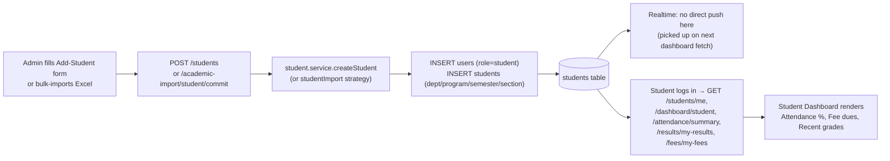

## 10.2 Attendance Flow

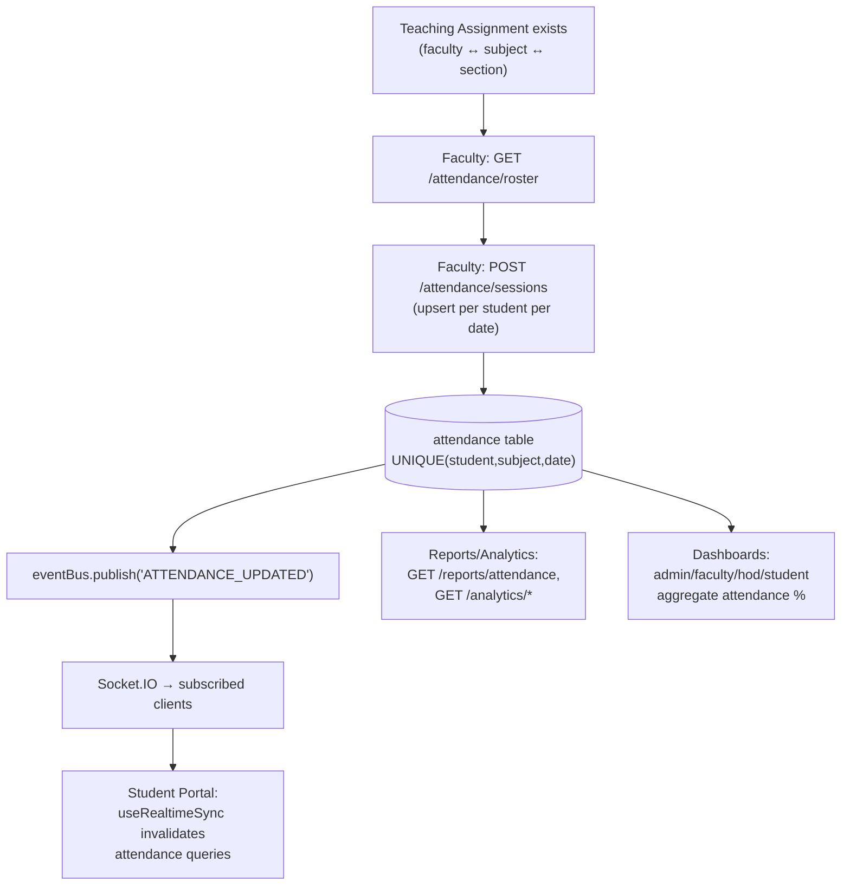

⚠ Note: the planning docs' "Attendance → Teaching Assignment → Attendance → Student Portal → Reports" flow implies a feedback loop through Teaching Assignment; in the actual implementation, Teaching Assignment is purely upstream (defines who *can* mark attendance for which section) — attendance data does not feed back into modifying teaching assignments.

## 10.3 Timetable Flow

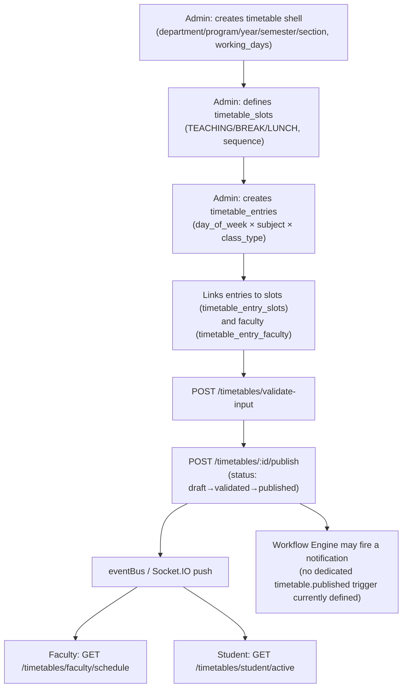

## 10.4 Result Flow

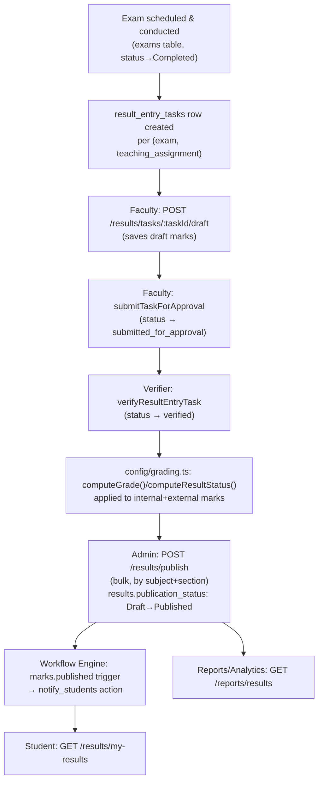

## 10.5 Login / Refresh Data Flow (see also §10.6 sequence diagram)

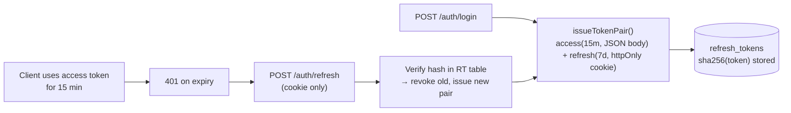

---

## 10.6 Sequence Diagrams

### 10.6.1 Login

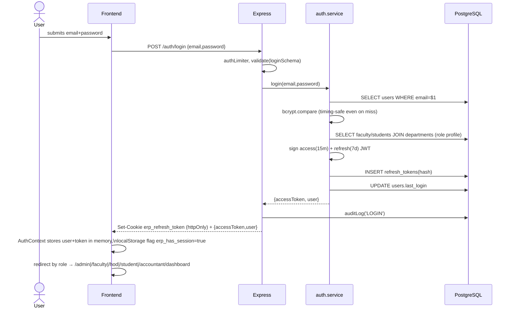

### 10.6.2 Attendance Marking

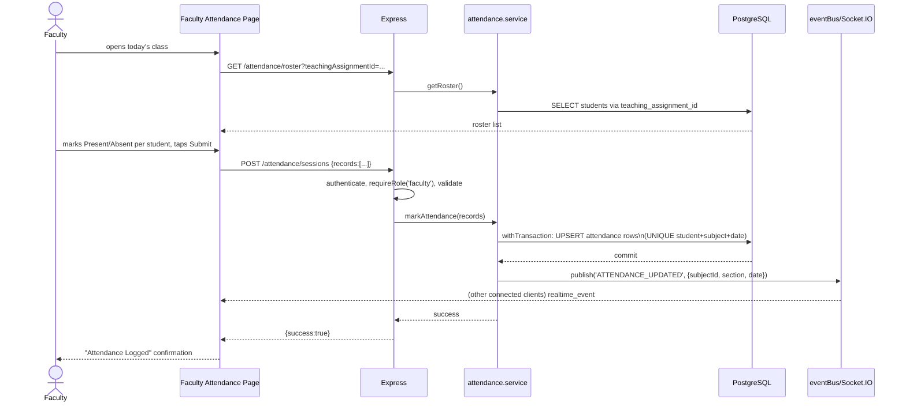

### 10.6.3 Results (Entry → Verify → Publish)

```mermaid
sequenceDiagram
    actor F as Faculty
    actor V as Verifier (Admin/HOD-scoped)
    actor A as Admin
    participant API as Express
    participant SV as result.service / resultEntryTask.service
    participant DB as PostgreSQL
    F->>API: POST /results/tasks/:taskId/draft {marks}
    API->>SV: saveDraftForTask()
    SV->>DB: UPSERT results (Draft), result_entry_tasks.status=draft_saved
    F->>API: POST /results/tasks/:taskId/submit
    API->>SV: submitTaskForApproval()
    SV->>DB: result_entry_tasks.status=submitted_for_approval, submitted_at=NOW()
    V->>API: POST /result-entry-tasks/:id/verify
    API->>SV: verifyResultEntryTask()
    SV->>DB: result_entry_tasks.status=verified
    A->>API: POST /results/publish {subjectId, section}
    API->>SV: publishResults()
    SV->>DB: UPDATE results SET publication_status='Published', published_at=NOW()\nWHERE subject_id=... AND section=... AND publication_status='Draft'
    SV->>DB: result_entry_tasks.status=published
    SV-->>API: count published
    Note over SV,DB: Workflow Engine trigger 'marks.published' fires\nfrom within the transaction's event queue
```

### 10.6.4 Timetable Publishing

```mermaid
sequenceDiagram
    actor A as Admin
    participant API as Express
    participant SV as timetable.service
    participant DB as PostgreSQL
    A->>API: POST /timetables {dept,program,year,semester,section,working_days}
    API->>SV: create()
    SV->>DB: INSERT timetables (status=draft)
    A->>API: (multiple) creates timetable_entries + links slots/faculty
    A->>API: POST /timetables/validate-input
    API->>SV: validateInput() — structural checks
    A->>API: POST /timetables/:id/publish
    API->>SV: publish()
    SV->>DB: UPDATE timetables SET status='published'
    SV-->>API: published timetable
    API-->>A: success
    Note over API: Faculty/Student clients subsequently GET\n/timetables/faculty/schedule or /student/active
```

### 10.6.5 Teaching Assignment Creation & Transfer

```mermaid
sequenceDiagram
    actor A as Admin
    participant API as Express
    participant SV as teachingAssignment.service
    participant DB as PostgreSQL
    A->>API: POST /teaching-assignments {facultyId, subjectId, section, academicYear}
    API->>SV: createTeachingAssignment()
    SV->>DB: validate against subject_curriculum_mappings
    SV->>DB: INSERT teaching_assignments\n(partial unique idx blocks a 2nd active owner for subject+year+section)
    Note over A,DB: Later — faculty resigns/on leave
    A->>API: POST /teaching-assignments/:id/transfer {newFacultyId, reason}
    API->>SV: transferTeachingAssignment()
    SV->>DB: withTransaction:\n1) old row: removed_by, removal_reason, is_active=false\n2) INSERT new teaching_assignments row for newFacultyId
    SV-->>API: new assignment
    Note over SV: Downstream attendance/marks/exams/materials keep their\noriginal teaching_assignment_id (historical FK), new activity\nuses the new assignment id
```

### 10.6.6 Subject/Curriculum Allocation (Bulk Excel Import)

```mermaid
sequenceDiagram
    actor A as Admin
    participant FE as SubjectCatalogManager
    participant API as Express
    participant SV as subjectImport.service
    participant DB as PostgreSQL
    A->>FE: drags in Excel/CSV file
    FE->>API: POST /subjects/import/preview (multipart, memory storage)
    API->>SV: parse rows, fuzzy department match, validate constraints
    SV-->>FE: preview {validRows, invalidRows, distributions}
    A->>FE: reviews preview, confirms
    FE->>API: POST /subjects/import (commit)
    API->>SV: importCommit()
    SV->>DB: withTransaction: chunked INSERT/UPDATE subjects\n+ subject_curriculum_mappings
    SV-->>API: {created, updated, skipped}
    API-->>FE: summary + downloadable error report
```

### 10.6.7 Student Registration (Bulk Import via Academic Import Engine)

```mermaid
sequenceDiagram
    actor A as Admin
    participant FE as Import Wizard
    participant API as Express
    participant Pipe as ValidationPipeline / studentImport.strategy
    participant TM as ImportTransactionManager
    participant DB as PostgreSQL
    A->>FE: uploads roll-list spreadsheet
    FE->>API: POST /academic-import/student/preview (multipart, 15MB)
    API->>Pipe: parse → validate headers → validateRows()
    Pipe-->>FE: ImportSummary {total, valid, invalid, duplicate, toCreate, toUpdate}
    A->>FE: reviews, chooses Merge or Replace mode, confirms
    FE->>API: POST /academic-import/student/commit {mode}
    API->>TM: commitInChunks() — chunks of 500 rows
    TM->>DB: withTransaction (single transaction for entire job):\n[Replace mode: delete impacted rows first]\nINSERT/UPDATE users+students per chunk
    DB-->>TM: commit (all-or-nothing across all chunks)
    TM->>DB: INSERT import_jobs (status=completed, counts)
    TM-->>API: job summary
    API-->>FE: {createdCount, updatedCount, jobId}
```

### 10.6.8 Mentorship Assignment (Auto-Balanced Groups)

```mermaid
sequenceDiagram
    actor MH as Mentoring Head
    participant API as Express
    participant SV as mentorGroup.service
    participant DB as PostgreSQL
    MH->>API: GET /mentor-groups/candidates?department&semester
    API->>SV: listMentorCandidates()
    SV->>DB: SELECT eligible faculty + unassigned students
    MH->>API: GET /mentor-groups/suggest
    API->>SV: suggestBalancedGroups()
    SV->>DB: reads mentorship_settings (recommended/max per mentor)
    SV->>SV: computes BalancedGroupsResult (even distribution)
    SV-->>API: suggested groups
    MH->>API: POST /mentor-groups/check-conflicts {groups}
    API->>SV: checkConflicts() — detects double-assignment
    MH->>API: POST /mentor-groups {finalized groups}
    API->>SV: createGroup() (repeated per group, or bulk)
    SV->>DB: INSERT mentor_groups + mentor_group_students (if manual method)
    Note over SV,DB: Workflow trigger 'mentor.assigned' may fire a notification
```

### 10.6.9 Notification Delivery

```mermaid
sequenceDiagram
    participant Trigger as Domain event\n(e.g. marks.published, fee.paid, mentor.assigned)
    participant WF as workflowEngine.service
    participant DB as PostgreSQL
    participant EB as eventBus / Socket.IO
    participant FE as Any connected client
    Trigger->>WF: event fires (inside withTransaction, queued until commit)
    WF->>DB: SELECT workflow_rules WHERE trigger_event=$1 AND is_active
    WF->>WF: evaluate JSON condition array (ANDed)
    WF->>DB: INSERT notifications (per matched rule's notify_students action)
    WF->>DB: INSERT workflow_logs (status=success/failed/retrying)
    DB-->>EB: (after commit) eventBus.publish('NOTIFICATION_EMITTED', payload)
    EB-->>FE: Socket.IO push
    FE->>FE: useRealtimeSync matches recipient (userId/role/department/semester)\n→ invalidates ["notifications"] query, fires newRealtimeNotification event
    FE->>FE: TopHeader bell badge updates, NotificationCenter list refreshes
```


# 11. Business Logic & Module Synchronization Matrix

← [Back to Index](00-INDEX.md)

This section documents core computational business rules as **actually implemented in code**, and explicitly calls out where the planning documents (`BUSINESS_RULES_AND_WORKFLOWS.md`, `ARCHITECT_REVIEW.md`) describe behavior that does not exist yet.

## 11.1 Attendance Calculation

- **Implemented**: one row per (student, subject, date) in `attendance`, `status ∈ {present, absent}`. Cumulative percentage is computed on read (in `attendance.service.ts`/`analytics.service.ts`/`report.service.ts`) as `count(present) / count(total) * 100` — not a stored/materialized column.
- **Not implemented** (described in `BUSINESS_RULES_AND_WORKFLOWS.md` §4 but absent from the schema/code): a `Late` status (schema enum is binary present/absent only, no fractional-absence weighting); a formal correction-window timestamp + HOD-approval gate for post-lock corrections (any admin/faculty can `PATCH /attendance/:id` directly); medical/sports-leave denominator adjustment (no leave-tracking table exists).

## 11.2 Grade / Result Computation

- **Implemented** (`config/grading.ts`): `computeGrade(obtained, maximum, rules?)` maps a percentage to a letter grade via `DEFAULT_GRADE_RULES` (O≥90%, A+≥80%, A≥70%, B+≥60%, B≥55%, C≥50%, else F), and `computeResultStatus(grade, isAbsent, rules?)` derives Pass/Fail/Absent. `results.total_marks` is DB-CHECK-enforced to equal `internal_marks + external_marks`.
- **Single global grading scheme** — the function accepts an optional `rules` override but no caller was found passing anything other than the default; a documented future path exists to move this to a DB-driven `grading_configs` table keyed by (program, regulation) once multiple simultaneous schemes are needed.
- **Not implemented**: CGPA/SGPA aggregation across subjects/semesters (results are per-subject; no `computeCGPA()`/`computeSGPA()` function or `student_gpa` view/table was found) — `UI_UX_BLUEPRINT.md`'s mockups show a CGPA figure on the student dashboard, but the actual aggregation logic for it was not located in the researched services and should be verified before relying on it.

## 11.3 Subject / Curriculum Mapping

- **Implemented**: `subject_curriculum_mappings` resolves "what does department X, program Y, regulation Z teach in year/semester W" — a genuine many-to-many normalization (§6.6). `curriculumRegistry.service.ts` is the single resolution point other modules should call (Teaching Assignment, Teaching Plan roadmap, Import strategies all use it) rather than querying the mapping table directly.

## 11.4 Teaching Assignment Allocation

- **Implemented**: DB-enforced via a partial unique index — one active faculty per (subject, academic_year, section) at a time. `transferTeachingAssignment`/`transferAllocation` handles faculty resignation/substitution by deactivating the old row (`removed_by`, `removal_reason`) and creating a new one, rather than mutating the original row's `faculty_id` — this preserves historical attribution on every dependent record (attendance/marks/exams marked under the old assignment keep pointing at the old `teaching_assignment_id`).
- **Not implemented**: the planning docs' distinct "Substitute" concept (a temporary proxy who can mark attendance but not finalize grades) has no dedicated schema support — a transfer is a full ownership handover, not a temporary delegation.

## 11.5 Mentorship Allocation

- **Implemented**: `mentorGroup.service.suggestBalancedGroups()` computes an even distribution of students across available mentors respecting `mentorship_settings.recommended_students_per_mentor`/`maximum_students`/`allow_cross_department`; three group-formation methods exist (`range`, `section`, `manual` — the `mentor_assignment_method` enum), with `mentor_group_students` supporting arbitrary manual rosters. `checkConflicts()` detects double-assignment before committing.
- **Legacy parallel system**: `mentor_assignments` (1:1 model) still exists and is DB-constrained to one active mentor per student — both models can theoretically coexist for the same student, which is a latent data-consistency risk worth flagging to any team extending this module (verify which model a given feature should read from).

## 11.6 Timetable Generation

- **Implemented**: manual entry model — admin builds `timetable_entries` explicitly, links them to `timetable_slots` (supporting merged/double periods via the join table) and to one-or-more `faculty` (co-teaching support). `POST /timetables/validate-input` performs a structural pre-check.
- **Not implemented**: an automated conflict-free scheduling *generator* (the kind that takes constraints and produces a schedule) — this was an explicit MVP exclusion (`MVP_DEFINITION_AND_DEVELOPMENT_ROADMAP.md` §9, "we won't build algorithmic conflict detection") and no evidence of a constraint-solver was found in `timetable.service.ts` during research; verify directly against that file before assuming conflict detection exists if this becomes a hard requirement.

## 11.7 Academic Year / Semester Promotion

- **Not implemented as an automated process.** There is no "promote all students to next semester" batch operation, no detention/backlog-tracking table, and no ATKT (Allowed To Keep Terms) mechanism described in `BUSINESS_RULES_AND_WORKFLOWS.md` §2. A student's `semester`/`academic_year`/`section` are plain mutable columns updated via `PATCH /students/:id` one at a time (or via the bulk Student Importer in Merge mode, which can update these fields en masse from a fresh spreadsheet — the closest current analog to a promotion workflow, but not purpose-built for it).

## 11.8 Fee / Exam-Eligibility Gating

- **Not implemented.** The planning docs (`SYSTEM_MODEL.md` §7, `BUSINESS_RULES_AND_WORKFLOWS.md` §7/§10) describe Exam Eligibility as depending on both Attendance percentage and Fee clearance. No code path in `examination.service.ts`, `examSeating.service.ts`, or `result.service.ts` was found querying `fees.payment_status` or computed attendance percentage before allowing exam registration, hall-ticket-equivalent seat allocation, or result entry. This is the single most significant gap between the documented business rules and the implemented system — flagged here and in [15-future-and-appendix.md](15-future-and-appendix.md) as the top candidate for the Workflow Rule engine to eventually enforce (a `condition` referencing attendance/fee state, blocking a `result_entry_task` or seat allocation action).

---

## 11.9 Module Synchronization Matrix

This matrix shows, for each row module, which other modules it **reads from** (depends on) and which it **feeds into** (downstream consumers), based on the actual FK/service-call graph documented in [06-database.md](06-database.md) and [09-api-documentation.md](09-api-documentation.md).

| Module | Reads from (upstream) | Feeds into (downstream) |
|---|---|---|
| Departments/Programs | — (foundational) | Students, Faculty, Subjects/Curriculum, Timetable, Opportunity Hub, Announcements, Mentor Groups |
| Students | Departments, Programs | Attendance, Internal Marks, Results, Fees, LMS Submissions, Mentorship, Opportunity Bookmarks, Exam Seating, Timetable (via section), Feedback |
| Faculty | Departments | Teaching Assignment, Attendance, Internal Marks, Exams, LMS, Teaching Plans, Mentorship, Exam Invigilation, Result Entry Tasks |
| Subjects & Curriculum | Departments, Programs | Teaching Assignment, Attendance, Internal Marks, Exams, Results, LMS, Teaching Plans, Timetable, Feedback |
| Teaching Assignment | Faculty, Subjects/Curriculum, Departments | Attendance, Internal Marks, Exams, Teaching Plans, Course Materials, LMS Assignments, Result Entry Tasks, Results |
| Attendance | Students, Faculty, Subjects, Teaching Assignment | Analytics/Reports/Dashboards, Student Experience Timeline |
| Internal Marks | Students, Faculty, Subjects, Teaching Assignment | Results (marks composition), Analytics/Reports |
| Examinations/Sessions/Rooms/Seating/Invigilation | Subjects, Faculty, Students, Departments | Results, Result Entry Tasks, Reports (seating/invigilator print center) |
| Results & Result Entry Tasks | Exams, Teaching Assignment, Students, Faculty | Student Dashboard, Analytics/Reports, Workflow Engine (`marks.published`) |
| Fees | Students, Programs | Student Dashboard, Analytics/Reports, Workflow Engine (`fee.paid`) — **not** wired to Exam Eligibility (§11.8 gap) |
| Timetable | Departments, Programs, Subjects, Faculty | Faculty/Student schedule views, Realtime push |
| LMS (Materials/Assignments/Submissions) | Subjects, Faculty, Students, Teaching Assignment | Teaching Plans (optional lesson↔material/assignment link), Workflow Engine (`material.created`/`assignment.created`) |
| Teaching Plans | Faculty, Subjects, Departments, Course Materials, Assignments | Student Roadmap, Workflow Engine (`lesson.completed`/`lesson.rescheduled`) |
| Mentorship (Groups + Notes) | Faculty, Students, Departments, Mentorship Settings | Reports, Workflow Engine (`mentor.assigned`) |
| Feedback | Departments, Subjects, Faculty, Students (tracking only) | Analytics, Workflow Engine (`feedback.published`) |
| Opportunity Hub | Departments, Students (bookmarks) | Notifications, Calendar Entries |
| Notifications/Announcements | Users, Departments | Realtime push to all roles |
| Academic Calendar/Documents/Parsed Events | Users, Departments | Calendar Entries (aggregated feed), Notifications |
| Academic Data Import | Users | Students (bulk create/update), Import Jobs audit trail |
| Workflow Rule Engine | Users | Notifications, Calendar Entries, Result Entry Tasks (creates on trigger), Workflow Logs |
| Analytics/Reports/Dashboards/Experience | **Everything** (widest fan-in) | Read-only — feeds no other module |
| Search | Students, Faculty, Subjects, Announcements, Calendar, Exams, Rooms, Results, Notifications, Departments | Read-only — feeds no other module |

**Reading the matrix**: Departments/Programs and Subjects/Curriculum are the deepest upstream dependencies (nearly everything reads from them); Analytics/Reports/Search are the widest downstream sinks (they read from nearly everything but feed nothing back). Teaching Assignment is the structural hub — the single module most other transactional modules (Attendance, Marks, Exams, LMS, Teaching Plans, Results) depend on directly via `teaching_assignment_id`.

## 11.10 Entity Lifecycle States (as implemented, cf. planning docs' aspirational versions)

| Entity | Implemented states | Planning-doc aspiration not implemented |
|---|---|---|
| Student | `active, graduated, suspended, inactive` (enum) | No `Applicant`/`Fee Pending`/`Detained`/`Transferred Out`/`Archived (Incomplete)` distinct states — collapses to the 4 enum values above |
| Faculty | `active, on_leave, resigned, retired` (enum) | No substitution/handover state machine (§11.4) |
| Exam | `Scheduled, Ongoing, Completed, Cancelled, Scripts Distributed, Archived` (enum) | Matches planning docs reasonably closely |
| Result | `publication_status: Draft, Published` + `result_status: Pass, Fail, Absent` | No `Final`/post-revaluation-lock state; no distinct revaluation workflow (§8.11) |
| Assignment Submission | `Submitted, Late Submission, Evaluated` (enum) | Matches planning docs' `Draft/Published/Submitted/Graded` reasonably (Draft/Published collapse into the parent `assignments` table having no such states — an assignment is visible to students immediately upon creation, there is no draft state for assignments themselves) |
| Fee | `payment_status: Pending, Partially Paid, Paid, Overdue` (enum) | Matches planning docs' Fee Lifecycle closely; no distinct `Disputed`/`Closed` state |
| Workflow-adjacent (Result Entry Task) | `open, draft_saved, submitted_for_approval, verified, published, closed` (enum) | This is the fullest realization of the planning docs' generic "Maker-Checker" pattern anywhere in the system |


# 12. Performance, Error Handling & Project Workflow Lifecycle

← [Back to Index](00-INDEX.md)

## 12.1 Performance

| Technique | Where implemented | Notes |
|---|---|---|
| **Pagination** | Nearly every list endpoint (`page`/`limit` Zod-validated per module, default page=1/limit=20, max 100 observed) | Implemented ad hoc per service (~19 files) rather than a shared pagination utility — see [05-backend.md](05-backend.md) §5.15 |
| **Database indexing** | Every migration adds targeted indexes: FK columns, composite lookup indexes (e.g. `idx_students_program_sem`, `idx_timetables_lookup`), partial indexes for soft-delete/active-row filtering | Full list in [06-database.md](06-database.md) per-table entries |
| **In-process TTL caching** | `utils/ttlCache.ts` — `Map`-based, used to memoize expensive dashboard/analytics aggregations | Deliberate no-Redis choice for a single-instance deployment; cache is lost on restart, no in-flight de-dup on concurrent misses (acceptable since wrapped calls are read-only) |
| **Frontend caching** | React Query `staleTime: 60s`, `refetchOnWindowFocus: false`; per-resource staleTime tuning in `hooks/useRegistry.ts` | Only covers the subset of pages using `useRegistry`/React Query — most pages fetch on every mount with no caching |
| **Connection pooling** | `pg.Pool` max 10 connections, 30s idle/connection timeouts (tuned for Neon serverless cold-starts) | See [05-backend.md](05-backend.md) §5.10 |
| **Realtime push vs. polling** | Socket.IO push (attendance/teaching-plan/exam-seating/notifications) avoids client polling for these specific data types | Most other data (e.g. most list pages) still uses on-mount fetch, no polling and no push — data can go stale until the page is revisited |
| **Export row cap** | `export.service.ts` caps CSV/Excel/PDF exports at 5000 rows, with an explicit "N more rows omitted" notice | Prevents unbounded memory/response-size blowups on large report exports |
| **Body size limit** | `express.json({limit:'10mb'})` | Raised from an original 10kb to accommodate bulk spreadsheet-import payloads (see `walkthrough.md`) |
| **React performance** | No explicit `memo`/`useMemo`/`useCallback` optimization patterns were systematically documented in the frontend research pass; Recharts components render directly from fetched data | Not a confirmed bottleneck at current scale but worth profiling before a large data-volume rollout |
| **Query design** | Raw parameterized SQL (no ORM overhead); denormalized columns on hot-path tables (`exams.semester`, `teaching_plans.department_id`) trade normalization purity for query speed, explicitly documented in SQL comments | See [06-database.md](06-database.md) §6.6 |

⚠ **Gaps vs. the Non-Functional Requirements in `project_vision_and_requirements.md` §5** (target: <2s API response, <500ms search/listing at 100k records, 2000+ concurrent users, 99.9% uptime): none of these targets have been load-tested or measured as part of this documentation pass — they should be treated as aspirational until verified. Notably:
- No read-replica or horizontal-scaling story exists (single `pg.Pool`, single Node process).
- No Redis or shared cache — the TTL cache is per-process, so horizontal scaling (multiple API instances) would each maintain independent, inconsistent caches.
- No CDN/static-asset optimization strategy beyond Next.js's own build output.

## 12.2 Error Handling

Full mechanics in [05-backend.md](05-backend.md) §5.9 and [07-authentication-and-security.md](07-authentication-and-security.md). Summary by layer:

| Layer | Mechanism |
|---|---|
| **Frontend** | `lib/api.ts`: network failures → soft `{success:false}` object (no throw); non-2xx → thrown `Error`, caught in local `try/catch` per call site; no global error boundary (`error.tsx` doesn't exist); no shared toast/snackbar — inline banners or `alert()` |
| **Backend (validation)** | `middleware/validate.ts` — Zod errors → `400 VALIDATION_ERROR` with joined field messages |
| **Backend (business logic)** | `errors/AppError.ts` — single class, static factories per HTTP status, decentralized `code` strings per throw site |
| **Backend (database)** | `middleware/errorHandler.ts` maps Postgres codes: `23505`→409 `DUPLICATE_RECORD`, `23503`→400 `FOREIGN_KEY_VIOLATION`, `23502`→400 `NOT_NULL_VIOLATION` |
| **Backend (global/unhandled)** | `errorHandler.ts` catches everything else → logs via `console.error`, returns `500 INTERNAL_ERROR` (message hidden in production, shown in dev/test) |
| **Backend (process-level)** | `server.ts`: `unhandledRejection`/`uncaughtException` handlers close the HTTP server and exit rather than continuing in a corrupted state |
| **Database (constraints)** | CHECK constraints (financial bounds, mark limits, date ordering, enum-adjacent value sets) reject invalid data at the DB layer regardless of application-layer bugs — a genuine defense-in-depth layer |

**Response envelope contract** (relied upon by the frontend's `apiFetch`): success → `{success:true, data, message?, metadata?}`; failure → `{success:false, code, message}`. Any new endpoint should conform to this shape.

## 12.3 Project Workflow Lifecycle (Request → Response, Generic)

```mermaid
flowchart TD
    UA["User Action\n(click, form submit)"] --> FE["Frontend\n(page component, local state)"]
    FE --> API["API Call\n(apiFetch → Express route)"]
    API --> MW["Middleware Chain\n(helmet→cors→parse→log→rateLimit→authenticate→authorize→validate)"]
    MW --> SVC["Service\n(business logic, one owning service per table)"]
    SVC --> DB["Database\n(withTransaction, CHECK constraints enforced)"]
    DB --> SVC
    SVC --> RESP["Response envelope\n(sendSuccess/sendError)"]
    RESP --> FE2["Frontend Update\n(local state set, or React Query cache update)"]
    DB -.->|"on commit, if event queued"| EB["eventBus → Socket.IO"]
    EB -.->|"realtime_event"| OtherClients["Other connected clients\n(useRealtimeSync)"]
```

This is the same lifecycle detailed with concrete field names in [02-architecture-and-diagrams.md](02-architecture-and-diagrams.md) §2.4 and per-module in [10-data-flow-and-sequence-diagrams.md](10-data-flow-and-sequence-diagrams.md).

## 12.4 Background Work & Scheduling — Explicit Gap

⚠ As documented in [05-backend.md](05-backend.md) §5.16, **no scheduler/cron/job-queue exists anywhere in the codebase**. This has concrete operational consequences worth tracking as a punch list:

| Task that would normally be scheduled | Current behavior without a scheduler |
|---|---|
| Purge expired/revoked `refresh_tokens` | Rows accumulate indefinitely |
| Auto-transition `fees.payment_status` to `Overdue` past `due_date` | Must be computed on read (if at all) rather than stored/pushed |
| Auto-close feedback campaigns / result-entry windows past their configured close time | Requires a manual admin action (`closeCampaign`, task status transitions) rather than automatic expiry |
| Retry `workflow_logs` rows with `status='retrying'` | No retry mechanism was found to actually re-attempt these — the status exists in the enum but appears to require manual intervention |
| Periodic re-aggregation of `ttlCache`-backed dashboard metrics | Cache simply expires and recomputes lazily on next read, not proactively refreshed |

This is the single highest-leverage infrastructure addition for production-readiness — see [15-future-and-appendix.md](15-future-and-appendix.md) for the prioritized recommendation.


# 13. Deployment, Configuration Files & Dependencies

← [Back to Index](00-INDEX.md)

## 13.1 Deployment — Current State

⚠ **No deployment infrastructure exists in this repository today.** An exhaustive search found no `Dockerfile`, no `docker-compose.yml`, no `.github/workflows/` (no CI/CD pipeline at all), no `Procfile`, no `vercel.json`/`railway.json`/`render.yaml`, and no deployment shell scripts anywhere in the repo. This is a real gap, not an oversight in this document — treat it as the top infrastructure item in [15-future-and-appendix.md](15-future-and-appendix.md).

What *does* exist and hints at the intended deployment target:
- `backend/src/config/database.ts` special-cases SSL for connection strings containing `neon.tech`, strongly implying **Neon serverless Postgres** is the actual/intended production database.
- `backend/package.json` scripts are a standard compile-then-run Node process: `build` (`tsc`) → `start` (`node dist/server.js`) — no serverless-function wrapper, no bundler.
- `frontend`'s standard Next.js `build`/`start` scripts — a natural fit for Vercel, though no `vercel.json` commits to that.
- `.env.example` (backend only) documents every required runtime environment variable (§13.3).

### Recommended target architecture (not yet implemented)
A reasonable next step — one Dockerfile per service (`backend/Dockerfile`, `frontend/Dockerfile`), a `docker-compose.yml` for local dev parity (app + local Postgres), and a GitHub Actions workflow running `typecheck`/`test`/`build` on every PR — is discussed further in [15-future-and-appendix.md](15-future-and-appendix.md).

## 13.2 Environments

| Environment | How it's distinguished | Notes |
|---|---|---|
| Development | `NODE_ENV=development` (default) | SQL query logging enabled (`config/database.ts`); refresh cookie `secure:false` |
| Test | `NODE_ENV=test` | Used by Jest config (`tsconfig.test.json`); error messages exposed in responses |
| Production | `NODE_ENV=production` | Refresh cookie `secure:true`; internal error messages hidden from API responses (generic `INTERNAL_ERROR` only) |

## 13.3 Environment Variables (`backend/.env.example`)

| Variable | Default | Purpose |
|---|---|---|
| `NODE_ENV` | `development` | Environment switch (§13.2) |
| `PORT` | `3001` | Backend HTTP port |
| `DATABASE_URL` | — (required) | Postgres connection string; presence of `neon.tech` or `sslmode=` auto-enables SSL |
| `JWT_ACCESS_SECRET` | — (required, min 32 chars) | Access-token signing secret |
| `JWT_REFRESH_SECRET` | — (required, min 32 chars) | Refresh-token signing secret (separate from access) |
| `JWT_ACCESS_EXPIRES_IN` | `15m` | Access-token TTL |
| `JWT_REFRESH_EXPIRES_IN` | `7d` | Refresh-token TTL |
| `BCRYPT_ROUNDS` | `12` | bcrypt cost factor (bounded 10–14 by Zod) |
| `CORS_ORIGIN` | `http://localhost:3000` | Comma-separated allowlist |
| `RATE_LIMIT_WINDOW_MS` | `900000` | ⚠ Defined but not actually read by `rateLimiter.ts` (vestigial) |
| `RATE_LIMIT_MAX` | `100` | ⚠ Same — vestigial |
| `UPLOAD_DIR` | `uploads/documents` | Document upload target — ⚠ not documented in `.env.example` despite being in the Zod schema |
| `LMS_UPLOAD_DIR` | `uploads/lms` | LMS file upload target — ⚠ same gap |

**Frontend**: `NEXT_PUBLIC_API_URL` (defaults to `http://127.0.0.1:3001/api`), `NEXT_PUBLIC_SOCKET_URL` (defaults to `http://127.0.0.1:3001`) — set via `frontend/.env.local` (not committed; no `.env.example` was found on the frontend side).

Invalid or missing required env vars cause the backend to `process.exit(1)` at boot with per-field Zod error messages logged — a deliberate fail-fast design.

## 13.4 Build Tools

| Tool | Where used | Purpose |
|---|---|---|
| `tsc` | Backend (`npm run build`) | Compiles `backend/src` → `backend/dist` (CommonJS, ES2022 target) |
| `tsx` | Backend (`npm run dev`) | Hot-reload dev runner (`tsx watch src/server.ts`); also used for one-off DB scripts (`migrate`, `seed`, `sync-excel-rolls`) |
| Next.js's own bundler | Frontend (`npm run build`/`dev`) | No custom Webpack/Turbopack config beyond Next.js defaults (`next.config.ts` is empty) |
| `jest` + `ts-jest` | Backend only | 20 service-level test files (`backend/src/__tests__/`), no supertest/HTTP-level integration tests found |

## 13.5 Package Managers

Both `frontend/` and `backend/` are independent npm packages with their own `package.json`/`package-lock.json`/`node_modules` — there is no monorepo tool (no Nx/Turborepo/Lerna/npm workspaces) tying them together. Shared type definitions between frontend and backend are **not** generated/shared — they're maintained by hand in parallel (`frontend/src/lib/*.ts` / `frontend/src/types/*.ts` vs `backend/src/types/*.ts`), a duplication risk noted in [04-frontend.md](04-frontend.md) §4.12.

## 13.6 Development Tools

- **`tsx`** — backend dev/hot-reload and script runner.
- **ESLint 9** (flat config) — **frontend only**; extends `eslint-config-next/core-web-vitals` + `eslint-config-next/typescript`, downgrades `@typescript-eslint/no-explicit-any` and `@typescript-eslint/no-unused-vars` to warnings. ⚠ **The backend has no ESLint configuration at all** — code quality there is enforced solely by TypeScript's strict compiler flags (`strict`, `noUnusedLocals`, `noUnusedParameters`, `noImplicitReturns`, `noFallthroughCasesInSwitch`, all `true`) and the Jest test suite.
- **VS Code / any IDE** — no `.vscode/` workspace settings or recommended-extensions file was found.

## 13.7 Version Control

Git, single repository containing both `frontend/` and `backend/` (a "polyrepo-in-a-monorepo-folder" layout rather than a true monorepo tool). Current branch: `main`. No branch-protection or PR-template configuration files (`.github/`) exist.

## 13.8 Configuration Files — Full Inventory

| File | Purpose |
|---|---|
| `backend/package.json` | Scripts: `dev`, `build`, `start`, `migrate`, `seed`, `sync-excel-rolls`, `typecheck`, `test`/`test:watch`/`test:coverage`. Dependencies grouped in §13.9. |
| `backend/tsconfig.json` | `target: ES2022`, `module: CommonJS`, `strict: true` + all extra strictness flags, `rootDir: ./src`, `outDir: ./dist`, excludes `__tests__` (built separately) |
| `backend/tsconfig.test.json` | Extends base config, adds `jest`/`node` types, relaxes unused-vars/params checks for test code |
| `backend/jest.config.js` | `testEnvironment: node`, `roots: ['<rootDir>/src']`, `testMatch: ['**/__tests__/**/*.test.ts']`, `ts-jest` via `tsconfig.test.json`, `clearMocks: true` |
| `backend/.env.example` | Documents all required/optional env vars (§13.3) |
| `frontend/package.json` | Scripts: `dev`, `build`, `start`, `lint`. Dependencies grouped in §13.9. |
| `frontend/tsconfig.json` | `target: ES2017`, `module: esnext`, `moduleResolution: bundler`, `jsx: react-jsx`, `noEmit: true` (Next handles bundling), path alias `@/* → ./src/*` |
| `frontend/next.config.ts` | Essentially empty (`const nextConfig: NextConfig = {}`) — no rewrites/redirects/headers/image domains/experimental flags |
| `frontend/eslint.config.mjs` | Flat config, extends Next's core-web-vitals + typescript configs, 2 rules downgraded to warn |
| `frontend/postcss.config.mjs` (implied by `@tailwindcss/postcss` dependency) | TailwindCSS 4 PostCSS pipeline |

## 13.9 Dependencies (Grouped by Purpose, with Rationale)

### Backend (`backend/package.json`)

| Group | Packages | Why they're there |
|---|---|---|
| Web framework | `express ^4.21.0` | HTTP server & routing |
| Real-time | `socket.io ^4.8.3` | Push updates for attendance/teaching-plan/exam-seating/notifications |
| Database | `pg ^8.12.0` | Raw Postgres client — no ORM is used anywhere |
| Auth | `jsonwebtoken ^9.0.2`, `bcryptjs ^2.4.3`, `cookie-parser ^1.4.6` | JWT sign/verify, password hashing, refresh-cookie parsing |
| Validation | `zod ^3.23.8` | Request schema validation, env var validation |
| Security/middleware | `helmet ^8.0.0`, `cors ^2.8.5`, `express-rate-limit ^7.4.0` | Security headers, CORS, brute-force/DoS mitigation |
| File processing | `multer ^2.2.0`, `exceljs ^4.4.0`, `pdfkit ^0.19.1`, `pdf-parse ^2.4.5` | Uploads, Excel/CSV read+write (imports/exports), PDF generation (reports/documents), PDF text extraction (academic-calendar auto-parsing) |
| Utilities | `uuid ^10.0.0`, `dotenv ^16.4.5` | Random ID generation (upload filenames), env loading |
| Dev/Test/Build | `typescript ^5.5.0`, `tsx ^4.16.0`, `jest ^29.7.0`, `ts-jest ^29.4.11`, `@types/jest`, plus `@types/*` for bcryptjs/cookie-parser/cors/express/jsonwebtoken/multer/node/pdf-parse/pdfkit/pg/uuid | Type-checking, dev hot-reload, unit testing |

Notably **absent**: no ORM, no logging library (winston/pino — console-only), no job-queue library, no Redis client, no HTTP-mocking/integration-test library (tests are service-level unit tests, not endpoint-level).

### Frontend (`frontend/package.json`)

| Group | Packages | Why they're there |
|---|---|---|
| Framework | `next 16.2.9`, `react 19.2.4`, `react-dom 19.2.4` | Core app framework |
| Data fetching/state | `@tanstack/react-query ^5.101.4` | Partial server-state caching (§4.7) |
| Real-time | `socket.io-client ^4.8.3` | Consumes backend Socket.IO push events |
| UI/Charts | `recharts ^3.9.0`, `lucide-react ^1.18.0` | Dashboard/analytics visualizations, icon set |
| Styling | `tailwindcss ^4`, `@tailwindcss/postcss ^4` (dev) | Utility-first CSS |
| Dev/Build/Lint | `typescript ^5`, `@types/node ^20`, `@types/react ^19`, `@types/react-dom ^19`, `eslint ^9`, `eslint-config-next 16.2.9` | Type-checking, linting |

Notably **absent**: no form library (react-hook-form/Formik), no client-side schema validation (no zod on the frontend despite the backend using it — §4.8), no dedicated auth/cookie library, **no test runner/testing-library configured at all** (no jest/vitest config anywhere in `frontend/`), no state-management library beyond React Query + Context.

## 13.10 Server Requirements (inferred, not documented anywhere in-repo)

- **Node.js** — a version compatible with TypeScript 5.5 / ES2022 target and Next.js 16 / React 19 (Node 20+ recommended based on `@types/node ^20`).
- **PostgreSQL** — any version supporting the SQL features used (JSONB, array columns, partial/composite unique indexes, `uuid-ossp` extension) — effectively any modern Postgres (13+).
- **Persistent local disk** for `backend/uploads/{documents,lms}` — ⚠ this means a horizontally-scaled or ephemeral-filesystem deployment (e.g. multiple stateless containers, or a PaaS with an ephemeral filesystem) would **lose uploaded files** or serve inconsistent results across instances unless uploads are moved to shared/object storage first. This is a concrete pre-requisite for any horizontal scaling of the backend.
- **Outbound network access** to the Postgres host (Neon) and nothing else — no other external service (email/SMS/payment gateway) is called from the backend today.


# 14. File-Level Documentation, Code Metrics & Feature Dependency Graph

← [Back to Index](00-INDEX.md)

## 14.1 Code Metrics (measured directly from the repository)

| Metric | Backend (`backend/src`) | Frontend (`frontend/src`) |
|---|---|---|
| Total lines of code | ~51,036 | ~60,667 |
| Route files | 47 (incl. `index.ts` barrel + `protected.routes.ts` reference) | — |
| Controller files | 45 | — |
| Service files | 60 | — |
| Registry facade files | 7 (incl. `index.ts` barrel) | — |
| Middleware files | 9 | — |
| SQL migration files | 50 | — |
| Backend test files | 20 (`__tests__/*.test.ts`, Jest) | 0 (no frontend test runner configured) |
| Page routes (`page.tsx`) | — | 89 |
| Layout files (`layout.tsx`) | — | 6 (root + 5 role layouts) |
| Component files (`.tsx` under `components/`) | — | 70 |
| Context providers | — | 4 |
| Custom hooks | — | 2 |
| `lib/*.ts` domain modules | — | 10 |

### Lines of code by backend folder

| Folder | LOC |
|---|---|
| `services/` | ~26,168 |
| `types/` | ~5,228 |
| `controllers/` | ~3,518 |
| `routes/` | ~2,700 |
| `db/` (migrations + scripts) | ~1,511 |
| `import/` | ~1,184 |
| `middleware/` | ~558 |
| `utils/` | ~520 |
| `registries/` | ~375 |
| `errors/` | 43 |

`services/` dwarfing every other backend folder (roughly half of all backend code) directly reflects the "thin controller, fat service" architecture described in [05-backend.md](05-backend.md).

### Lines of code by frontend folder

| Folder | LOC |
|---|---|
| `app/` (pages + layouts) | ~36,428 |
| `components/` | ~20,054 |
| `lib/` | ~2,340 |
| `context/` | ~1,076 |
| `types/` | ~345 |
| `hooks/` | ~381 |
| `providers/` | 43 |

`app/` being the largest frontend folder (60% of frontend LOC) reflects that most page-level logic (data fetching, local state, inline forms) lives directly in page components rather than being extracted into shared hooks/components — consistent with the "imperative fetch + useState per page" pattern noted in [04-frontend.md](04-frontend.md) §4.7.

## 14.2 Entities / Models / Schemas Count

| Category | Count | Reference |
|---|---|---|
| Database tables | 60 (+ 1 backward-compat view) | [06-database.md](06-database.md) §6.4 |
| Enum types | 43 | [06-database.md](06-database.md) §6.2 |
| API endpoints (approx., counted across all route files) | ~230 | [09-api-documentation.md](09-api-documentation.md) |
| Functional modules documented | 23 | [08-modules.md](08-modules.md) |
| User-facing roles (DB-level) | 4 (`admin`,`faculty`,`student`,`accountant`) + 2 designation/capability flags (HOD, Mentoring Head) + 1 super-admin flag | [01-overview-and-vision.md](01-overview-and-vision.md) §3 |

## 14.3 Complete File Documentation — Backend

This is a pointer table rather than a repeated listing — every backend file's purpose is documented in the section indicated, to avoid duplicating ~250 file descriptions across this document:

| File category | Where documented |
|---|---|
| `server.ts`, `app.ts` | [05-backend.md](05-backend.md) §5.1 |
| All 47 route files | [09-api-documentation.md](09-api-documentation.md) (endpoint-by-endpoint), summarized in [05-backend.md](05-backend.md) §5.2 |
| All 45 controller files | [05-backend.md](05-backend.md) §5.3 (role/pattern), individual controller responsibilities implied by their route file's endpoint table in [09](09-api-documentation.md) |
| All 60 service files | [08-modules.md](08-modules.md) (per-module "Backend" subsection lists the owning service(s) for each domain) |
| All 7 registry files | [05-backend.md](05-backend.md) §5.5 |
| All 9 middleware files | [05-backend.md](05-backend.md) §5.6, full auth mechanics in [07-authentication-and-security.md](07-authentication-and-security.md) |
| `errors/AppError.ts` | [05-backend.md](05-backend.md) §5.9 |
| `config/{env,database,grading}.ts` | [05-backend.md](05-backend.md) §5.12–5.13 |
| `utils/*.ts` (8 files) | [05-backend.md](05-backend.md) §5.11 |
| `import/*.ts` + `import/strategies/*.ts` | [05-backend.md](05-backend.md) §5.15 |
| All 50 migration files | [06-database.md](06-database.md) (final-state schema; per-migration provenance noted inline, e.g. "(035)") |
| `db/{migrate,seed,check,sync_roll_list,query_*}.ts` | [03-folder-structure.md](03-folder-structure.md) §3.2 |
| `__tests__/*.test.ts` (20 files) | [13-deployment-config-dependencies.md](13-deployment-config-dependencies.md) §13.8 (jest config); covers academicCalendar, announcement, attendance, calendarEntry, calendarExtractor, document, examination, faculty, fee, internal-marks, lmsAssignment, lmsSubmission, material, notification, opportunityHub, parsedEvent, result, search, subject, timetable services |

## 14.4 Complete File Documentation — Frontend

| File category | Where documented |
|---|---|
| `app/layout.tsx` + 5 role `layout.tsx` files | [04-frontend.md](04-frontend.md) §4.1 |
| `app/page.tsx` (login) | [04-frontend.md](04-frontend.md) §4.2 |
| All 89 page routes | [03-folder-structure.md](03-folder-structure.md) §3.3 (full tree) + [04-frontend.md](04-frontend.md) §4.4 (representative purpose per role) |
| All 70 components | [03-folder-structure.md](03-folder-structure.md) §3.3 (full listing by subfolder), architecture rationale in [04-frontend.md](04-frontend.md) §4.5 |
| `context/*.tsx` (4 files) | [04-frontend.md](04-frontend.md) §4.6 |
| `providers/AppProviders.tsx` | [04-frontend.md](04-frontend.md) §4.6 |
| `hooks/*.ts` (2 files) | [04-frontend.md](04-frontend.md) §4.6 |
| `lib/*.ts` (10 files) | [04-frontend.md](04-frontend.md) §4.6 |
| `types/*.ts` (5 files) | [03-folder-structure.md](03-folder-structure.md) §3.3 |

## 14.5 Feature Dependency Graph

This graph shows build/feature *dependency order* — which modules must exist before another can function — distinct from the runtime data-read dependencies in the [Synchronization Matrix](11-business-logic-and-sync-matrix.md) §11.9.

```mermaid
flowchart TD
    Auth["Authentication & RBAC"] --> Org["Departments & Programs"]
    Org --> Users["Students / Faculty / Accountants provisioning"]
    Users --> Subjects["Subjects & Curriculum Mapping"]
    Subjects --> TA["Teaching Assignment"]
    TA --> Attendance["Attendance"]
    TA --> Marks["Internal Marks"]
    TA --> LMS["LMS (Materials/Assignments/Submissions)"]
    TA --> Plans["Teaching Plans"]
    TA --> Exams["Examinations"]
    Exams --> Seating["Exam Seating / Invigilation / Rooms / Sessions"]
    Exams --> Results["Results & Result Entry Tasks"]
    Users --> Fees["Fees & Payments"]
    Users --> Mentorship["Mentorship (Groups/Notes)"]
    Org --> Timetable["Timetable"]
    Subjects --> Timetable
    Users --> Feedback["Feedback Campaigns"]
    Org --> Opportunities["Opportunity Hub"]
    Users --> Notifications["Notifications & Announcements"]
    Org --> Calendar["Academic Calendar & Document Parsing"]
    Users --> Import["Academic Data Import"]

    Attendance --> Analytics["Analytics / Reports / Dashboards / Experience"]
    Marks --> Analytics
    Results --> Analytics
    Fees --> Analytics
    LMS --> Analytics
    Mentorship --> Analytics
    Plans --> Analytics
    Seating --> Analytics
    Opportunities --> Analytics
    Feedback --> Analytics

    Notifications -.->|"driven by"| Workflow["Workflow Rule Engine"]
    Results -.->|"marks.published trigger"| Workflow
    Fees -.->|"fee.paid trigger"| Workflow
    Attendance -.->|"attendance.marked trigger"| Workflow
    Mentorship -.->|"mentor.assigned trigger"| Workflow
    LMS -.->|"material.created / assignment.created trigger"| Workflow
    Plans -.->|"lesson.completed / lesson.rescheduled trigger"| Workflow
    Feedback -.->|"feedback.published trigger"| Workflow
    Seating -.->|"exam_seating.published trigger"| Workflow
```

This mirrors the planning docs' "Subjects → Curriculum → Teaching Assignment → Attendance → Results → LMS → Teaching Planner → Student Dashboard" chain (`project_vision_and_requirements.md`), extended to reflect every implemented module rather than the original MVP subset — notably adding Fees, Mentorship, Feedback, Opportunity Hub, Notifications, Academic Calendar, Import, and the Workflow Rule Engine as siblings that all ultimately feed the Analytics/Dashboard layer, with the Workflow Engine cutting across nearly every module as a dotted (event-driven, not structural) dependency.


# 15. Future Improvements, Appendix & Undocumented/Missing Components

← [Back to Index](00-INDEX.md)

## 15.1 Future Improvements (Prioritized)

### Tier 1 — Infrastructure foundations (do first, unblocks everything else)
1. **Containerization + CI/CD**: add `Dockerfile`s for `backend/`/`frontend/`, a `docker-compose.yml` for local dev parity, and a GitHub Actions workflow running `typecheck`/`test`/`build`/`lint` on every PR. Currently **zero** deployment/CI infrastructure exists (see [13-deployment-config-dependencies.md](13-deployment-config-dependencies.md) §13.1).
2. **Background job scheduler** (e.g. `node-cron` or a lightweight queue): purge expired `refresh_tokens`, auto-transition overdue fees, auto-close expired feedback/result-entry windows, retry failed `workflow_logs`. See [12-performance-error-handling-workflow.md](12-performance-error-handling-workflow.md) §12.4.
3. **Object storage for uploads**: move `backend/uploads/{documents,lms}` off local disk to S3-compatible storage before any horizontal scaling — the current design silently loses files or serves inconsistent results across multiple instances (see [13](13-deployment-config-dependencies.md) §13.10).
4. **Socket.IO handshake authentication hardening**: verify the JWT presented at socket-connect time server-side before allowing a connection (see [07-authentication-and-security.md](07-authentication-and-security.md) §7.10).

### Tier 2 — Close the documented-vs-implemented business-rule gaps
5. **Fee-clearance / attendance-percentage gating for exam eligibility** — the single largest gap between the planning docs and the implemented system (see [11-business-logic-and-sync-matrix.md](11-business-logic-and-sync-matrix.md) §11.8). The Workflow Rule Engine's `condition` JSON is the natural mechanism to implement this without new schema.
6. **Attendance correction approval workflow** (maker-checker, 48-hour window) as originally specified — currently direct `PATCH` by any faculty/admin (§11.1).
7. **Academic year promotion / detention / ATKT-backlog tracking** — currently manual, one student at a time (§11.7).
8. **Revaluation workflow** as a distinct, audited process rather than a direct result `PATCH` (§8.11, §11.10).
9. **CGPA/SGPA aggregation** across subjects/semesters if the student dashboard is meant to show it (verify current behavior directly against `analytics.service.ts`/`dashboard.service.ts` before assuming it's missing vs. just undiscovered in this research pass).

### Tier 3 — Scale & robustness
10. **Redis (or equivalent shared cache)** to replace the in-process `ttlCache` once running more than one API instance — the current cache is per-process and would be inconsistent across replicas.
11. **Read replicas / connection-pool tuning** ahead of the documented 2000+ concurrent user target (`project_vision_and_requirements.md` §5) — untested at that scale.
12. **Structured logging** (winston/pino) + log aggregation, replacing console-only logging, before running multiple instances where correlating logs across processes matters.
13. **Frontend test coverage** — currently zero automated frontend tests exist; introduce Vitest/Jest + React Testing Library at minimum for `lib/permissions.ts` (RBAC logic) and `lib/api.ts` (refresh/retry logic), given how much of the security model lives there.
14. **Shared type generation** between frontend and backend (e.g. a shared package, or OpenAPI-generated client types) to eliminate the hand-maintained duplication noted in [04-frontend.md](04-frontend.md) §4.12.
15. **Toast/snackbar system** on the frontend to replace `alert()`/inline-banner error UX (§4.9).

### Tier 4 — Product expansion (per the original planning docs' aspirations)
16. **Library management module** (planning docs describe it; entirely unbuilt).
17. **Hostel & Transport modules** (unbuilt; planning docs note these should hook into the existing Student and Fee entities via FK, requiring no core schema rework).
18. **Parent/Guardian portal** (unbuilt; planning docs note it can be a read-only role mapped to existing Student IDs).
19. **Placement-drive workflow** beyond the current generic Opportunity Hub posting board (company/round tracking, eligibility-based shortlisting, resume management).
20. **Payment gateway integration** to replace manual "record payment" entry (explicit MVP exclusion, still true today).
21. **AI/predictive analytics** (at-risk-student prediction from attendance/marks trends, chatbot) — planning-doc aspiration, unbuilt; the append-only, immutable-ledger design of `attendance`/`internal_marks`/`results` (§6.5) is explicitly noted in the planning docs as good preparation for this, if pursued.
22. **Multi-language (i18n) support** — unbuilt.
23. **Biometric attendance integration** — unbuilt; planning docs note this could hit the same `/api/attendance` endpoint the web UI uses today, requiring no backend change, only a device-side integration.

## 15.2 Appendix — Glossary

| Term | Meaning in this system |
|---|---|
| **Teaching Assignment** | The record linking one faculty member to one subject+section+academic-year; the structural hub most transactional modules depend on |
| **Curriculum Mapping** | The join record placing a subject within a specific department/program/regulation/year/semester |
| **Result Entry Task** | A per-(exam, teaching-assignment) unit of work driving the entry→verify→publish approval chain for results |
| **Mentoring Head** | A faculty capability flag (`is_mentoring_head`) granting department-wide mentorship management, not a distinct role |
| **HOD** | Head of Department — a `faculty.designation` value, DB-uniqueness-enforced at one per department, not a distinct role |
| **Registry** | An internal, non-routed facade service consolidating a cross-module "master data" lookup (e.g. `studentRegistry`) to prevent duplicate ad hoc queries |
| **Workflow Rule / Workflow Engine** | The configurable, event-driven automation system (trigger → condition → action) distinct from the Result Entry Task's maker-checker approval chain |
| **Exam Session vs. Examination Session** | Two distinct tables — see [06-database.md](06-database.md) §6.3.10 — do not conflate |
| **Academic Session** | Not a real table — `students.academic_year` (a string) stands in for it; `teaching_assignments.academic_session_id` is a deliberate untyped placeholder for a possible future formal entity |
| **Soft delete** | `deleted_at TIMESTAMPTZ`, `NULL` = live row; deliberately absent on ledger tables (attendance, internal marks, fee payments) where corrections should be updates or new rows, not deletes |
| **Ownership model** | The convention that each database table has exactly one "owning" service; other modules read via that service or a Registry, not direct cross-table queries |
| **RBAC label** (frontend) | The richer, client-side-only role vocabulary (`Super Admin`, `College Admin`, `HOD`, `Academic Coordinator`, `Placement Officer`, `Mentoring Head`, `Faculty`, `Student`) used purely for UI nav-filtering — **not** backed by distinct database roles |
| **Simulation Context** | A legacy/demo local-state store (`localStorage`-persisted) that also doubles as the app's theme provider and a role-switch simulator — distinct from the real `AuthContext` session |

## 15.3 Appendix — Abbreviations

| Abbreviation | Meaning |
|---|---|
| ERP | Enterprise Resource Planning |
| RBAC | Role-Based Access Control |
| JWT | JSON Web Token |
| LMS | Learning Management System |
| ATKT | Allowed To Keep Terms (backlog/supplementary exam carry-forward) |
| HOD | Head of Department |
| CGPA/SGPA | Cumulative / Semester Grade Point Average |
| TTL | Time To Live (cache expiry) |
| CRUD | Create, Read, Update, Delete |
| FK / PK | Foreign Key / Primary Key |
| CSRF / XSS | Cross-Site Request Forgery / Cross-Site Scripting |
| SAD | Software Architecture Document (this document) |

## 15.4 Appendix — References

- In-repo planning documents: `project_vision_and_requirements.md`, `ARCHITECT_REVIEW.md`, `SYSTEM_MODEL.md`, `BUSINESS_RULES_AND_WORKFLOWS.md`, `MVP_DEFINITION_AND_DEVELOPMENT_ROADMAP.md`, `UI_UX_BLUEPRINT.md`, `walkthrough.md`, `README.md`.
- In-repo engineering notes: `docs/erp-integration-audit.md`, `docs/teaching-assignment-refactor-plan.md`.
- This document was produced by direct inspection of `frontend/src`, `backend/src`, and all 50 files in `backend/src/db/migrations/`, as of commit `184a34c`.

## 15.5 Appendix — Development Notes

- Route files consistently declare literal path segments before `/:id` — follow this convention for any new endpoint (see [09-api-documentation.md](09-api-documentation.md) §9.0).
- Every new mutating table should get a `deleted_at` column **unless** it is a genuine append-only ledger (attendance-like) — see [06-database.md](06-database.md) §6.5 for the existing precedent either way.
- New cross-module lookups should go through a Registry facade (or a new one should be added) rather than querying another module's table directly — see [05-backend.md](05-backend.md) §5.5.
- New business rules that need "if X then notify/create-event Y" behavior should be modeled as a `workflow_rules` row + a new `workflow_trigger_event`/`workflow_action_type` enum value where possible, rather than hardcoded into a service — this keeps the automation surface configurable (see [08-modules.md](08-modules.md) §8.21).

---

## 15.6 Undocumented or Missing Components

Per the documentation brief, this section explicitly lists everything that could **not** be documented because it does not exist in the codebase, or exists only as a stub/placeholder — rather than silently omitting it.

### Entirely missing (no code found)
- Library management module (catalog, checkout/return, fines).
- Hostel management module.
- Transport management module.
- Parent/Guardian portal or role.
- Placement Officer role and a dedicated placement-drive workflow (company/round tracking, resume management) — only the generic Opportunity Hub posting board exists.
- Payment gateway integration (fees are recorded manually only).
- Email/SMS notification delivery (notifications are in-app/Socket.IO only; no SMTP/Twilio-equivalent integration).
- Background job scheduler / cron / message queue of any kind.
- CI/CD pipeline (no `.github/workflows`), Dockerfile, docker-compose, or any deployment manifest.
- Frontend automated test suite (no Jest/Vitest/Playwright/Cypress configuration in `frontend/`).
- Backend ESLint configuration (backend has no lint config at all, only TypeScript strictness + tests).
- Multi-language / i18n support.
- Biometric hardware integration.
- AI/predictive analytics (at-risk student prediction, chatbot).
- Account lockout after repeated failed logins (only IP-based rate limiting exists).
- Scheduled purge of expired/revoked `refresh_tokens`.
- Generic department-scoped authorization middleware (HOD department-scoping is handled ad hoc per-service, not centrally).
- Formal Academic Session entity (`teaching_assignments.academic_session_id` exists as an untyped, unused-by-FK placeholder column).

### Partially implemented / stubbed
- **Bulk Academic Data Import**: only the Student entity-type strategy is implemented; Faculty/Subjects/Curriculum/Teaching-Assignment/Department/Classroom/Timetable/Exam-Schedule strategies are modeled in the `import_entity_type` enum and the `ImportStrategy` interface but throw `IMPORT_STRATEGY_NOT_IMPLEMENTED` if invoked (see [05-backend.md](05-backend.md) §5.15).
- **Timetable conflict detection**: a `POST /timetables/validate-input` endpoint exists, but whether it performs full faculty/room double-booking conflict detection (vs. structural validation only) was not confirmed against `timetable.service.ts` in this research pass — verify directly before relying on it (see [11-business-logic-and-sync-matrix.md](11-business-logic-and-sync-matrix.md) §11.6).
- **CGPA/SGPA computation**: no dedicated aggregation function was located; the student dashboard mockups in `UI_UX_BLUEPRINT.md` show a CGPA figure whose current backend source was not confirmed.
- **Workflow log retry**: `workflow_logs.status` includes a `retrying` value, but no actual retry-execution mechanism was found — it may require manual intervention today.
- **Fee-based / attendance-based exam eligibility gating**: schema and planning docs describe this; no enforcing code path was found in Examinations/Result services (see [11](11-business-logic-and-sync-matrix.md) §11.8 — the most significant gap flagged in this document).
- **Attendance correction approval workflow**: no correction-window timestamp or approval-queue table exists; corrections are a direct role-gated `PATCH`.
- **Socket.IO connection-time authentication**: a token is passed at handshake, but server-side verification of that token before accepting the connection was not confirmed in the middleware/server code reviewed — flagged as a security item to verify, not a confirmed vulnerability.
- **Revaluation & Supplementary-exam workflows**: `exam_type` enum includes `Supplementary Exam`/`Improvement Exam` values and `results` supports re-`PATCH`, but no distinct state machine, fee-linkage, or audit trail beyond generic `audit_logs` was found for either process.

### Superseded but retained (not "missing," but worth flagging as historical)
- `faculty_subject_assignments` — retained only as a read-only compatibility VIEW over `teaching_assignments`.
- `/api/subject-allocations` routes — retained only as a deprecated, zero-logic re-export of the Teaching Assignment module.
- `mentor_assignments` (legacy 1:1 mentorship) — retained alongside the newer `mentor_groups` model; both can theoretically apply to the same student simultaneously (see [11](11-business-logic-and-sync-matrix.md) §11.5).

This list should be treated as a living punch list — re-verify it against the codebase before using it to plan new work, since the system is under active development (most recent commits touch curriculum scheme and teaching assignments, per the repository's git log).
